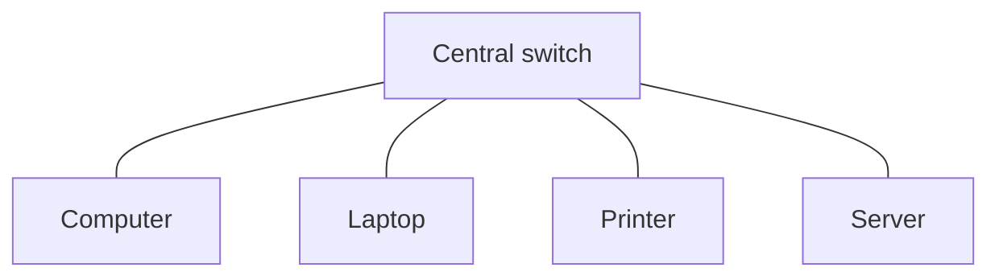
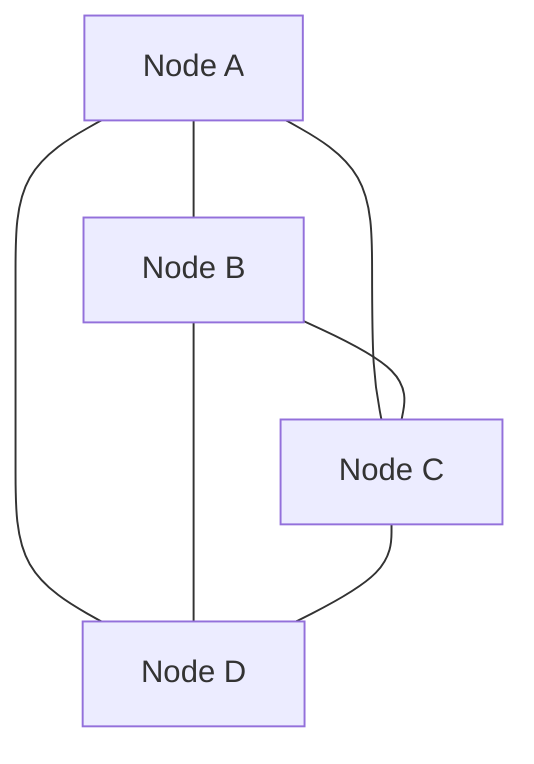
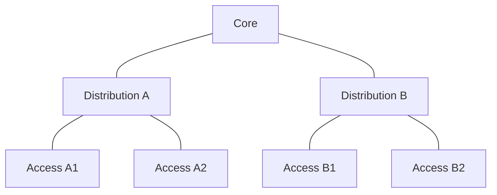
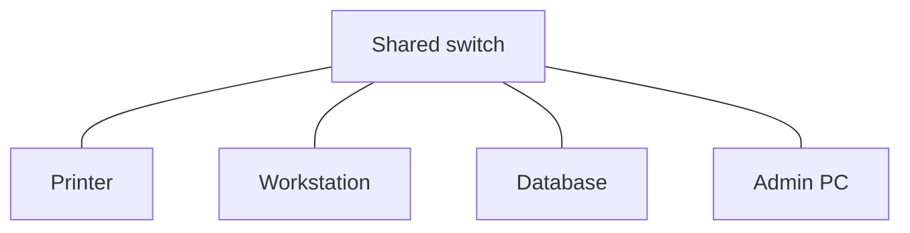
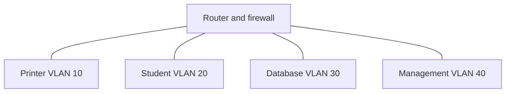
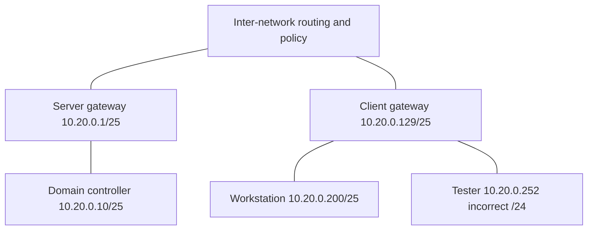
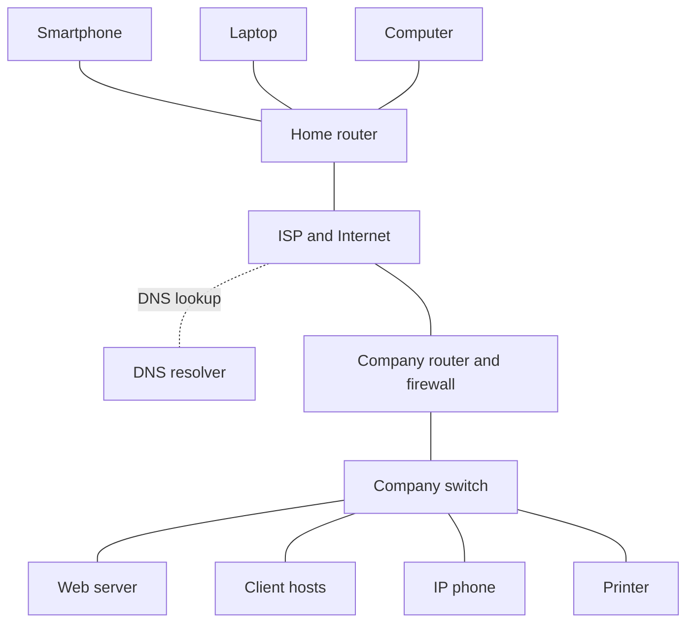
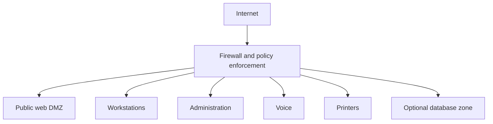
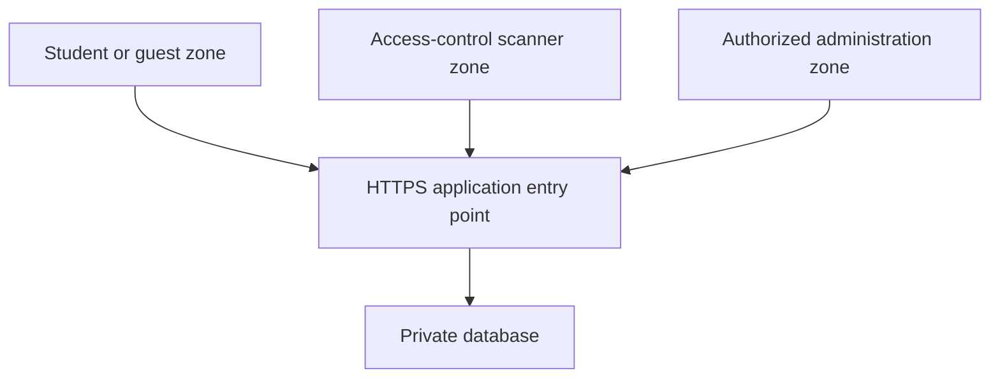

# Section 01 — Networking Overview

Source: learner-supplied HTB Section 1, [official module](https://academy.hackthebox.com/course/preview/introduction-to-networking). Independent explanations and original examples.

## Fundamentals
A network enables devices to exchange data. A client requests a service and a server supplies it. A switch forwards local Ethernet frames using MAC addresses; a router forwards IP packets across networks. An access point connects wireless devices. An ISP supplies connectivity. A default gateway is the next hop for traffic without a more specific route.

| Topology | Structure | Tradeoff |
| --- | --- | --- |
| Star | Central switch | Central point of failure |
| Mesh | Multiple paths | Resilience, greater complexity |
| Tree | Hierarchical branches | Scalable, upstream dependencies |

Copper Ethernet and coaxial cable transmit electrical signals, fiber uses light, and wireless uses radio waves. Ethernet can also operate over fiber. Protocols define communication rules: TCP provides a reliable ordered byte stream; UDP sends datagrams without built-in reliability or ordering; IP handles addressing and routing; IPX is a legacy Novell protocol; DHCP distributes network settings; DNS resolves names and other records.

## Defense in depth
A flat network offers broad reachability. Segmentation separates trust zones and controls traffic between them. VLANs separate Layer 2 broadcast domains; subnets define Layer 3 prefixes; firewall rules and ACLs enforce policy. A subnet alone is not a security boundary. Lateral movement is movement between compromised systems; pivoting uses an intermediary to reach otherwise inaccessible resources.

The lesson's house analogy: a fence represents ACLs and controlled entry points; lights represent documented assets and traffic visibility; window deterrents represent intrusion detection. Maintain an inventory and approved traffic matrix. Unexpected printer-to-server HTTP, printer internet access, or scanning originating from a printer network should prompt investigation, not automatically prove compromise. DHCP leases may change, so enforce policy at the zone level and maintain asset attribution. An IDS alerts; an inline IPS may drop traffic. Suricata and Snort are open-source engines with rule-based detection and PCAP analysis. Encrypted traffic and missing sensor visibility limit detection.

## Subnetting and the assessor's oversight
| Prefix | Mask | Total addresses | Conventional usable hosts |
| --- | --- | ---: | ---: |
| /24 | 255.255.255.0 | 256 | 254 |
| /25 | 255.255.255.128 | 128 | 126 |

A /24 has 24 network bits and 8 host bits; /25 has 25 network bits and 7 host bits. A /24 can be split into two /25 prefixes. For 192.168.1.0/24, usable addresses are .1–.254. The two /25s have usable .1–.126 and .129–.254; broadcast addresses .127 and .255. Network and broadcast addresses are reserved in these conventional examples; /31 and /32 have special semantics.

The supplied HTB scenario:
| Device | Address |
| --- | --- |
| Server gateway | 10.20.0.1/25 |
| Domain controller | 10.20.0.10/25 |
| Client gateway | 10.20.0.129/25 |
| Workstation | 10.20.0.200/25 |
| Tester | 10.20.0.252/24, gateway 10.20.0.1 |

Server subnet: 10.20.0.0/25, usable .1–.126. Client subnet: 10.20.0.128/25, usable .129–.254. The tester mistakenly treats both as on-link and may send ARP requests for the server or invalid-for-this-segment gateway instead of routing through the client gateway. On isolated Layer 2 segments, these requests receive no reply. Proxy ARP or shared Layer 2 could change behavior. Correct addressing would use the client prefix and approved client gateway, subject to network policy and explicit authorization; it does not guarantee server access. The lesson describes an assessor who reached workstations but mistakenly reported a domain controller offline. A domain controller provides centralized identity and authentication services. Impacket is a Python network protocol toolkit; successful use of a tool is not proof that assessment coverage is complete. Check addressing, routing, filtering and scope before concluding that a host is offline. Never change production network settings without authorization.

## Internet communication and addressing
```text
Home laptop -> home router -> ISP / interconnected networks
                                  |
                           DNS lookup (separate)
                                  |
                     company firewall/router -> web server
```
The browser parses a URL, looks up its hostname if not cached, selects a route, and sends off-link traffic to a gateway. Routers forward packets. The browser establishes the appropriate transport and, for HTTPS, uses TLS to protect HTTP; HTTP/3 uses QUIC over UDP. The server returns a response. Return paths can differ. DNS may be provided by parties other than the ISP, and an IP is a logical address, not precise geographic coordinates.

Original URL: https://portal.example.com/students?id=17
- Scheme: https
- FQDN (Fully Qualified Domain Name): portal.example.com; a trailing root dot can explicitly denote a complete DNS name.
- Path: /students
- Query: id=17

A URL locates a resource and its access scheme; an FQDN names a host in the DNS hierarchy; an IP address identifies a logical network interface/address (e.g. 192.0.2.25, reserved for documentation). DNS can return multiple addresses or none. HTTP is a web request/response protocol; HTTPS protects it with TLS.

## Five enterprise zones
| Zone | Purpose and controls |
| --- | --- |
| Web/DMZ | Isolate public services; permit only intended inbound HTTPS; restrict access to internal networks |
| Workstations | Host firewalls, restrict peer-to-peer connections, separate servers |
| Administration | Restrict router/switch management to authorized administrators, MFA where supported, secure management protocols |
| IP phones | Isolate VoIP; control eavesdropping risk; QoS prioritizes latency-sensitive traffic |
| Printers | Limit printing and scanning flows, internet egress and sensitive data exposure |

Spoofing means impersonating an identity or address; an on-path (man-in-the-middle) attack interferes with communication. OSPF (Open Shortest Path First) is a link-state routing protocol; unexpected routing advertisements can alter traffic paths if untrusted adjacencies are allowed. Restrict routing interfaces and authenticate neighbors where supported. QoS (Quality of Service) prioritizes traffic but does not authenticate or encrypt it. NTLMv2 is Windows challenge-response authentication; captured responses are not plaintext passwords, but may enable offline guessing or relay under certain conditions. SMB commonly uses TCP 445; restrict unnecessary SMB, enforce signing where appropriate and reduce NTLM use.

## Printer security case
The lesson's authorized physical assessment illustrates malicious peripheral/supply-chain risk: an unexpected printer was connected to an internal network, allowing remote access and sensitive authentication exposure. A reverse shell is an outbound connection enabling remote command access. Phishing exploits trust to induce an action. Defenses: verify unexpected deliveries through a known channel, inventory and quarantine new devices, restrict printer internet access and device-initiated connections, deny unnecessary workstation-to-printer TCP 445, allow only approved print and scan paths, and monitor anomalous outbound connections. A scanner may legitimately need an approved mail server. Blocking one port alone is not sufficient; test required functions and maintain secure device updates.

## Original examples and project applications
Example: a campus printer needs printing only from an approved print server, not direct database or internet access. A student network may access an HTTPS application, but never its database directly. UniTrack: proposed isolated scanner, student/guest, backend/database and management zones; scanners reach the approved API only, and backend reaches its database. ProTrack-MX: constrain privileged cloud access, protect Supabase service-role credentials, use authentication and row-level security; VLANs do not replace application authorization. These are design recommendations, not findings about either deployment.

## Read-only command reference
Windows PowerShell: ipconfig /all (adapter configuration), route print -4 (IPv4 routes), Resolve-DnsName example.com (DNS records).
Ubuntu WSL2: ip -br address (brief addresses), ip route (routes), ip route get 192.0.2.25 (local route decision, no probe), getent ahosts example.com (system name resolution). Illustrative output: default via 192.168.1.1 dev eth0. Actual WSL2 interfaces and gateways vary. Do not publish sensitive internal output.

## Individual guides
- [Network diagnostics](Tools/01-Network-Diagnostics.md)
- [Network segmentation and firewalls](Tools/02-Network-Segmentation.md)
- [Suricata](Tools/03-Suricata.md)
- [Snort 3](Tools/04-Snort.md)
- [Impacket](Tools/05-Impacket.md)

References: [DNS RFC 1034](https://www.rfc-editor.org/rfc/rfc1034), [URI syntax RFC 3986](https://www.rfc-editor.org/rfc/rfc3986), [CIDR RFC 4632](https://www.rfc-editor.org/rfc/rfc4632).

## Expanded technical reference

### Network components and communication

| Component | Detailed function | Original example |
| --- | --- | --- |
| Host | A device participating in a network | Laptop or scanner |
| NIC | Physical or virtual network interface | Ethernet or WSL2 virtual adapter |
| Client | Requests a service | Browser requesting a student portal |
| Server | Provides a service | UniTrack backend |
| Switch | Learns source MAC addresses and forwards Ethernet frames on a local network | Office switch |
| Router | Selects a next hop for IP packets using its routing table | Connects campus subnets |
| Gateway | Next hop for traffic to other networks | Home router |
| Access point | Connects wireless clients to a network | Campus Wi-Fi |
| Firewall | Enforces communication policies | Allows HTTPS to a public service |
| DNS resolver | Resolves DNS names and records | Looks up an application hostname |
| ISP | Internet Service Provider | Broadband provider |

A home router frequently combines routing, switching, wireless access, DHCP, NAT and firewall functions. These are distinct roles even when implemented in one appliance. A MAC address identifies a link-layer interface, an IP address is a logical network address, and a TCP/UDP port identifies a transport endpoint. Routers normally replace link-layer framing at each hop. Understanding these distinctions helps identify silent failures during security assessments.

### Physical and logical topology diagrams



Star topology: a failed endpoint usually affects itself, but the central switch can be a single point of failure.



Full mesh topology: each node has a direct link to every other node. Partial mesh provides selected redundant paths. Greater resilience comes with increased management and routing complexity.



Tree topology: hierarchical branches improve organization and scalability, while failures in upstream devices may affect downstream branches. Physical and logical topology may differ.

### Communication media and protocol comparisons

| Medium | Signal | Application | Security consideration |
| --- | --- | --- | --- |
| Twisted-pair copper Ethernet | Electrical | Office endpoints | Protect physical ports; consider interference and distance |
| Optical fiber | Light | Building backbone | High capacity and electrical isolation; physical protection still necessary |
| Coaxial | Electrical | Cable broadband and legacy networks | Shielding and shared infrastructure |
| Wireless | Radio waves | Mobile clients | Shared radio medium; strong authentication and encryption |

Ethernet can also operate over optical fiber.

| Protocol | Full name | Example | Security consideration |
| --- | --- | --- | --- |
| TCP | Transmission Control Protocol | HTTPS over TCP | Reliability does not mean encryption |
| UDP | User Datagram Protocol | DNS queries and voice | No built-in delivery or ordering guarantee |
| IP | Internet Protocol | Routing | Addressing does not authenticate senders |
| IPX | Internetwork Packet Exchange | Historical NetWare | Legacy, not ordinary modern internet routing |
| DHCP | Dynamic Host Configuration Protocol | Automatic IP assignment | Unauthorized servers may misdirect clients |
| DNS | Domain Name System | Hostname resolution | DNS results alone do not establish application authenticity |
| HTTP | Hypertext Transfer Protocol | Web requests | Plain HTTP lacks TLS |
| HTTPS | HTTP over TLS | Secure portals | Verify certificates; encryption does not replace authorization |

### Flat versus segmented networks



A flat network is operationally convenient but can permit unnecessary reachability. A switch alone does not establish the full security policy; host firewalls and port isolation may still reduce access.



Segmenting Layer 2 broadcast domains with VLANs and Layer 3 networks with subnets permits deliberate enforcement of inter-zone traffic policies. Segmentation is not encryption. Traffic within a VLAN may bypass inter-zone firewalls. Defense in depth combines segmentation, host policies, authentication, logging and secure service configuration.

| House analogy | Security concept | Example investigation |
| --- | --- | --- |
| Fence and controlled gates | ACLs/firewalls | Why does a printer initiate HTTP toward an internal server? |
| Lights | Inventory, documentation and monitoring | Why is a printer contacting the internet? |
| Window deterrents | IDS/IPS | Why does a printer generate unusual connection attempts? |

These are investigation prompts, not additional exercises. Unexpected traffic may have legitimate explanations; compare against the documented baseline before declaring compromise. Record asset owner, purpose, VLAN, subnet, DHCP assignment, allowed destinations, protocols and change approvals. Place IDS sensors where relevant traffic is visible. An IDS alerts; an inline IPS may block. Suricata and Snort both support rule-based detection and offline packet-capture analysis. Encrypted traffic and sensor placement limit visibility.

### Worked IPv4 subnet calculations

IPv4 has 32 bits, represented by four eight-bit octets. CIDR prefix length is the number of network bits. For ordinary broadcast subnets with h host bits, total addresses = 2^h and conventional usable hosts = 2^h - 2. /31 and /32 have special semantics.

```text
/24  11111111.11111111.11111111.00000000
/25  11111111.11111111.11111111.10000000
```

The additional network bit in /25 has decimal value 128, producing two blocks of 128 addresses.

| Property | Original /24 | First /25 | Second /25 |
| --- | --- | --- | --- |
| Network | 10.20.0.0 | 10.20.0.0 | 10.20.0.128 |
| Mask | 255.255.255.0 | 255.255.255.128 | 255.255.255.128 |
| First host | 10.20.0.1 | 10.20.0.1 | 10.20.0.129 |
| Last host | 10.20.0.254 | 10.20.0.126 | 10.20.0.254 |
| Broadcast | 10.20.0.255 | 10.20.0.127 | 10.20.0.255 |
| Total addresses | 256 | 128 | 128 |
| Usable hosts | 254 | 126 | 126 |



| Field | Incorrect | Expected in the illustrated client network |
| --- | --- | --- |
| Host IP | 10.20.0.252 | 10.20.0.252 |
| Prefix | /24 | /25 |
| Mask | 255.255.255.0 | 255.255.255.128 |
| Gateway | 10.20.0.1 | 10.20.0.129 |

The destination .10 and tester .252 share the first 24 bits but not the first 25 bits. With /24 the tester believes .10 is on-link. With /25 the host normally selects a route via an appropriate gateway. ARP (Address Resolution Protocol) resolves local IPv4 next-hop addresses to link-layer addresses. Correct routing does not override ACLs or guarantee a service is reachable.

Professional assessment methodology: confirm the assigned scope and configuration; inspect addresses, routes and gateway; distinguish DNS, local link, routing, firewall and service failures; document evidence and uncertainty. Report "unreachable from this vantage point" rather than "offline" when availability is not established. In the lesson, reaching a workstation using Impacket did not establish complete coverage. Never change production configuration without authorization.

### End-to-end web request



This original diagram illustrates the lesson's home/company architecture, not the recommended secure design.

1. The user enters a URL.
2. The browser parses the scheme, hostname, path and query.
3. The resolver obtains an IP address if not already cached.
4. The operating system selects the route and next hop.
5. Local link-layer delivery reaches the router when needed.
6. Routers forward IP packets across interconnected networks.
7. For HTTPS, TLS protects the HTTP exchange; HTTP/3 uses QUIC over UDP.
8. The server processes the request and returns a response, potentially over a different route.
9. The browser renders the content.

| Postal analogy | Networking equivalent | Limitation |
| --- | --- | --- |
| Building address | FQDN | DNS names need not identify one physical building |
| Floor and mailbox | URL path and query | Application interprets parameters |
| Address book | DNS | Maps names to records, not precise geography |
| Local post office | Router | Uses a routing table |
| Postal network | ISP and internet | Traffic may traverse many networks |
| Return address | Source IP | NAT or proxies may change the visible address |

Original URL: `https://portal.example.com/students?id=17`. The scheme is https, the FQDN is portal.example.com, the path is /students and query is id=17. HTTPS normally uses default port 443. The URL is not itself an FQDN; the FQDN is one component. A hostname may resolve to multiple addresses. DNS need not be provided by the ISP, and an IP address is not an exact geographic coordinate.

### Secure enterprise design



DMZ: permit only intended public services, protect backend resources from a compromised public host. Workstations: host firewalls restrict peer communication. Administration: isolate management-plane access; allow only authorized management hosts and secure protocols. OSPF (Open Shortest Path First) exchanges link-state routing data; unexpected routing advertisements can change paths if untrusted adjacencies are permitted. Restrict routing interfaces and authenticate neighbors where supported. Voice: VoIP (Voice over Internet Protocol) carries voice communications; QoS (Quality of Service) helps prioritize latency-sensitive traffic but does not encrypt or authenticate it. Printers: restrict unsolicited outbound and lateral traffic, protect stored job data, update firmware, change default credentials and verify procurement. The extra database zone is an original extension.

| Source | Destination | Service | Policy example |
| --- | --- | --- | --- |
| Internet | DMZ web proxy | HTTPS 443 | Allow published service |
| Student | Application | HTTPS 443 | Allow authorized access |
| Student | Database | Any | Deny direct access |
| Backend | Database | PostgreSQL 5432 if applicable | Allow approved application path only |
| Administration | Router/switch | Approved SSH or HTTPS | Allow authorized management hosts |
| Print server | Printer | Required printing protocol | Allow documented flow |
| Printer | Internet | Any | Deny by default; approve necessary exceptions |
| Printer | Workstation | New unsolicited connections | Deny |
| Scanner | Approved mail server | Configured mail submission | Allow only if required |

A reverse shell is an outbound connection providing remote command access. The supplied printer case illustrates trusted-looking hardware and social engineering risk. The relevant mitigations are procurement verification, inventory, quarantine, egress filtering, restricted authentication exposure and monitoring. SMB commonly uses TCP 445. Restrict unnecessary workstation-to-printer SMB, but validate legitimate print-management dependencies. NTLMv2 challenge-response data is not a plaintext password; it may create offline guessing or relay risk under certain conditions. Spoofing impersonates another identity or address; a man-in-the-middle/on-path attack interferes with communications. Authentication, encryption and segmentation are complementary defenses.

### Command reference and output interpretation

Windows PowerShell (built in):
```powershell
ipconfig /all
route print -4
Resolve-DnsName example.com
```
The first displays detailed adapter configuration; /all includes subnet mask, gateway, DHCP and DNS. The second displays IPv4 routing entries; -4 selects IPv4. The third resolves DNS records for the given name.

Ubuntu WSL2:
```bash
ip -br address
ip route
ip route get 192.0.2.25
getent ahosts example.com
```
-br produces brief interface/address output; ip route displays the routing table; route get calculates the selected route without transmitting a probe; getent consults the system name service.

Illustrative fabricated Linux output, not actual learner evidence:
```text
eth0    UP    192.168.1.50/24
default via 192.168.1.1 dev eth0
192.0.2.25 via 192.168.1.1 dev eth0 src 192.168.1.50
```
The first line shows interface, link state and CIDR address; the second shows the default next hop and interface; the third gives the chosen route and source address for a documentation-only IP. Check unexpected prefixes, missing default routes, virtual adapters and resolver errors. WSL2 NAT and mirrored networking can differ from Windows host networking. Redact sensitive actual network output before public publication. No additional exercise is required.

### Original project architecture



UniTrack proposal: allow scanners to contact only required API services, authenticate scanner requests, enforce server-side authorization, limit administrative access and protect student data. Network isolation does not replace QR validation, role checks, session security or audit logs.

ProTrack-MX proposal: clients reach an approved cloud API via TLS; authenticated users obtain appropriately scoped access; Supabase row-level security protects student and teacher records; service-role credentials remain on trusted backends. Do not assume a managed cloud service offers arbitrary VLAN configuration. Both are original design recommendations, not confirmed vulnerabilities or descriptions of existing deployments.

### Official standards and learning references

- [TCP RFC 9293](https://www.rfc-editor.org/rfc/rfc9293)
- [UDP RFC 768](https://www.rfc-editor.org/rfc/rfc768)
- [IPv4 RFC 791](https://www.rfc-editor.org/rfc/rfc791)
- [ARP RFC 826](https://www.rfc-editor.org/rfc/rfc826)
- [DHCP RFC 2131](https://www.rfc-editor.org/rfc/rfc2131)
- [HTTP semantics RFC 9110](https://www.rfc-editor.org/rfc/rfc9110)
- [TLS 1.3 RFC 8446](https://www.rfc-editor.org/rfc/rfc8446)
- [OSPFv2 RFC 2328](https://www.rfc-editor.org/rfc/rfc2328)
- [NIST firewall guidance](https://csrc.nist.gov/pubs/sp/800/41/r1/final)
- [Suricata downloads](https://suricata.io/download/) and [documentation](https://docs.suricata.io/)
- [Snort downloads](https://www.snort.org/downloads) and [documentation](https://docs.snort.org/)
- [Impacket source](https://github.com/fortra/impacket) and [releases](https://github.com/fortra/impacket/releases)

## Documentation coverage

All substantive chat concepts are retained in independent English explanations. Interactive diagrams are represented using original GitHub-compatible Mermaid source, with static subnet tables and worked calculations. Five separate technology guides complement the lesson. All example output is illustrative unless explicitly marked as observed; the original course prose is not copied verbatim. There are no mandatory questions or required installations in this section.

## Verification
Full learner-supplied Section 1 studied and documented. No mandatory question or lab shown. +10 reward displayed, not yet verified as earned. No tool installed or executed by learner. Next: Mark Complete & Next in Academy; await next section and completion evidence.
