# Section 02 — Network Types

Source: full learner-supplied HTB Academy Section 2, [Introduction to Networking](https://academy.hackthebox.com/course/preview/introduction-to-networking). Independent English explanations, technical clarifications and original examples. No required question or lab appears in the supplied section.

## Learning objectives
Distinguish networks by geographical coverage, medium and purpose; understand private IPv4 addressing, WAN routing, VPN architecture, wireless and personal networks; interpret routes and recognize security boundaries. Network type is not topology: a LAN may use a star, a mesh or a tree. VPN is a logical overlay, not a distance category.

| Type | Full name | Example | Main characteristic |
| --- | --- | --- | --- |
| PAN | Personal Area Network | Phone connected by USB to laptop | Personal devices |
| WPAN | Wireless Personal Area Network | Bluetooth headset | Wireless personal connectivity |
| LAN | Local Area Network | Office Ethernet network | Local infrastructure |
| WLAN | Wireless Local Area Network | Campus Wi-Fi | Wireless local connectivity |
| MAN | Metropolitan Area Network | University sites across one city | Regional aggregation |
| WAN | Wide Area Network | Offices in different cities/countries | Wide-area connectivity |
| GAN | Global Area Network | International corporate network | Worldwide reach |
| VPN | Virtual Private Network | HTB remote lab access | Logical private connectivity over another network |

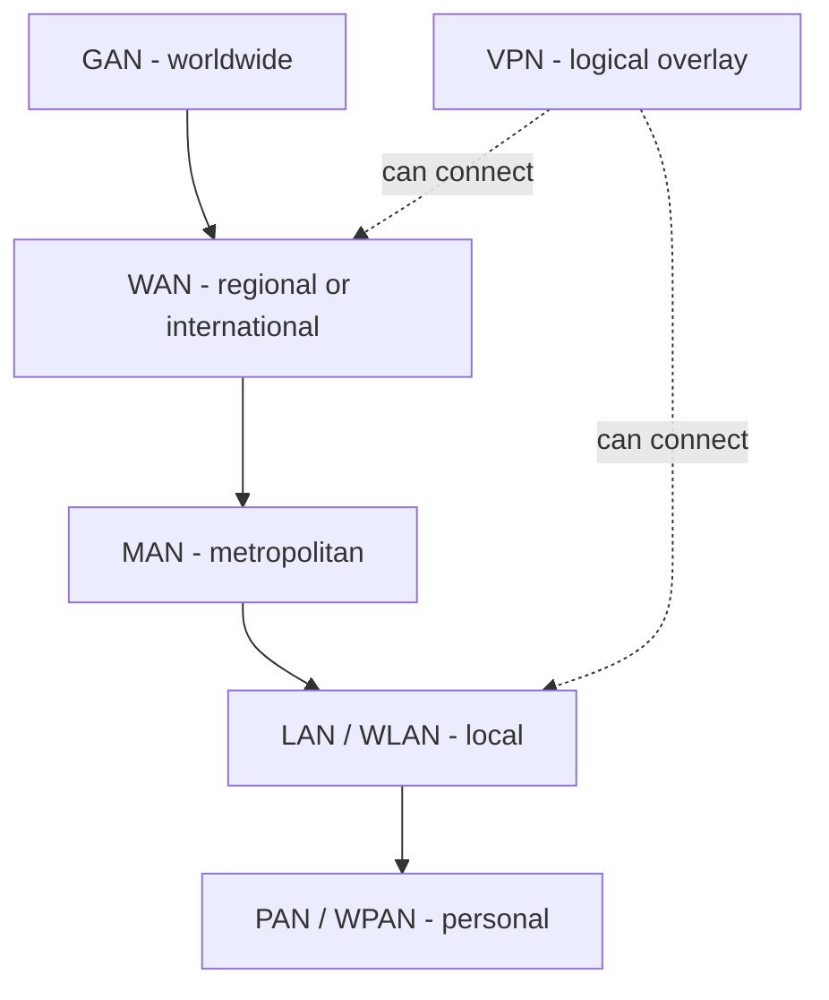
The nesting illustrates coverage, not mandatory hierarchy or strict distance limits. The internet is a global interconnection of networks. The humorous historical 500-mile email delivery incident illustrates that timeouts and propagation delays may create unexpected apparent geographic limits; not a universal email distance restriction.

## WAN (Wide Area Network)
WANs interconnect geographically separated LANs across carrier circuits, fiber, leased lines, cellular, satellite, private services or internet overlays. An ISP provides connectivity; routers forward traffic between networks. A company can operate a private WAN without public internet access. An intranet is a private organizational network, not necessarily a WAN or an air gap; an air-gapped environment has no direct external network connection. Public-facing reachability depends on routes, firewalls, NAT and provider policy.

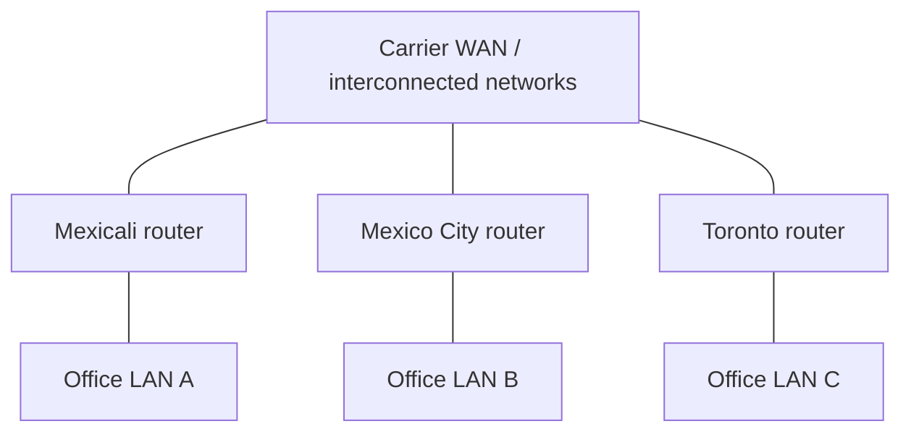

| Interface | Illustrative IPv4 address | Purpose |
| --- | --- | --- |
| Router WAN | 203.0.113.25 | Upstream connection; documentation-only address |
| Router LAN | 192.168.1.1 | Local gateway |
| Laptop | 192.168.1.100 | Client |
| Smartphone | 192.168.1.101 | Client |

A WAN interface may receive a public, private or carrier-grade NAT address. LANs may use public IPv4 or globally scoped IPv6. Neither addressing nor BGP is a requirement for a WAN. Carrier-grade NAT (CGNAT) may use 100.64.0.0/10 shared space (RFC 6598); not RFC 1918. NAT translates addresses, commonly ports too, but does not replace a firewall.

## RFC 1918 private IPv4
| CIDR | Mask | Inclusive range | Total addresses |
| --- | --- | --- | ---: |
| 10.0.0.0/8 | 255.0.0.0 | 10.0.0.0–10.255.255.255 | 16,777,216 |
| 172.16.0.0/12 | 255.240.0.0 | 172.16.0.0–172.31.255.255 | 1,048,576 |
| 192.168.0.0/16 | 255.255.0.0 | 192.168.0.0–192.168.255.255 | 65,536 |

32-bit IPv4 address counts = 2^(32 - prefix length); counts are totals, not usable hosts of a single deployment. Private ranges are reusable and not normally routed on the public internet. They can be routed internally or over VPNs. RFC 1918 is an IPv4 specification; IPv6 unique local addressing is defined in RFC 4193. Not-private does not imply public routability: loopback 127.0.0.0/8, link-local 169.254.0.0/16 and documentation prefixes 192.0.2.0/24, 198.51.100.0/24, 203.0.113.0/24 are other examples.

Original classification examples:
| Address | RFC 1918? | Explanation |
| --- | --- | --- |
| 10.10.10.5 | Yes | First octet 10 |
| 172.20.10.5 | Yes | Second octet 16 through 31 |
| 172.31.0.10 | Yes | Upper private boundary |
| 172.32.0.10 | No | Outside 172.16/12 |
| 192.168.1.1 | Yes | First two octets 192.168 |
| 203.0.113.25 | No | Reserved for documentation, not a public server |

The chat address checker is represented by this static table and optional read-only local Python reference:
```python
from ipaddress import IPv4Address, IPv4Network
ranges = [IPv4Network(p) for p in ("10.0.0.0/8", "172.16.0.0/12", "192.168.0.0/16")]
address = IPv4Address("172.20.10.5")
print(next((str(n) for n in ranges if address in n), "Not RFC 1918"))
```
Expected illustrative output: 172.16.0.0/12. IPv4Address validates input; IPv4Network creates CIDR ranges; membership tests check exact RFC 1918 coverage. Python's is_private is broader than RFC 1918 and is not used here. No learner execution required.

## BGP (Border Gateway Protocol)
BGP exchanges network reachability information between autonomous systems (AS), administrative routing domains identified by AS numbers (ASN). eBGP exchanges routes between ASes; iBGP distributes BGP information inside an AS. BGP runs over TCP port 179 and chooses routes according to attributes and policy, not merely physical distance. AS_PATH identifies traversed ASes; LOCAL_PREF influences outbound selection within an AS. Private ASNs 64512–65534 can illustrate private routing.

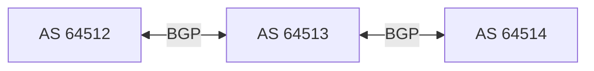

Incorrect route advertisements may cause blackholing, route leaks or hijacking. Defenses include approved peer configurations, prefix filters, maximum-prefix limits, routing monitoring and RPKI route-origin validation (which checks origin authorization, not the entire AS path). Not all WANs use BGP; OSPF, static routes and other technologies may be appropriate. See [BGP and FRRouting guide](Tools/06-BGP-FRRouting.md).

## LAN and WLAN
LANs connect local endpoints, often via Ethernet switches. A WLAN is a wireless form of LAN, often bridged to wired infrastructure through an access point. Local communication does not inherently require internet access. Private IPv4 is common but not required. SSID is the Service Set Identifier, the wireless network name.

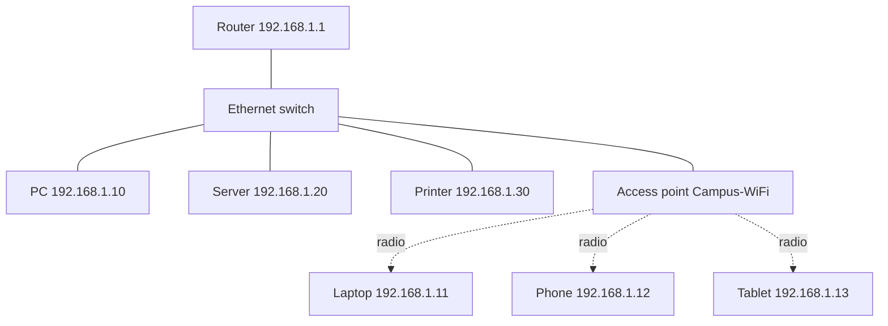
| Aspect | Wired LAN | WLAN |
| --- | --- | --- |
| Medium | Copper/fiber Ethernet | Radio waves |
| Standard family | IEEE 802.3 | IEEE 802.11 |
| Infrastructure | Switch | Access point |
| Mobility | Cable-limited | Mobile coverage |
| Performance | Usually predictable | Signal/interference/congestion dependent |
| Security | Physical port control, 802.1X, VLANs | WPA2/WPA3, authentication, VLANs, client isolation |

WPA2 and WPA3 protect Wi-Fi access and link traffic; prefer WPA3 where supported or securely configured WPA2. Rogue AP = unauthorized infrastructure; evil twin = impersonating a trusted wireless network; client isolation restricts direct wireless-client communication. Separate guest, staff and sensitive equipment; use secure management and updates. Wi-Fi encryption does not replace HTTPS or service authorization. See [LAN/WLAN guide](Tools/07-LAN-WLAN.md).

## VPN architecture
A VPN is a logical private connection over another network; encrypted VPNs encapsulate and protect data between endpoints. VPNs can connect hosts or networks, without inherently making them a single Layer 2 LAN. Some provider VPN services offer traffic separation without encryption; validate the threat model. A VPN is not anonymity, endpoint security or blanket authorization.

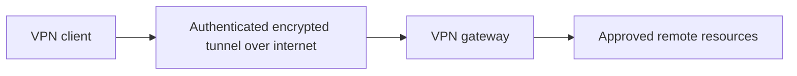

### Site-to-site VPN
Both endpoints are typically gateways/routers/firewalls. Networks advertise or configure routes for remote prefixes. Clients need not individually connect. Distinct subnets help avoid overlapping-address ambiguity. IPsec/IKEv2, OpenVPN and WireGuard are possible implementations; protocols differ.


Original university example: two campuses share an approved application across a site-to-site tunnel; only required application traffic is allowed, not unlimited inter-campus access. Use device authentication, narrowly scoped routes, logging and key rotation.

### Remote-access VPN
A client computer establishes a tunnel, receives a virtual interface and selected routes, and reaches permitted remote services. OpenVPN is the HTB example. A TUN adapter carries Layer 3 IP packets; TAP carries Layer 2 Ethernet frames and can support bridging. Names such as tun0 are configuration dependent.

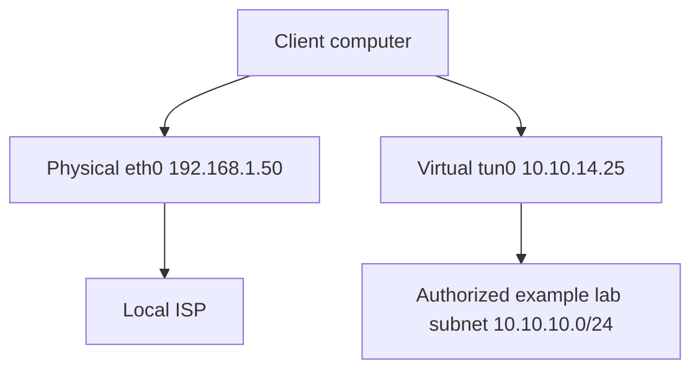
All addresses are illustrative, not actual learner VPN assignments.

### Split tunnel versus full tunnel
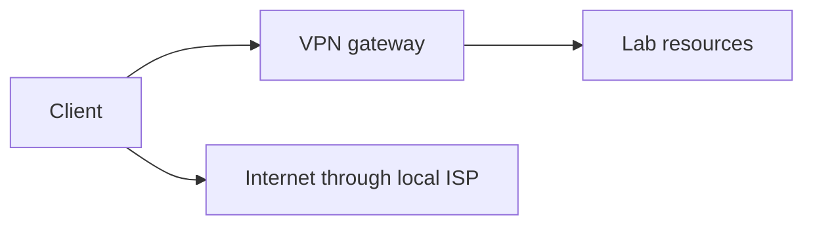
Split tunnel: selected destinations use VPN routes; other traffic follows ordinary routing policy. Example 10.10.10.0/24 via tun0. It reduces VPN bandwidth requirements and can preserve local internet use, but centralized network monitoring does not see all off-tunnel traffic.

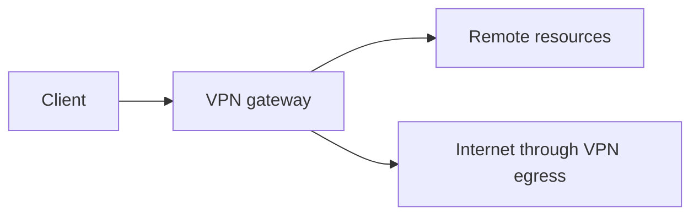
Full tunnel: general internet traffic also uses the VPN gateway, subject to configured exceptions, DNS and IPv6 policy. OpenVPN redirect-gateway can direct general traffic into the tunnel. A full tunnel is not a guarantee of zero leaks, anonymity or malware protection; configure DNS, IPv6, fail-closed behavior if required and endpoint security.

| Feature | Split | Full |
| --- | --- | --- |
| Remote network traffic | VPN | VPN |
| Ordinary internet | Local ISP | VPN egress |
| Bandwidth | Usually lower VPN load | Usually higher VPN load |
| Monitoring | Partial visibility | Broader centralized visibility |
| Use | Selective access / HTB | Managed corporate access |

Split tunneling is not inherently insecure. Evaluate endpoint protection, corporate policy, DNS, routing, logging and local LAN exposure. VPN use does not authorize destinations beyond the assigned scope.

## OpenVPN reference
OpenVPN is a free/open-source VPN implementation. TLS authenticates endpoints and protects the control channel; a negotiated data channel protects encapsulated network traffic. The client receives routes and a virtual adapter. The .ovpn file may contain sensitive certificates/keys and endpoints. Never commit actual profiles or private keys.

Windows 11: download the appropriate official Community installer, install required network drivers, launch OpenVPN GUI, import authorized HTB profile, connect. [Official download](https://openvpn.net/community/).

Ubuntu WSL2 (optional reference only):
```bash
sudo apt update
sudo apt install openvpn
openvpn --version
sudo openvpn --config "$HOME/academy.ovpn"
```
sudo grants elevation; apt update refreshes package metadata; apt install installs software; --version displays version; --config chooses the profile; $HOME is the user's Linux home directory. academy.ovpn is an example name. Illustrative success message: Initialization Sequence Completed. Not proof of application reachability. Keep the client running; Ctrl+C stops foreground operation. Do not install or connect for this theory-only section.

```bash
ip -br address
ip route
ip route get 10.10.10.50
```
Illustrative route output:
```text
default via 192.168.1.1 dev eth0
10.10.10.0/24 dev tun0
192.168.1.0/24 dev eth0
```
-br displays brief interface/address information; ip route displays routes; route get calculates route selection without probing. default is the fallback, via identifies next hop, dev selects interface. The lab /24 is more specific than default and selects tun0. Windows-host VPN routes may not be directly visible in WSL2; NAT and mirrored networking differ. Check configuration, TUN support, route overlap, DNS and firewall policy. See [VPN architecture](Tools/08-VPN-Architecture.md) and [OpenVPN guide](Tools/09-OpenVPN.md).

## SSL VPN and HTB Pwnbox
SSL VPN commonly means a TLS-based remote-access solution; modern deployments should use TLS, not obsolete SSL versions. Clientless gateways proxy selected applications through a browser. Client-based TLS VPNs may provide broader routed connectivity. SSL VPN is not exclusively browser-based.

Pwnbox is a hosted Parrot Linux security workstation accessible through a browser remote desktop. The tools run remotely; your laptop does not automatically join the lab network. It illustrates browser-based remote access, not necessarily a clientless VPN implementation.

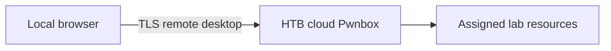
| Feature | Local OpenVPN | Pwnbox |
| --- | --- | --- |
| Execution | Local machine or VM | Remote cloud workstation |
| Setup | VPN client/profile | Browser and Academy access |
| OS | User-selected | Configured Parrot Linux |
| Lab path | Local VPN routes | Remote workstation |
| Resources | Local compute | Hosted compute and usage limits |

[Academy VPN instructions](https://help.hackthebox.com/en/articles/12710285-connecting-to-academy-vpn), [Pwnbox guide](https://help.hackthebox.com/en/articles/5185608-introduction-to-pwnbox). See [TLS remote access and Pwnbox](Tools/10-TLS-VPN-Pwnbox.md).

## GAN and MAN (book terminology)
GAN means Global Area Network. It spans worldwide locations, potentially combining WANs through terrestrial fiber, undersea cables, satellite or private carriers. The public internet is one example, not the only one. MAN means Metropolitan Area Network, connecting LANs across a city or metropolitan region; carrier Ethernet, leased fiber and other media may provide high bandwidth. MANs may interconnect with WANs/GANs. A MAN is not necessarily faster than the public internet; throughput and latency depend on access technology, capacity, distance and congestion. Satellite latency depends on orbit and path; fiber propagation also takes time. The historical email-distance anecdote is a reminder to investigate timeout settings and latency rather than assume a geographical rule.

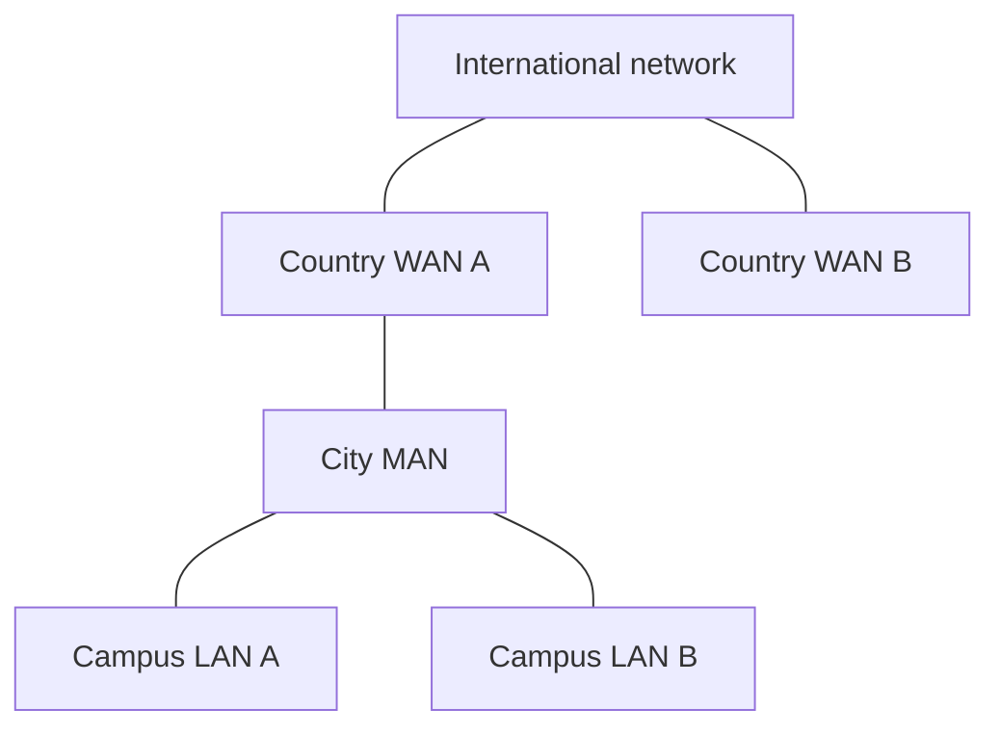

## PAN and WPAN
PAN connects personal devices, such as a phone and laptop via USB. WPAN uses wireless media, e.g. Bluetooth. Personal networks usually cover a small area; range depends on device, radio, power and environment; mesh and relays can extend coverage. Wireless USB is a historical WPAN technology, not identical to ordinary wired USB. Bluetooth Classic is common for audio; Bluetooth Low Energy (BLE) supports energy-efficient devices, sensors and other roles. Piconet is a Bluetooth connected topology with a central and peripheral devices; Classic and LE differ, and Bluetooth Mesh is a separate networking capability.

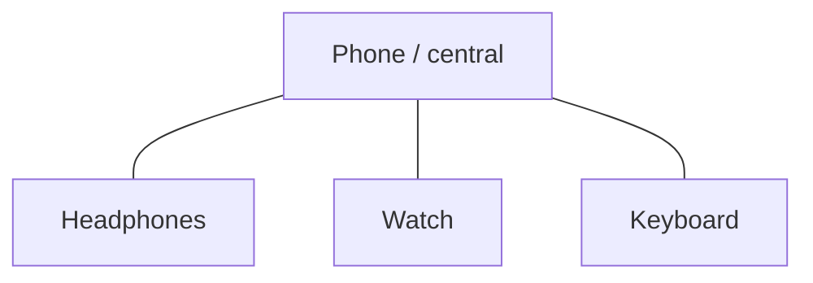
Illustrative Bluetooth device connections; actual supported roles differ. Pairing establishes a security relationship; bonding can retain keys for reconnection. Use appropriate authenticated pairing, firmware updates, restrict discoverability and remove obsolete pairings. [Bluetooth guide](Tools/11-Bluetooth-WPAN.md).

## IoT (Internet of Things)
IoT includes connected physical devices such as sensors, lights, controllers, locks and monitoring equipment. Many use low-power protocols and gateways rather than direct internet access.

| Technology | Medium / topology | Typical use | Security consideration |
| --- | --- | --- | --- |
| Bluetooth LE | 2.4 GHz, point-to-point or other supported modes | Wearables and sensors | Secure pairing, updates |
| Zigbee | IEEE 802.15.4-based low-power networks, often mesh | Sensors and lights | Secure commissioning, protect network keys |
| Z-Wave | Region-specific sub-GHz radio; classic mesh, long-range variants differ | Home automation | S2 where supported, secure inclusion |
| Insteon | Dual-band powerline and RF in supported devices | Lighting and switches | Trusted controller, isolate IP gateway, maintain support |

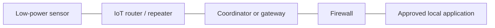
A coordinator or gateway translates or mediates between local device protocols and IP applications when applicable. Not all devices relay traffic. Use device inventory, authenticated commissioning, protected secrets, least privilege, updates, segmented gateway network, restricted outbound access and monitoring. See individual [Zigbee](Tools/12-Zigbee.md), [Z-Wave](Tools/13-Z-Wave.md), [Insteon](Tools/14-Insteon.md) guides.

## Project applications and original security scenarios
UniTrack: campus LAN hosts an approved application; scanner/IoT zone is isolated, guest WLAN cannot reach scanners or databases, and staff administration uses narrowly scoped remote access where needed. Site-to-site VPN may connect campuses; remote staff should authenticate and receive only required resources. QR authorization, audit logging, backend authentication and database security remain necessary.

ProTrack-MX: teachers and students connect over LAN/WLAN/WAN to approved HTTPS cloud endpoints. Protect Supabase service-role credentials on backend only and enforce RLS. A VPN may protect management access if supported, but cannot replace authentication, authorization or TLS. These are proposed designs, not verified vulnerabilities.

| Scenario | Diagnostic or defensive response |
| --- | --- |
| Lab VPN connects but target does not respond | Check assigned scope, selected VPN route, conflicting local subnet and firewall; do not infer target is offline |
| Guest Wi-Fi can reach database | Separate guest trust zone, restrict flows, verify authorized policy |
| Two offices use overlapping 192.168.1.0/24 | Plan distinct prefixes or approved translation rather than assume routing works |
| Smart-home gateway makes unexpected outbound requests | Compare with approved baseline and investigate; restrict unneeded egress |
| WAN routing incident | Verify authorized prefixes, route origin and provider logs |

## Official references
- [RFC 1918 private IPv4](https://www.rfc-editor.org/rfc/rfc1918), [RFC 6598 shared address space](https://www.rfc-editor.org/rfc/rfc6598), [RFC 5737 documentation addresses](https://www.rfc-editor.org/rfc/rfc5737), [RFC 4193 IPv6 ULA](https://www.rfc-editor.org/rfc/rfc4193)
- [BGP RFC 4271](https://www.rfc-editor.org/rfc/rfc4271), [FRRouting documentation](https://docs.frrouting.org/en/latest/index.html)
- [OpenVPN Community](https://openvpn.net/community/), [OpenVPN TUN/TAP and routing](https://community.openvpn.net/Pages/Getting%20started%20with%20OpenVPN), [Full/split tunneling](https://openvpn.net/as-docs/tutorials/tutorial--full-and-split-tunnel-vpn/)
- [Cisco clientless TLS VPN overview](https://www.cisco.com/c/en/us/td/docs/security/asa/asa916/asdm716/vpn/asdm-716-vpn-config/webvpn-overview.html)
- [Bluetooth SIG overview](https://www.bluetooth.com/learn-about-bluetooth/tech-overview/), [Zigbee](https://csa-iot.org/all-solutions/zigbee/), [Z-Wave](https://z-wavealliance.org/technology-overview/), [Insteon technology](https://support.insteon.com/technology)
- [WSL networking](https://learn.microsoft.com/en-us/windows/wsl/networking)

## Verification and next action
Section 2 learner-supplied content fully documented in English with original diagrams, technical clarifications, worked examples and separate guides. Section 1 was advanced past, but completion not separately evidenced. No mandatory question, required installation or live lab. +10 available reward displayed; not confirmed earned. Select Mark Complete & Next and supply the next section. Do not count guide files as additional HTB lessons.
