# Section 03 — Networking Topologies

Source: full learner-supplied HTB Academy Section 3, [official module](https://academy.hackthebox.com/course/preview/introduction-to-networking). Independent explanations, original diagrams and technical clarifications. No mandatory question or practical lab in supplied content.

## Objectives and fundamentals
A network topology describes the arrangement of connections and communication paths. Hosts include clients and servers; network infrastructure includes switches, bridges, routers and other forwarding devices. Topology affects media access, failure domains, capacity, cost, troubleshooting and security visibility.

| Concept | Question | Example |
| --- | --- | --- |
| Network type | What kind of network? | LAN, WAN, MAN |
| Topology | How do endpoints connect? | Star, mesh, ring |
| Medium | What carries signals? | Copper, fiber, Wi-Fi |
| Protocol | What rules govern communication? | Ethernet, IP, TCP |

Example: a university LAN may use a star layout, twisted-pair Ethernet and TCP/IP.

Physical topology is the actual arrangement of links, cabling and equipment. Logical topology describes forwarding, access to the medium and communication paths. Computers physically placed in a circle are not necessarily a ring network. A physical star using a hub behaves as a logical shared bus. Some historical Token Ring installations used a physical star via a multistation access unit while implementing a logical ring.

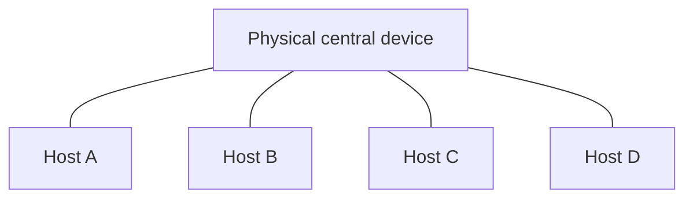
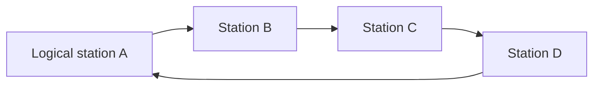

## Connections and media
| Medium | Signal | Typical application | Considerations |
| --- | --- | --- | --- |
| Coaxial cable | Electrical; shielded central conductor | Legacy shared Ethernet, cable broadband | Termination, shielding, shared medium |
| Optical fiber | Light | Campus backbones, WAN | Capacity, distance, physical protection |
| Twisted pair | Electrical signals on twisted copper pairs | Cat5e/Cat6 wired LAN | Distance, interference, cabling quality |
| Wi-Fi | Radio | Local wireless access | Signal coverage, authentication, interference |
| Cellular | Radio | Mobile and remote access | Carrier availability, bandwidth, latency |
| Satellite | Radio via satellites | Remote locations | Orbit, propagation, weather and cost |

Ethernet is a family of networking technologies, not just copper cabling. Fiber can carry Ethernet too. Physical security, encryption and access policy remain important regardless of medium.

## Nodes, interfaces and infrastructure
NIC means Network Interface Controller (or Card), enabling transmission/reception via physical or virtual interfaces. Nodes are broader: connection points or participating devices, including simple embedded controllers and non-programmable components depending on context. A node is not necessarily a NIC. A physical Ethernet adapter commonly uses a MAC address; virtual interfaces may carry Ethernet or IP. Devices can perform several roles.

| Component | Typical OSI layer | Function |
| --- | --- | --- |
| NIC | 1–2 for Ethernet | Interface to a network |
| Repeater | 1 | Regenerates signals |
| Hub | 1 | Repeats signals to other ports |
| Bridge | 2 | Connects and filters Ethernet segments |
| Switch | 2; multilayer can route at 3 | Learns MACs and forwards frames |
| Router | 3 | Routes IP packets between networks |
| Modem | Primarily 1 | Adapts signals for access medium |
| Gateway | Varies | Next-hop access or protocol translation |
| Firewall | Varies | Enforces traffic policy, possibly state/application aware |

A hub shares collision domain; a switch generally separates ports into individual collision domains and learns source MAC addresses. Known unicast forwarding uses learned destination port; broadcasts and unknown unicasts may flood within the VLAN. A switch does not automatically prevent all interception. A router selects routes by destination IP, normally using longest-prefix match, and separates Layer 2 broadcast domains. Modems, routers and APs may be integrated in one appliance. See [Network hardware and NICs](Tools/15-Network-Hardware-NICs.md).

## Eight topologies

### 1. Point-to-point
Dedicated physical or logical link between two endpoints, e.g. routers joined by fiber. Simple management, predictable path and fault isolation; failure of sole link interrupts connectivity. A point-to-point link may be bidirectional; encryption/authentication are separate controls. Traditional telephony provides an analogy. Peer-to-peer (P2P) instead describes distributed roles, such as peers sharing files; it is not a synonym for topology.
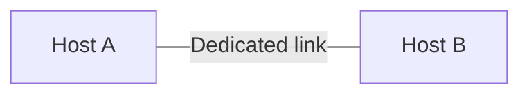

### 2. Bus
Many nodes share one backbone, historically coaxial Ethernet. Classic linear coax requires suitable termination at both ends. Signals are available to attached stations; a receiving station evaluates whether a frame is relevant. No central switch is required. In half-duplex shared Ethernet simultaneous transmission may collide; CSMA/CD (Carrier Sense Multiple Access with Collision Detection) senses the medium, detects collisions and backs off before retransmission. This is not a universal bus arbitration mechanism: CAN uses identifier-based arbitration, and modern full-duplex switched Ethernet does not normally use CSMA/CD. Shared bandwidth and backbone faults constrain reliability. Shared media can expose traffic; use authentication and encryption. See [Shared Ethernet and token access](Tools/16-Shared-Medium-Token-Ring.md).
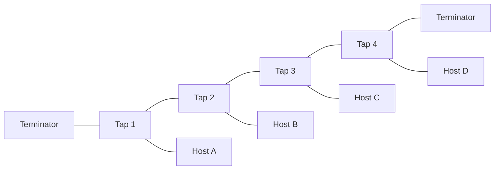

### 3. Star
Every endpoint has a separate link to a central component, usually a switch in modern Ethernet; hub or router-based arrangements also exist. The central equipment performs forwarding appropriate to its role (switch frames, router packets, hub repeats signals). Individual cable faults generally affect one endpoint; central failure affects all attached endpoints. Central capacity and uplink bottlenecks matter. Protect equipment, management access, VLANs and endpoint authorization.
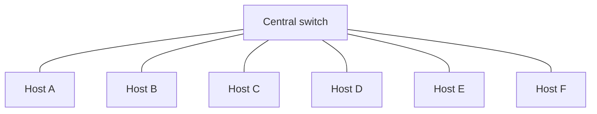

### 4. Ring
Nodes have two neighbors, forming a closed loop. Physical rings use actual links; logical rings can operate over a physical star using a distributor. Some historical systems use token passing, in which a control pattern circulates to grant transmit permission; token loss/recovery and claim procedures depend on the specific protocol. Simplified example: A receives a free token, sends permitted data, B receives it, a free token becomes available. Not every ring uses tokens or one-way traffic; modern industrial Ethernet ring protection can use other control protocols, and switches may be active components. Simple ring link/node failure can disrupt communication; dual rings and protection switching can improve resilience. Control-plane integrity and physical link monitoring matter.
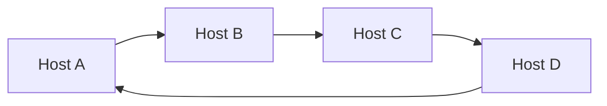
The arrows illustrate a historical logical token ring, not every ring implementation.

### 5. Mesh
Full mesh directly connects every pair of nodes. Partial mesh provides selected redundant links; endpoints need not each have exactly one connection. Mesh layouts can be fixed physically or dynamically organized; forwarding depends on protocols and node roles. Not all nodes are routers or share the same functions. Common for WAN/MAN backbone resilience and some wireless networks.
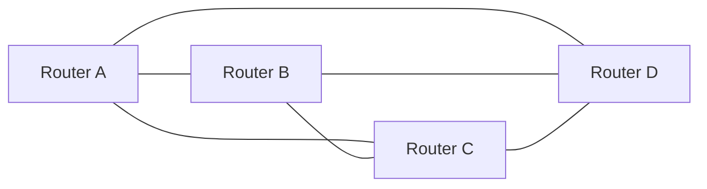
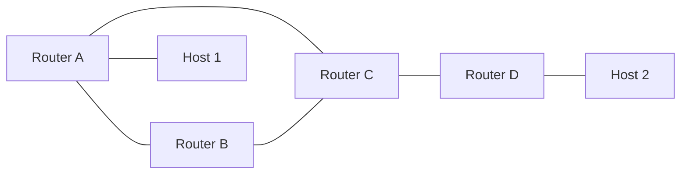
In an undirected full mesh with n nodes, each node has n-1 links, counted twice across endpoints; unique links = n(n-1)/2. For 4, 6, 10 and 20 nodes, links = 6, 15, 45 and 190 respectively. Physical full mesh becomes expensive rapidly. Alternative paths may improve resilience, capacity and load distribution only if routing/convergence, capacity and independent failure domains support them. Failure of one router still affects resources attached only to it. Monitor routing and policy, authenticate control traffic where supported, and avoid assuming redundancy automatically provides security.

### 6. Tree
Hierarchical extension of star networks. Core, distribution and access roles may be combined depending on size. Used in structured building cabling, larger LANs, broadband and MAN designs. A tree is connected and acyclic; a simple tree has n-1 links. Upstream failures can affect downstream branches. Physical redundancy can coexist with a logical tree enforced by STP (Spanning Tree Protocol). STP is a Layer 2 protocol that prevents forwarding loops by selecting a root bridge and placing redundant paths into non-forwarding states when needed. RSTP (Rapid Spanning Tree Protocol) improves convergence. BPDUs (Bridge Protocol Data Units) exchange control information. A loop can lead to broadcast storms, MAC table instability and outages. Use approved root placement, BPDU Guard on appropriate edge ports, loop protections, monitoring and change control. See [STP/RSTP guide](Tools/17-STP-RSTP.md).
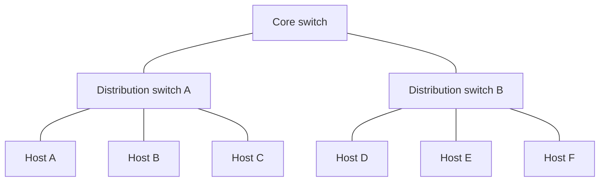

### 7. Hybrid
Combines different basic topological patterns, e.g. a mesh of backbone routers with star access LANs. Connecting two trees by a single edge can still yield a tree; connecting multiple networks does not automatically create a distinct hybrid graph. Hybrid designs are practical but require coherent policies, documentation and fault isolation.
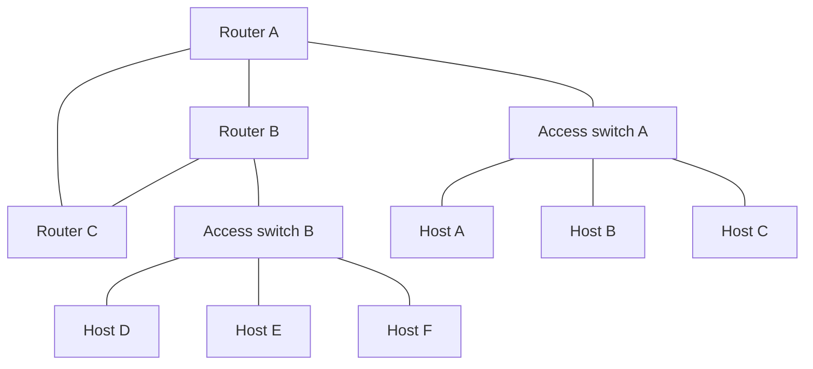
Backbone mesh provides alternative paths; access stars provide simpler endpoint cabling. Distinct physical failure domains and failover must be verified.

### 8. Daisy chain
Nodes connect sequentially, each intermediate node connected to previous and next. Unlike a bus with shared backbone taps, a chain of active Ethernet switches depends on intermediate forwarding devices. Failure of an intermediate device or link may isolate downstream nodes. Passive daisy-chained cabling need not behave like active forwarding. Daisy chain describes arrangement, not token access method.
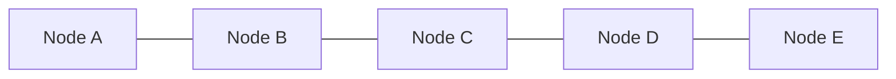
Industrial automation sometimes uses daisy-chained connectors. CAN (Controller Area Network) normally uses a shared linear bus with short stubs and appropriate termination, not sequential host-to-host packet forwarding. CAN's identifier-based arbitration differs from Ethernet collision detection. On standard high-speed CAN, nominal 120-ohm termination at each bus end is common; follow hardware specifications. A CAN bus does not inherently authenticate message senders or encrypt payloads; gateways, physical protection and validated application controls help. No real vehicle, controller or industrial equipment testing is part of this lesson. See [CAN and SocketCAN](Tools/18-CAN-SocketCAN.md).

## Comparison
| Topology | Main benefit | Main limitation | Typical use |
| --- | --- | --- | --- |
| Point-to-point | Simple dedicated path | Link failure | Router interconnect |
| Bus | Simple shared wiring | Shared capacity/backbone failure | Legacy Ethernet, linear fieldbus |
| Star | Easy endpoint isolation | Central component dependency | Modern Ethernet LAN |
| Ring | Structured path; protected variants resilient | Unprotected ring interruption | Industrial/metropolitan rings |
| Full mesh | Many alternative paths | Quadratic link cost | Small critical backbone |
| Partial mesh | Cost/resilience compromise | Some single-path nodes | Enterprise WAN |
| Tree | Scalable hierarchy | Upstream dependencies | Campus/building LAN |
| Hybrid | Fits diverse needs | Design and operational complexity | Enterprise infrastructure |
| Daisy chain | Simple sequential cabling | Downstream isolation on failure | Device/industrial connections |

## Original failure and resilience model
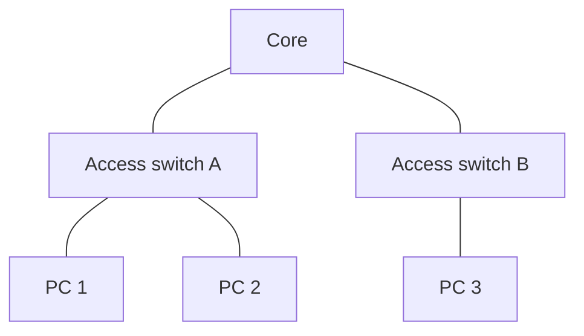
If PC 1 cable fails, only PC 1 is normally disconnected. If switch A fails, PC 1 and PC 2 lose their path. If the only core fails, both branches may lose upstream connectivity. Redundancy, separate power supplies and physical routes can reduce correlated failures; monitoring and failover tests are needed. Two links in the same conduit are not independent of a cable cut.

For switched Ethernet, redundant links without suitable loop prevention may reduce availability instead of improving it. In routed networks, alternative routes need convergence; redundancy does not guarantee zero packet loss. A physical path, logical route and security permission are separate facts.

## Read-only topology and device inspection
Windows PowerShell (built in):
```powershell
Get-NetAdapter
Get-NetIPConfiguration
Get-NetRoute -AddressFamily IPv4
```
Get-NetAdapter lists physical and virtual adapters and status; Get-NetIPConfiguration displays IP/gateway/DNS details; AddressFamily IPv4 limits route output. No installer required.

Linux / Ubuntu WSL2:
```bash
ip -br link
ip -br address
ip route
bridge link
bridge fdb show
```
-br makes output concise; link displays interface state and MAC information; address adds IP information; route lists routing table; bridge link shows bridge port configuration; fdb show lists forwarding database entries where applicable. These commands are from iproute2. WSL2 may show virtual adapters rather than physical campus topology. Bridge output may be empty without a local bridge. Illustrative output:
```text
eth0    UP    02:00:00:00:00:10
eth0    UP    192.168.1.50/24
default via 192.168.1.1 dev eth0
```
The first line shows link state and example MAC, second shows IPv4 prefix, third shows default next hop. These do not reveal complete physical topology. Use authorized diagrams, switch port inventories, LLDP neighbor information and approved management access to reconstruct network layout. LLDP (Link Layer Discovery Protocol) exchanges local link neighbor/device information; it is not a complete topology scanner. Wireshark is a supplemental free packet analysis tool; capture only on authorized interfaces and avoid storing private data. See [Topology documentation and packet visibility](Tools/19-Topology-Documentation-Wireshark.md).

## Project applications
UniTrack: proposed access-layer star switches connect QR scanners and authorized endpoints. Distribution/core layer connects policy-separated student, management, scanner and backend zones. A redundant uplink may improve availability if STP or routed design is appropriate. Separate power/path dependencies, enforce scanner authentication and API authorization, and maintain a private database. Avoid a daisy chain of critical access-control equipment if intermediate failure could disconnect several doors; evaluate emergency/fail-safe behavior with authorized facility specialists. These are design proposals, not verified deployment findings.
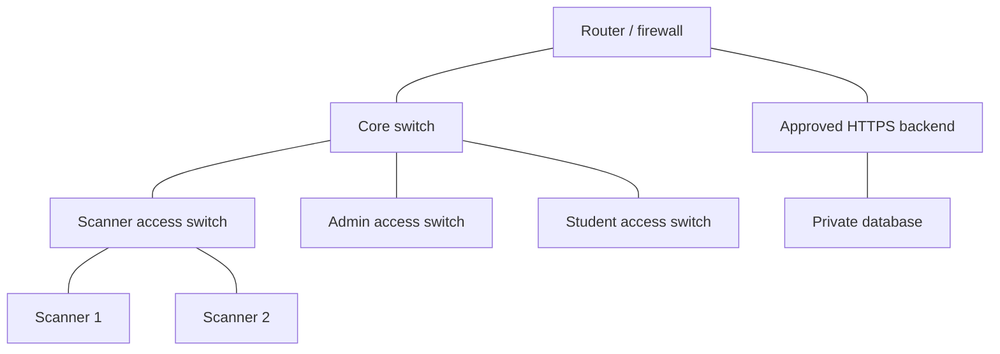
ProTrack-MX: student and teacher clients access HTTPS cloud services through local star/WLAN and upstream WAN. Cloud physical topology is not established by application source code. Protect API authorization, Supabase RLS, privileged credentials and service availability. Network redundancy does not replace application security. Neither project is claimed vulnerable.

## Official resources
- [IEEE 802.3 Ethernet](https://www.ieee802.org/3/)
- [IEEE 802.1 networking](https://1.ieee802.org/)
- [Cisco STP documentation](https://www.cisco.com/c/en/us/td/docs/routers/ios-xe/lan-wan/lan-wan/m_lsw-span-tree-prot.html)
- [Linux SocketCAN](https://docs.kernel.org/networking/can.html)
- [CAN implementation guide](https://www.analog.com/en/resources/app-notes/an-1123.html)
- [iproute2 source](https://git.kernel.org/pub/scm/network/iproute2/iproute2.git/)
- [Wireshark downloads](https://www.wireshark.org/download.html) and [user guide](https://www.wireshark.org/docs/wsug_html/)
- [Microsoft WSL networking](https://learn.microsoft.com/en-us/windows/wsl/networking)

## Individual guides
- [Network hardware and NICs](Tools/15-Network-Hardware-NICs.md)
- [Shared media, CSMA/CD and Token Ring](Tools/16-Shared-Medium-Token-Ring.md)
- [Spanning Tree and RSTP](Tools/17-STP-RSTP.md)
- [CAN and SocketCAN](Tools/18-CAN-SocketCAN.md)
- [Topology documentation and Wireshark](Tools/19-Topology-Documentation-Wireshark.md)

## Verification
All supplied Section 3 concepts documented independently with original Mermaid diagrams, failure scenarios, command explanations, calculations and additional references. No mandatory questions, required installs or labs. +10 displayed but not confirmed earned. Learner advanced to Section 3; separate prior platform completion not evidenced. No commands executed or tools installed by learner. Next: Mark Complete & Next; await Section 4.

---

## Additional visual reference from the chat

The eight basic topologies are illustrated individually above. Interactive demonstrations are preserved below as static states and worked results.

### STP normal operation and failover

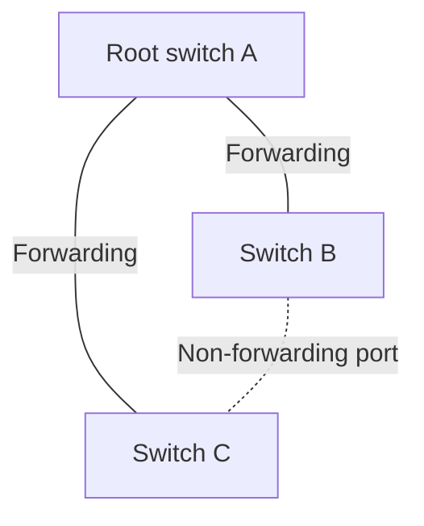


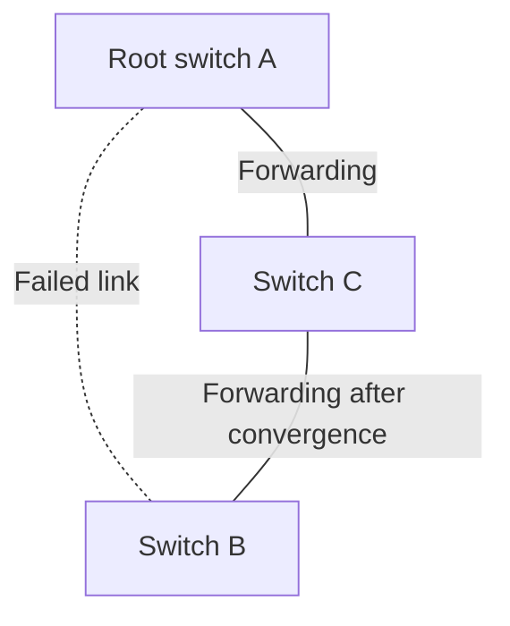

### Daisy chain failure

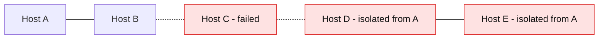

D and E may remain locally connected to each other. Failure isolates them from A through the broken chain, not necessarily from every network.

### CAN shared bus

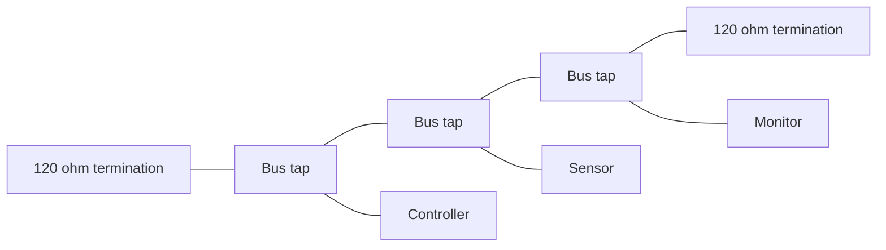

Typical high-speed CAN termination; consult hardware specification. Device images and hardware diagrams can be consulted in the [CAN physical implementation guide](https://www.analog.com/en/resources/app-notes/an-1123.html), [IEEE Ethernet](https://www.ieee802.org/3/) and [Wireshark user guide](https://www.wireshark.org/docs/wsug_html/). No unlicensed web photographs are copied.

## Original visual atlas and interactive learning companion

[Open full-size SVG atlas](Assets/03-Networking-Topologies-Visual-Atlas.svg) — 14 labeled original illustrations with explanatory captions. The atlas supplements the detailed lesson above, rather than replacing it.

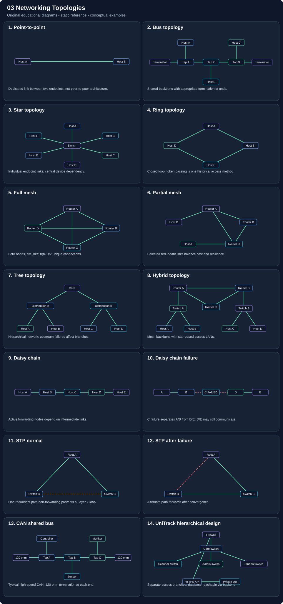

[Complete visual library](Assets/README.md). [Download offline interactive companion](Assets/Networking-Interactive-Companion.html) and open in a browser; relevant demonstrations: mesh, stp, chain. GitHub does not execute scripts in the file preview.

