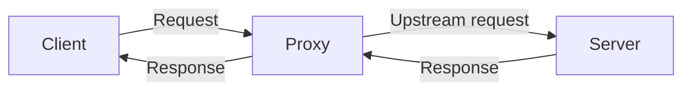
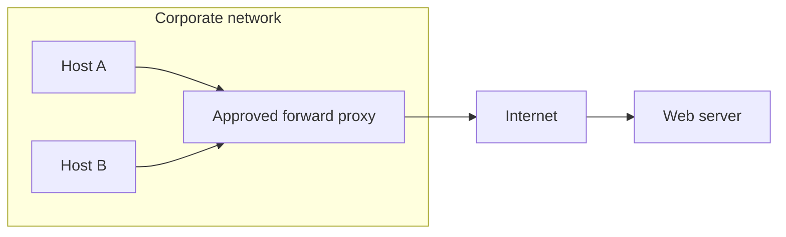
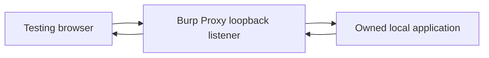
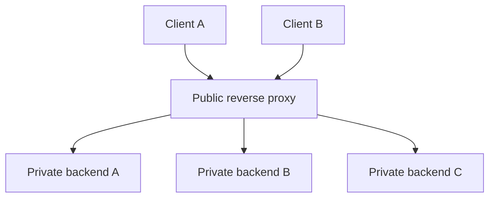
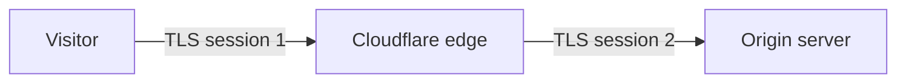
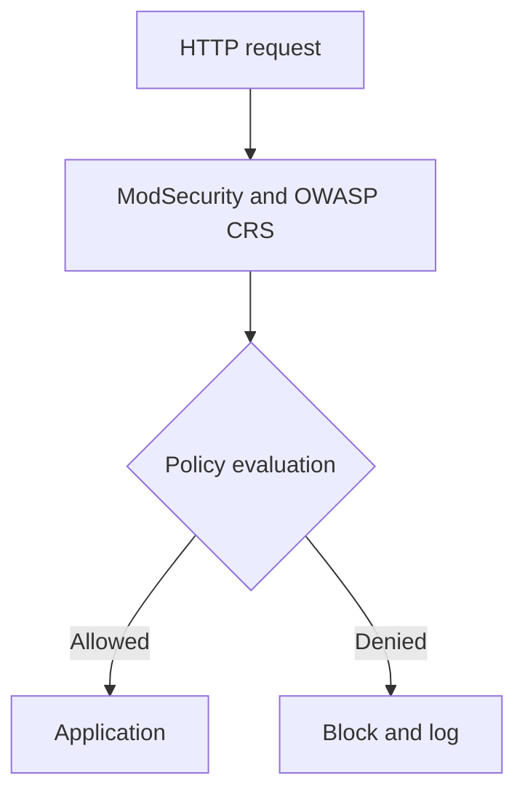
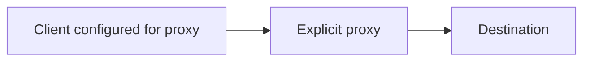
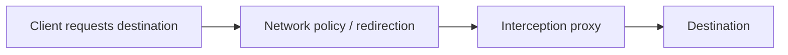
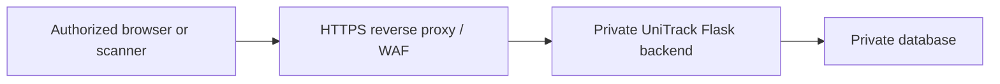

# Section 04 — Proxies

Source: full learner-supplied HTB Academy Section 4, [official course](https://academy.hackthebox.com/course/preview/introduction-to-networking). Independent English study notes, original diagrams, technical corrections, defensive scenarios and official references. No mandatory question or practical lab in the supplied material.

## Objectives and fundamental concepts

A proxy mediates connections or requests on behalf of a client or server. It may relay, authenticate, filter, cache, log, modify messages, or distribute requests. Security professionals use HTTP testing proxies and authorized remote-access tools; developers use reverse proxies, WAFs and edge services; consumers may confuse proxy services with VPNs. Use of a proxy alone does not establish anonymity or illegal activity.



| Technology | Primary purpose | Example |
| --- | --- | --- |
| Proxy | Mediates connections or application requests | Burp Proxy |
| Gateway | Connectivity or protocol translation | Default gateway |
| Router | Forwards IP packets | Home router |
| VPN | Logical private connectivity | OpenVPN |
| NAT | Translates addresses and sometimes ports | Home internet router |
| Firewall | Enforces communication policy | Network firewall |

Technical correction: a proxy does not necessarily decrypt or inspect all application contents. An HTTP CONNECT tunnel or SOCKS relay can carry encrypted traffic without reading the HTTPS request. HTTP proxies typically operate at OSI Layer 7; other relays operate at different layers. Gateway is a broader term, and RFC 9110 also uses gateway to describe a reverse proxy. Changing a visible IP address alone does not prove use of a proxy. NAT and VPN are not synonymous with proxy.

## Forward proxy

A forward proxy acts on behalf of clients. Client connects to intermediary, proxy evaluates policy, establishes upstream communication if allowed, receives response and returns it. A corporate proxy may authenticate users, restrict destination access, log events, cache permitted content and enforce egress policies.



| Example destination | Policy |
| --- | --- |
| University portal | Allow |
| Approved software repository | Allow |
| Known malicious domain | Block |
| Unauthorized file-sharing service | Block |
| Approved updates | Allow and log |

A firewall should restrict unapproved direct egress; proxy use cannot be assumed simply because browser settings specify it. Logging must have a clear purpose, retention, access controls and privacy limits. Caching private or authenticated data requires care.

### Explicit proxy configuration and proxy-aware applications

A proxy-aware application understands how to communicate with a proxy. Settings may come from application options, operating-system settings, environment variables, managed policies or PAC (Proxy Auto-Configuration) scripts. A PAC script selects a proxy or direct path based on destination/policy. Different applications and networking APIs behave differently.

The course's claim that Winsock automatically makes software proxy-aware is inaccurate: Winsock provides socket APIs, not automatic HTTP proxy negotiation. WinHTTP offers HTTP services with proxy facilities, and application behavior depends on API and implementation. Firefox uses its own networking stack and supports system, manual and managed proxy settings; it is not simply a libcurl-based browser. Chromium-based browsers commonly integrate OS proxy policy, but settings can be overridden by managed configuration. Browser choice alone is not reliable malware defense.

Read-only Windows PowerShell reference:
```powershell
netsh winhttp show proxy
Get-ChildItem Env: | Where-Object Name -Match 'PROXY'
```
First displays WinHTTP proxy configuration, not every browser setting. Second lists environment variables matching PROXY; values may include sensitive endpoints/credentials and must not be published. Firefox settings: search for proxy or connection settings and inspect policy; do not change corporate settings without authorization. [Microsoft WinHTTP](https://learn.microsoft.com/en-us/windows-server/administration/windows-commands/netsh-winhttp), [Mozilla proxy policy](https://firefox-admin-docs.mozilla.org/reference/policies/proxy/).

### Command and control and DNS monitoring

C2 (Command and Control) refers to communication used to control compromised systems. Proxies can contribute to egress control, but malware may use various transports. DNS can be abused as a communication channel. Defenders correlate DNS and endpoint telemetry, unexpected outbound connections, process identities and approved destinations. No single unusual query proves compromise, and monitoring cannot guarantee detection. Sysmon Event ID 22 logs DNS-query telemetry when available/configured. Event ID 3 records network connections when enabled. Monitor approved resolvers, consider encrypted DNS visibility, protect logs and combine network and endpoint controls. Do not rely on browser choice or one IDS to establish prevention.

## Burp Suite Community Edition

Burp Suite by PortSwigger provides HTTP(S)/WebSocket proxy and manual web testing tools. Proxy can intercept or forward requests; HTTP history records observed transactions; Repeater manually resends chosen requests; Decoder interprets encoded data; Comparer compares content; Target organizes scope. Community is free, but not open-source and lacks some paid features. Burp can also support specialized reverse or invisible proxy configurations; this section uses only an explicit local testing proxy.



Windows 11 setup reference: download the official Community installer, verify publisher, install, launch temporary project with defaults, open Proxy and built-in browser (already configured). Confirm listener uses loopback and intended port, commonly 127.0.0.1:8080. No need to change system-wide proxy or trust certificates globally. For Linux use official Linux installer on a supported graphical host; WSL GUI availability varies. Official [download](https://portswigger.net/burp/communitydownload), [installation](https://portswigger.net/burp/documentation/desktop/getting-started/download-and-install).

Original benign UniTrack development request:
```http
GET / HTTP/1.1
Host: 127.0.0.1:5000
Accept: text/html
```
GET requests resource; path / is root; Host names destination; Accept expresses desired content type. Response status and headers depend on actual application. An illustrative response:
```http
HTTP/1.1 200 OK
Content-Type: text/html
```
This response is fictional, not observed evidence. HTTP history can show request/response, while Intercept pauses traffic until forwarded/dropped. Scope testing to owned application, avoid real student credentials and redact sessions. If HTTPS inspection is required, Burp establishes separate TLS connections; its CA must be trusted by the dedicated testing browser. Do not install its CA globally or disable TLS verification to fix an error. [CA guide](https://portswigger.net/burp/documentation/desktop/external-browser-config/certificate).

Optional local-only cURL example with an already-running Burp listener and owned HTTP server:
```bash
curl --noproxy "" --proxy http://127.0.0.1:8080 -i http://127.0.0.1:5000/
```
--noproxy "" clears bypass matching for this invocation so loopback target uses the explicitly selected local proxy; --proxy selects proxy; -i includes response headers. Use curl.exe in Windows PowerShell when curl resolves to an alias. Listener and target must be accessible in same networking context. If Intercept is on, request may wait. No command executed or required.

## Reverse proxy

A reverse proxy represents servers. Clients access an edge address; edge evaluates requests, chooses upstream, forwards approved traffic and returns response. It can terminate TLS, balance load, cache responses, enforce rate limits and isolate backend services. Reverse proxy does not inherently provide WAF filtering, DDoS mitigation or high availability; these depend on deployment.



| Feature | Forward | Reverse |
| --- | --- | --- |
| Represents | Clients | Servers |
| Common direction | Outbound | Inbound |
| Objective | Control client access | Publish/protect backend services |
| Examples | Squid, Burp Proxy | NGINX, Cloudflare |

Original local NGINX architecture: browser connects to 127.0.0.1:8081; NGINX forwards to owned Flask server 127.0.0.1:5000. Illustrative configuration for native Linux where both share network namespace:
```nginx
server {
    listen 127.0.0.1:8081;
    server_name localhost;
    location / {
        proxy_pass http://127.0.0.1:5000;
        proxy_set_header Host $host;
        proxy_set_header X-Forwarded-Proto $scheme;
        proxy_set_header X-Real-IP $remote_addr;
        proxy_set_header X-Forwarded-For $remote_addr;
    }
}
```
listen binds loopback; location matches paths; proxy_pass selects upstream; proxy_set_header sets upstream metadata. Overwrite untrusted forwarding metadata at the external trust boundary. In multi-proxy deployments use a carefully defined trusted-proxy policy; never trust arbitrary incoming forwarded headers. Check configuration with nginx -t; do not reload shared service without permission. Docker and WSL networking differ; container loopback is not host loopback. No install or execution required. [NGINX official docs](https://docs.nginx.com/nginx/admin-guide/web-server/reverse-proxy).

## Cloudflare and TLS

Cloudflare offers DNS, reverse proxy/CDN, DDoS mitigation and WAF capabilities; features vary by plan. DDoS means Distributed Denial of Service: distributed traffic or resource pressure can disrupt legitimate availability. CDN distributes content via edge infrastructure. DNS-only records do not route HTTP through Cloudflare. Proxied records can route eligible HTTP(S) traffic through its edge. Origin protection requires restricting direct access and securing upstream TLS; hiding an address alone is insufficient.


TLS termination enables authorized edge inspection of HTTP content. A second TLS connection protects edge-to-origin traffic. Full (strict) validates origin certificates, unlike Full without strict verification; avoid Flexible for sensitive production applications. Consider data privacy and trust in third-party edge. Restrict origin access to approved paths, protect admin services and log genuine client IP only from trusted proxy sources. [Proxy status](https://developers.cloudflare.com/dns/proxy-status/), [Full strict](https://developers.cloudflare.com/ssl/origin-configuration/ssl-modes/full-strict/), [origin protection](https://developers.cloudflare.com/fundamentals/security/protect-your-origin-server/).

## ModSecurity and OWASP CRS

WAF means Web Application Firewall. ModSecurity is an open-source WAF engine integrated with compatible web servers/proxies, not necessarily a standalone reverse proxy. OWASP Core Rule Set (CRS) is an open-source collection of generic detection rules. NGINX or Apache handles web server/proxy functions; the application still implements authentication, authorization and business logic. WAFs can inspect HTTP request components and potentially response data depending on configuration; TLS-encrypted payload must be made available by an authorized terminating component for content inspection.



CRS commonly uses anomaly scoring: individual rule matches add to a score, and policy may block at a threshold. DetectionOnly mode logs without blocking; false positives can disrupt legitimate requests. Start with controlled staging, test representative legitimate traffic, tune narrow exclusions, monitor and keep rules updated. Patterns associated with SQL injection, XSS and malformed requests can be detected, but WAF is not a substitute for parameterized queries, output encoding and authorization. Avoid collecting secrets in audit logs.

Official [ModSecurity docs](https://modsecurity.org/docs/), [CRS docs](https://coreruleset.org/docs/), [CRS releases](https://github.com/coreruleset/coreruleset/releases), [official container documentation](https://github.com/coreruleset/modsecurity-crs-docker). Ready-to-run images can integrate engine and rules; use reviewed pinned release and local staging with approved backend, not unrestricted production deployment. No install required.

## Transparent and non-transparent proxies

Explicit/non-transparent: client knows proxy address and is configured to use it. Transparent/interception: network infrastructure directs traffic to proxy without explicit client configuration. Transparent here describes interception, not invisibility to detection or a guarantee of anonymity. It is an independent axis: forward/reverse describes whose behalf; explicit/interception describes how traffic reaches proxy. Clients of reverse proxies may be unaware of backend routing. HTTP terminology also distinguishes transforming vs non-transforming proxies; do not confuse those usages.




If explicit proxy is sole allowed egress path, absent/mistaken settings can break connectivity. Transparent interception requires policy, authorized infrastructure and appropriate protocol support. For HTTPS, transparent routing alone does not decrypt content; TLS interception requires a trusted CA, endpoint configuration, legal/privacy safeguards and compatible apps. Certificate pinning or mutual TLS may prevent inspection. Do not disable certificate checks. CONNECT creates a tunnel, normally preserving end-to-end TLS; destination metadata may still be visible. RFC 9110 defines CONNECT and HTTP intermediary semantics.

## SOCKS, SSH and tunneling technologies

SOCKS5 (RFC 1928) negotiates a connection relay with authentication method and requested destination. It supports TCP connections and UDP association with compatible implementation; it does not automatically encrypt payload. Conventionally TCP 1080, configurable. DNS may be resolved locally or through proxy according to client. SSH authenticates endpoints and encrypts its channel; SSH port forwarding relays approved connections. Tunnel transport and proxy semantics are distinct: a tunnel carries traffic within another connection, a proxy mediates a connection. Tools mentioned in the course:

| Technology | Purpose | Official reference |
| --- | --- | --- |
| OpenSSH | Secure remote administration and forwarding | https://www.openssh.com/ |
| Chisel | TCP/UDP tunnel over HTTP transport, protected using SSH | https://github.com/jpillora/chisel |
| ptunnel / ptunnel-ng | TCP tunneling over ICMP echo messages | https://github.com/utoni/ptunnel-ng |
| sshuttle | SSH-based transparent proxy / VPN-like remote connectivity | https://sshuttle.readthedocs.io/en/stable/ |

A compromised endpoint can be abused as an unauthorized relay; tunneling may reduce visibility for monitoring systems positioned elsewhere. This is a defensive explanation of the supplied scenario, not a procedure for bypassing a firewall or evading an IDS. Defenders restrict unauthorized listeners, forwarding, egress and remote access; correlate authentication, process and network events; monitor approved SSH and ICMP usage, and isolate compromised devices according to response procedures. Encryption limits payload inspection but does not erase all telemetry. Authorized network assessment requires explicit scope and approval. Separate guides describe installation sources, architecture, safe version/help checks and defenses without deploying unauthorized relays.

## HTTP CONNECT and diagnostic terminology
| Term | Meaning |
| --- | --- |
| CONNECT | HTTP method requesting tunnel to destination |
| TLS termination | Intermediary ends one TLS session and may start another |
| Upstream | Backend or next service from proxy perspective |
| 407 | Proxy Authentication Required |
| 403 | Forbidden; may originate from proxy, WAF or application |
| 502 | Bad Gateway; intermediary received invalid upstream response |
| 504 | Gateway Timeout; intermediary did not get timely upstream response |
| Forwarded/X-Forwarded-For | Metadata about previous connections; trust only approved intermediaries |

Do not infer a particular component from status alone; correlate proxy and application logs. An open proxy can be abused: restrict listener bindings and require appropriate authentication and destination policies.

## Sysmon and DNS telemetry
Sysmon (System Monitor) provides Windows process, network and other activity telemetry. Event ID 22 = DNS query; Event ID 3 = network connection when enabled; Event ID 1 = process creation. Official Microsoft download/docs: https://learn.microsoft.com/en-us/sysinternals/downloads/sysmon. Sysmon is free but not open source. On a system already configured for Sysmon, read-only PowerShell:
```powershell
Get-WinEvent -FilterHashtable @{LogName='Microsoft-Windows-Sysmon/Operational'; Id=22} -MaxEvents 10
```
FilterHashtable selects log and event ID; MaxEvents limits output. QueryName, Image and ProcessGuid may support correlation. Output may contain confidential names; do not publish raw records. If log absent, Sysmon may not be installed or configured; do not install/change production monitoring without approval. Event coverage varies. A benign query to example.com by a browser is not a security incident. See individual guide.

## Project applications and security architecture

UniTrack proposed design: public-facing NGINX reverse proxy terminates approved HTTPS, forwards to private Flask backend and limits exposed paths; backend accesses private database. Add WAF only after testing, rate limiting and structured logging without secrets. Application still needs CSRF protection, password hashing, MFA, QR validation and role enforcement. Trust forwarded headers only from configured proxies; avoid publicly reachable development server. Validate direct origin access restrictions.

ProTrack-MX: clients reach approved HTTPS cloud endpoints. Reverse proxy or edge controls may protect owned frontend/backend services, but Supabase managed infrastructure capabilities differ. Preserve RLS, authentication and server-only service-role keys. Do not route confidential student records through an unapproved third party. Neither project is claimed vulnerable.

Original defensive scenarios:
| Observation | Response |
| --- | --- |
| Browser reports 407 | Check approved proxy authentication and configuration |
| Reverse proxy returns 502 | Check upstream health, address, port and logs |
| TLS certificate mismatch | Check hostname and trusted CA, never disable validation |
| Unexpected outbound connection | Correlate process and network telemetry, investigate policy |
| Legitimate WAF block | Review rule ID, narrow tuning, retest in staging |
| Direct origin accessible | Review architecture and authorized origin restrictions |

## Individual guides
- [Burp Suite](Tools/20-Burp-Suite.md)
- [HTTP proxies and Squid](Tools/21-HTTP-Proxies-Squid.md)
- [NGINX reverse proxy](Tools/22-NGINX-Reverse-Proxy.md)
- [Cloudflare](Tools/23-Cloudflare.md)
- [ModSecurity and OWASP CRS](Tools/24-ModSecurity-OWASP-CRS.md)
- [SOCKS and OpenSSH](Tools/25-SOCKS-OpenSSH.md)
- [Chisel](Tools/26-Chisel.md)
- [ptunnel / ptunnel-ng](Tools/27-Ptunnel.md)
- [sshuttle](Tools/28-sshuttle.md)
- [Sysmon and DNS monitoring](Tools/29-Sysmon-DNS-Monitoring.md)

References: [HTTP RFC 9110](https://www.rfc-editor.org/rfc/rfc9110), [SOCKS5 RFC 1928](https://www.rfc-editor.org/rfc/rfc1928), [SSH architecture RFC 4251](https://www.rfc-editor.org/rfc/rfc4251), [TLS RFC 8446](https://www.rfc-editor.org/rfc/rfc8446).

## Verification
All major concepts from supplied Section 4 explained independently in English, with diagrams, official links, original local examples, corrections and ten linked guides. No mandatory question or lab; +10 reward displayed, not confirmed earned. Learner advanced beyond Section 3 without separate completion evidence. No installation, live testing or connection performed. Next: Mark Complete & Next and provide Section 5.
