# Section 05 — Networking Models

Source: full learner-supplied HTB Academy Section 5, [official course](https://academy.hackthebox.com/course/preview/introduction-to-networking). Independent English explanations, original diagrams, worked examples, security analysis and references. No mandatory question or required lab appears in supplied material.

## Learning objectives
Understand the seven-layer OSI reference model and conventional four-layer TCP/IP architecture; distinguish layer responsibilities, protocols, addressing and protocol data units (PDUs); follow encapsulation and decapsulation; interpret packet headers and apply layered troubleshooting. The OSI model is standardized by ISO and ITU-T (X.200). TCP/IP is a protocol family and practical architecture, not a single protocol. OSI is a conceptual reference model, not a network gateway, and its strict conceptual separation does not imply that deployed internet protocols always fit exactly into one layer.

## OSI versus TCP/IP

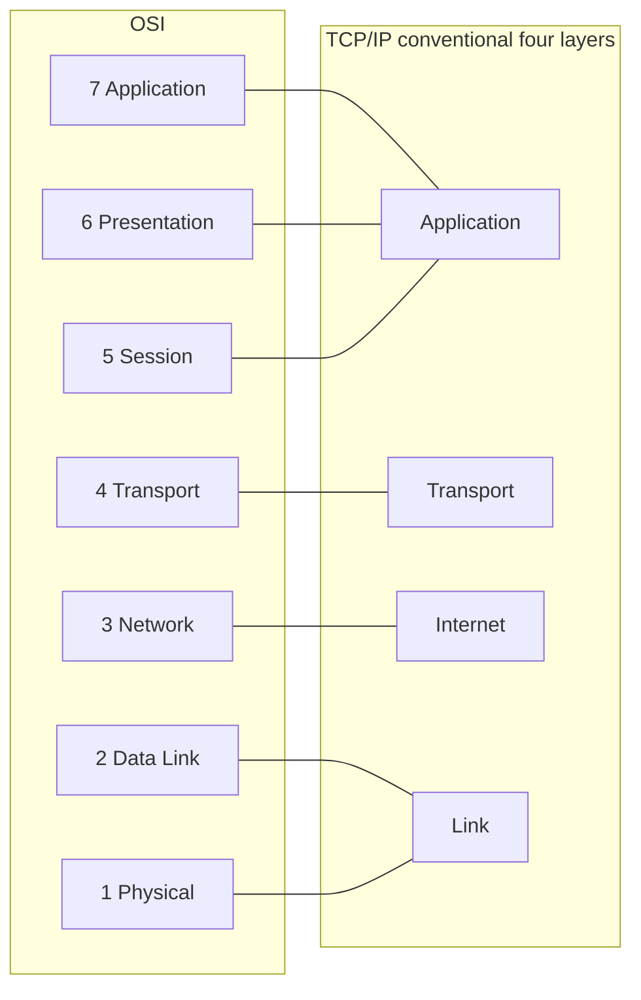

| OSI layer | TCP/IP approximate layer | Common PDU terminology | Primary function |
| --- | --- | --- | --- |
| 7 Application | Application | Data/messages | Network services for applications |
| 6 Presentation | Application | Data | Representation, conversion, cryptographic functions |
| 5 Session | Application | Data | Dialogue/session management |
| 4 Transport | Transport | TCP segment / UDP datagram | Endpoint communication and transport behavior |
| 3 Network | Internet | IP packet/datagram | Logical addressing and routing |
| 2 Data Link | Link | Frame | Local link delivery |
| 1 Physical | Link | Bits/signals | Physical signal transmission |

Some teaching models separate physical and data-link functions into five TCP/IP layers. Four-layer mapping is the HTB convention here. Upper-layer PDU names are pedagogical shorthand, not universal protocol-specific names. IP datagram and UDP datagram are both valid in their respective contexts.

## Seven OSI layers

### 7 — Application
Network services used by applications, not the whole graphical user interface. Example: browser generates HTTP request for a web server. DNS resolves records; SSH provides authenticated remote administration; SMTP transfers email; DHCP distributes network configuration. Common transport ports are conventions, not absolute requirements.

| Protocol | Purpose | Common transport/port |
| --- | --- | --- |
| HTTP | Web communication | TCP 80 |
| HTTPS | HTTP protected by TLS | TCP 443, HTTP/3 uses UDP 443 |
| DNS | Name resolution | UDP/TCP 53 for traditional DNS |
| SSH | Secure remote administration | TCP 22 |
| SMTP | Mail transfer | TCP 25 |
| FTP | File transfer control channel | TCP 21 |
| DHCPv4 | Address configuration | UDP 67/68 |

Security considerations: SQL injection, cross-site scripting, broken access control, insecure authentication and application data validation. Burp Suite and curl help examine approved HTTP transactions; application authorization cannot be replaced by a network firewall. See [Burp guide](Tools/20-Burp-Suite.md).

### 6 — Presentation
Describes data representation, encoding, serialization, compression and cryptographic transformations. UTF-8 represents text; JSON serializes structured data; JPEG represents images; Base64 encodes bytes using printable characters. TLS supplies cryptographic functions often associated conceptually with presentation, but the real TCP/IP stack does not neatly assign TLS to an OSI layer. Base64 is not encryption.

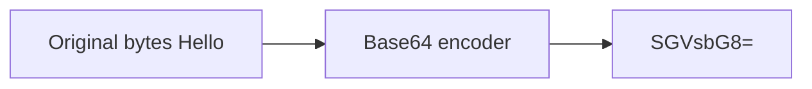

Original local example:
```python
import base64
encoded = base64.b64encode(b"Hello")
print(encoded.decode("ascii"))
print(base64.b64decode(encoded).decode("utf-8"))
```
Expected output (illustrative): SGVsbG8= then Hello. b64encode returns bytes; decode converts bytes to text; b64decode recovers original bytes. Encoding does not conceal secrets. Security: safe parsers, input validation, modern TLS, certificate verification, controlled serialization and decompression limits.

### 5 — Session
Conceptually establishes, manages, synchronizes and terminates dialogues. Web login sessions, session cookies, expiration and invalidation are useful application-layer analogies, not literal separate OSI Layer 5 protocols. Distinguish TCP connection, TLS session and application login session; their lifetimes may differ.

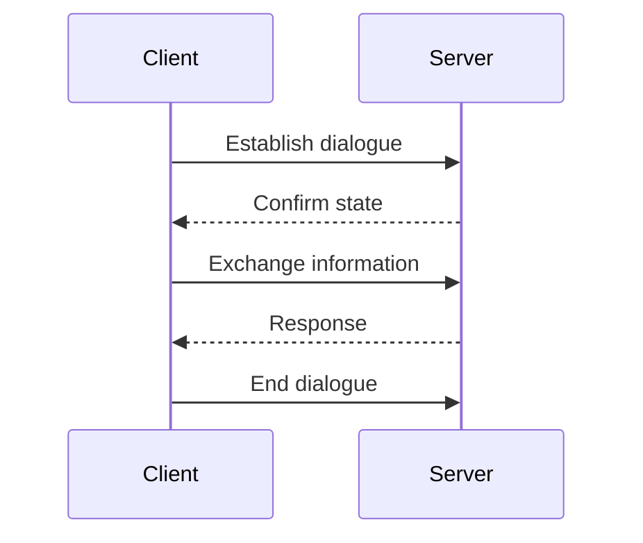
Security: prevent session fixation/hijacking, use secure random identifiers, secure cookie flags where applicable, expiration, rotation and invalidation. UniTrack should invalidate relevant sessions after password changes and enforce access roles on every protected request. No deployment verified here.

### 4 — Transport
TCP provides a reliable, ordered byte stream with sequencing, acknowledgments, retransmission, flow control and congestion control. UDP sends datagrams without built-in connection establishment, ordering or retransmission; applications may add reliability (e.g. QUIC). Ports distinguish transport endpoints. The 5-tuple (source IP, destination IP, source port, destination port, transport protocol) identifies ordinary flows from one viewpoint. TCP minimum header 20 bytes; UDP header 8 bytes. A port is not proof of application identity.

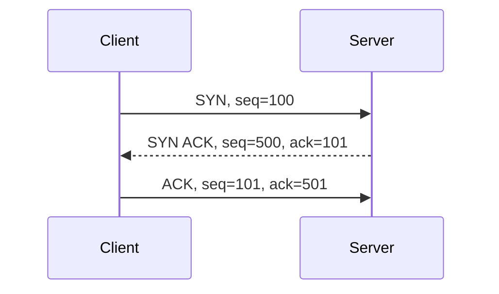
SYN consumes one sequence number. Initial numbers are fictional; actual values vary. SYN synchronizes, ACK acknowledges; FIN supports orderly close, RST resets. TCP does not inherently encrypt. UDP header includes source/destination port, length and checksum. TCP and UDP use distinct port spaces. Security: unauthorized listeners, connection exhaustion, service exposure, transport filtering. See [TCP/UDP/ICMP guide](Tools/31-TCP-UDP-ICMP.md).

### 3 — Network
IP supplies logical addresses and best-effort packet delivery across networks. IPv4 uses 32-bit addresses, IPv6 128-bit. Routers select routes (typically longest-prefix match), forward packets and decrement IPv4 TTL or IPv6 Hop Limit. ICMP provides diagnostic/error/control messages and belongs to internet layer; ICMPv4 and ICMPv6 have different type definitions. OSPF supports routing within a routing domain; BGP exchanges reachability over TCP, so do not equate control-plane role with wire encapsulation layer. Security: address spoofing, routing incidents, unauthorized inter-zone traffic. IP alone does not authenticate senders.

### 2 — Data Link
Local link delivery: Ethernet frames, MAC addressing, VLANs, STP and Wi-Fi framing. Switches learn source MAC addresses and forward known unicasts; broadcasts and unknown unicasts may flood within VLAN. ARP resolves IPv4 next-hop addresses on a local link and is commonly discussed at the link/network boundary; IPv6 Neighbor Discovery uses ICMPv6. A remote host's IP does not imply its MAC is visible locally.

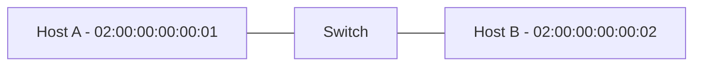
MAC examples are locally administered illustrative addresses. Ethernet FCS checks accidental corruption, not cryptographic authenticity. Security: ARP spoofing, unauthorized ports, VLAN mistakes and loops. Use segmentation, port access control, appropriate switch protections and higher-layer authentication/encryption.

### 1 — Physical
Represents bits using electrical, optical or radio signals. Includes media, connectors, signaling, link rates and physical reception. Copper Ethernet uses electrical signaling, fiber light, Wi-Fi radio. Repeaters regenerate signals; hubs repeat signals. Real signaling can encode several bits per symbol. Security: physical tampering, cabling faults, interference, unauthorized physical access. Physical access controls and redundant independent paths improve resilience.

## TCP/IP four layers
| Layer | Responsibilities | Protocol examples |
| --- | --- | --- |
| Application | Application services, representation, sessions | HTTP, DNS, SSH, SMTP, DHCP, TLS functions |
| Transport | Application endpoint communication | TCP, UDP |
| Internet | Logical addressing, routing, diagnostics | IPv4, IPv6, ICMP |
| Link | Local delivery and physical transmission | Ethernet, Wi-Fi, ARP |

RFC 1122 describes link, IP and transport requirements, with application/support covered by RFC 1123. Internet networks use this suite in private and public contexts. TCP/IP can run over many local media. A conceptual model helps diagnose actual protocols; mapping is approximate. [OSI X.200](https://www.itu.int/rec/T-REC-X.200/en), [RFC 1122](https://www.rfc-editor.org/rfc/rfc1122), [RFC 1123](https://www.rfc-editor.org/rfc/rfc1123).

## Packet transfer, PDUs, encapsulation and decapsulation
A PDU (Protocol Data Unit) is a unit exchanged between peer protocol entities. Payload is the carried content from the next higher layer. Header is protocol control metadata; trailer is additional metadata at the end (e.g. Ethernet FCS). Encapsulation adds appropriate framing/control information as data descends a stack; decapsulation processes/removes relevant headers/trailers at receiver. Not every conceptual layer adds a separate header, and lower-layer operations may split, combine or reassemble data. Physical layer represents the frame as signals rather than adding a universal header. The phrase packet may be used generically, but precise terms help during analysis.

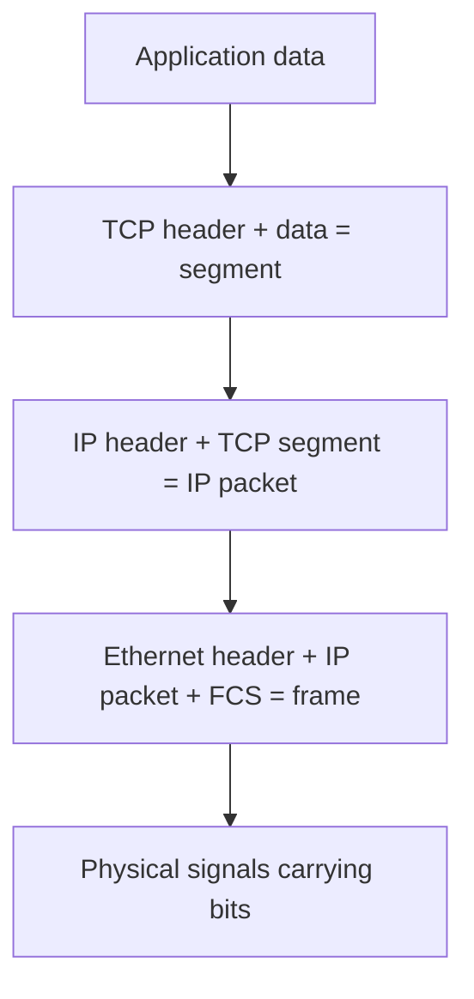

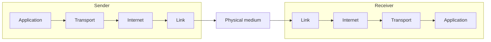

For a simple TCP/IPv4/Ethernet example, the on-wire layout is:
```text
[Ethernet header][IPv4 header][TCP header][Application payload][Ethernet FCS]
```
For UDP replace TCP header with UDP header. TLS-encrypted application data adds TLS record overhead; segmentation and protocol options change sizes. Ethernet may pad short payloads; VLAN tags add bytes. Ethernet FCS is often absent from OS packet captures because hardware removes it. Preamble/SFD and interframe gap are not included in normal Ethernet frame length.

### Worked byte-count example
Assume 100 bytes of application payload in a single TCP segment, no TCP/IP options, ordinary Ethernet II without VLAN tags, no TLS, no padding (packet is large enough), no segmentation offload artifact.
| Stage | Added bytes | Total bytes |
| --- | ---: | ---: |
| Application | 100 | 100 |
| TCP minimum header | 20 | 120 |
| IPv4 minimum header | 20 | 140 |
| Ethernet header | 14 | 154 |
| Ethernet FCS | 4 | 158 |

Wire MAC frame length = 158 bytes, not including preamble/SFD/interframe gap. A typical capture omitting FCS may show 154 bytes. Headers/trailer total 58 bytes; application fraction = 100/158 ≈ 63.3%. With 100-byte UDP payload, UDP 8 + IPv4 20 + Ethernet 14 + FCS 4 yields 146-byte MAC frame. For a typical 1500-byte Ethernet IP MTU, TCP MSS is often 1460 bytes with minimum IPv4/TCP headers; IPv6 base header 40 bytes gives 1440 under equivalent assumptions. MSS is TCP payload limit, MTU is link IP packet size; actual effective values vary with options, tunnels and path MTU. These calculations are educational examples, not observed traffic.

### Addressing at each layer
| Field | Example | Scope |
| --- | --- | --- |
| Destination MAC | 02:00:00:00:00:fe | Next-hop interface on local Ethernet |
| Destination IP | 198.51.100.20 | Intended network-layer destination |
| Destination TCP port | 80 | Example web service endpoint |
| HTTP path | / | Resource requested by application |

Example documentation IPs: client 192.0.2.10, router local 192.0.2.1, server 198.51.100.20. MAC next hop is gateway, not remote server, because destination is off-link.

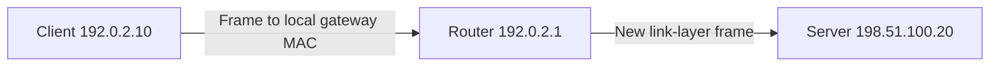
Routers normally remove incoming link framing and construct outgoing framing, decrement TTL/Hop Limit, and for IPv4 update header checksum. End-to-end IP addresses and transport ports normally remain unchanged in ordinary routing; NAT, proxies, tunneling or other middleboxes may change the visible endpoints. Switches forward local frames without decrementing IP TTL. A proxy can terminate one connection and start another.

### Example HTTP request and receiver processing
```http
GET / HTTP/1.1
Host: 127.0.0.1:5000
Accept: text/html
```
A local UniTrack example uses loopback; it is not transmitted over a physical Ethernet wire. For a remote Ethernet host, TCP carries request bytes, IP carries segment, link layer frames packet, physical medium transmits signals. Receiver accepts frame, evaluates IP destination and transport protocol, TCP reassembles ordered stream, application parses HTTP. Response travels in reverse logical direction, potentially different route. HTTPS normally encrypts HTTP before transport encapsulation, while HTTP/3 uses QUIC over UDP. One application message may span multiple packets, and one packet may contain parts of multiple messages. Do not assume request = packet.

## Network traffic analysis
Wireshark dissects captured data into protocol tree, packet list and byte view. Typical Ethernet capture: Frame (capture metadata), Ethernet II (MAC fields), IPv4 (IP addresses, TTL, protocol), TCP (ports, sequence, flags), HTTP if plaintext and recognized. TLS hides HTTP contents from an ordinary capture. Capture on authorized interfaces or use approved existing files; switched network visibility is limited by capture vantage. FCS can be absent; capture offload may make checksums or segmentation look unusual.

| Wireshark display filter | Purpose |
| --- | --- |
| eth | Ethernet protocol |
| ip | IPv4 packets |
| ipv6 | IPv6 packets |
| tcp | TCP |
| udp | UDP |
| icmp | ICMPv4 |
| icmpv6 | ICMPv6 |
| tcp.port == 443 | TCP source/destination port 443 |
| tcp.flags.syn == 1 && tcp.flags.ack == 0 | Initial SYN packets |
| http | Recognized HTTP traffic |
| tls | Recognized TLS records |

Display filters select already captured packets; capture filters use different syntax and decide what to collect. On approved existing sample.pcapng:
```bash
tshark -r sample.pcapng -Y "tcp" -V
```
-r reads file; -Y is display filter; -V prints verbose protocol details. Filename is illustrative; no file supplied and no commands run. [Wireshark user guide](https://www.wireshark.org/docs/wsug_html/), [official downloads](https://www.wireshark.org/download.html), [TShark manual](https://www.wireshark.org/docs/man-pages/tshark.html).

## Layered diagnostics (reference only)
| Layer | Typical symptom | Reference |
| --- | --- | --- |
| 1 | Cable unplugged/link down | Adapter status, physical inspection |
| 2 | Local next-hop unreachable | Neighbor table, approved switch/VLAN inventory |
| 3 | Route missing | ip route, Get-NetRoute |
| 4 | Service connection fails | ss, Get-NetTCPConnection |
| 5 | Session repeatedly ends | Application/session logs |
| 6 | Certificate or encoding error | TLS certificate validation, parser logs |
| 7 | HTTP 403/500 | Authorized application/API logs |

Windows PowerShell:
```powershell
Get-NetAdapter
Get-NetIPConfiguration
Get-NetRoute -AddressFamily IPv4
Get-NetTCPConnection -State Listen
```
First lists adapters and state; second IP/DNS/gateway configuration; third IPv4 routes; fourth local TCP listeners. Linux/WSL2:
```bash
ip -br link
ip neigh
ip route
ss -lnt
ss -lnu
```
-br brief output; neigh lists neighbor entries; ss displays sockets; -l listening, -n numeric, -t TCP, -u UDP. WSL2 can differ from Windows host; UDP sockets have different state semantics. A listening socket does not establish remote reachability. Redact actual IPs, credentials and user data. No practical exercise required.

## Original project applications
UniTrack: browser or QR scanner uses HTTPS (application/TLS), TCP or QUIC transport, IP routing, Ethernet/Wi-Fi local links. If scanner cannot reach server, distinguish link, VLAN/gateway, transport listener, TLS trust, HTTP status, authentication and QR validation; do not change production configuration without authorization. A 403 may mean intended role enforcement, not network failure. Secure passwords, MFA, CSRF and session invalidation remain application responsibilities.
ProTrack-MX: clients use authenticated HTTPS cloud endpoints; Realtime may use WebSockets and TLS. Supabase RLS controls database access at application/data policy level; network reachability does not prove authorization. Separate DNS/routing/connectivity from token expiration and RLS failures. These are proposals and diagnostic examples, not verified deployment findings.

## Official resources
- [ITU-T X.200](https://www.itu.int/rec/T-REC-X.200/en), [RFC 1122](https://www.rfc-editor.org/rfc/rfc1122), [RFC 1123](https://www.rfc-editor.org/rfc/rfc1123)
- [TCP RFC 9293](https://www.rfc-editor.org/rfc/rfc9293), [UDP RFC 768](https://www.rfc-editor.org/rfc/rfc768), [IPv4 RFC 791](https://www.rfc-editor.org/rfc/rfc791), [IPv6 RFC 8200](https://www.rfc-editor.org/rfc/rfc8200)
- [ICMP RFC 792](https://www.rfc-editor.org/rfc/rfc792), [ICMPv6 RFC 4443](https://www.rfc-editor.org/rfc/rfc4443), [ARP RFC 826](https://www.rfc-editor.org/rfc/rfc826)
- [TLS 1.3 RFC 8446](https://www.rfc-editor.org/rfc/rfc8446), [QUIC RFC 9000](https://www.rfc-editor.org/rfc/rfc9000), [HTTP/3 RFC 9114](https://www.rfc-editor.org/rfc/rfc9114)
- [IANA service names and port registry](https://www.iana.org/assignments/service-names-port-numbers/service-names-port-numbers.xhtml), [IEEE 802.3](https://www.ieee802.org/3/)

## Separate technical guides
- [OSI and TCP/IP model reference](Tools/30-OSI-TCP-IP-Models.md)
- [TCP, UDP and ICMP](Tools/31-TCP-UDP-ICMP.md)
- [Encapsulation and Wireshark packet analysis](Tools/32-Packet-Encapsulation-Wireshark.md)
- Existing [network diagnostics](Tools/01-Network-Diagnostics.md), [Wireshark topology guide](Tools/19-Topology-Documentation-Wireshark.md), [Burp Suite](Tools/20-Burp-Suite.md).

## Verification
Section 5 full learner-supplied content documented independently in English with layer-by-layer explanations, original diagrams, protocol comparisons, worked byte counts, diagnostic examples and three individual guides. No mandatory question or lab; +10 displayed not confirmed earned. Learner advanced beyond Section 4 without separate completion evidence. No new installations, captures, tests or commands executed. Next: Mark Complete & Next and provide Section 6.

---

## Additional visual reference from the chat

### Seven-layer sender and receiver processing

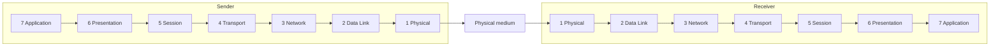

### Frame composition

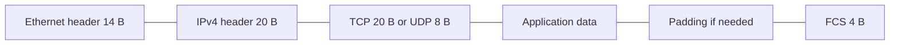

For ordinary untagged Ethernet II with no IPv4/TCP options, padding = max(0, 46 - (20 + transport header + payload)). Frame length = 14 + 20 + transport header + payload + padding + 4. The interactive calculator's static examples: 100 B TCP payload yields 158 B, UDP yields 146 B; a 1-byte TCP/UDP payload produces the 64-byte minimum MAC frame. Preamble/SFD/interframe gap excluded.
### Wireshark protocol tree (illustrative)

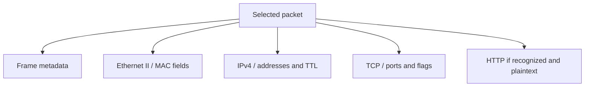

For actual software screenshots see [official Wireshark user guide](https://www.wireshark.org/docs/wsug_html/).

