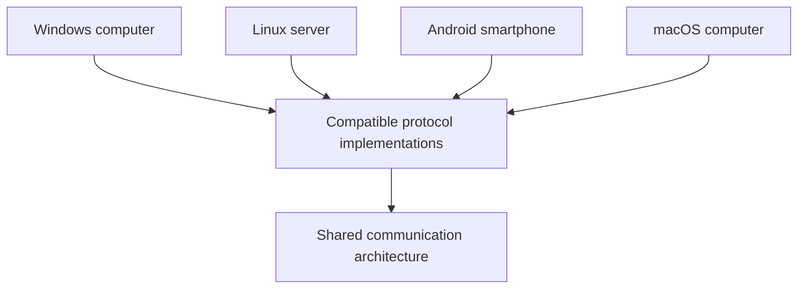
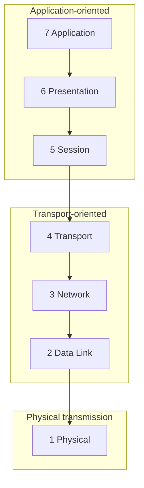
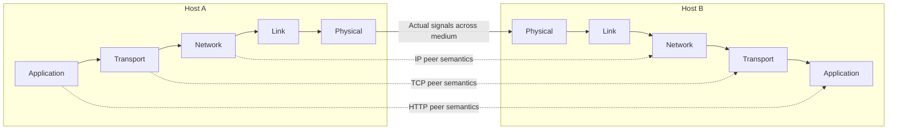
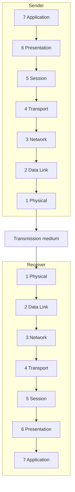
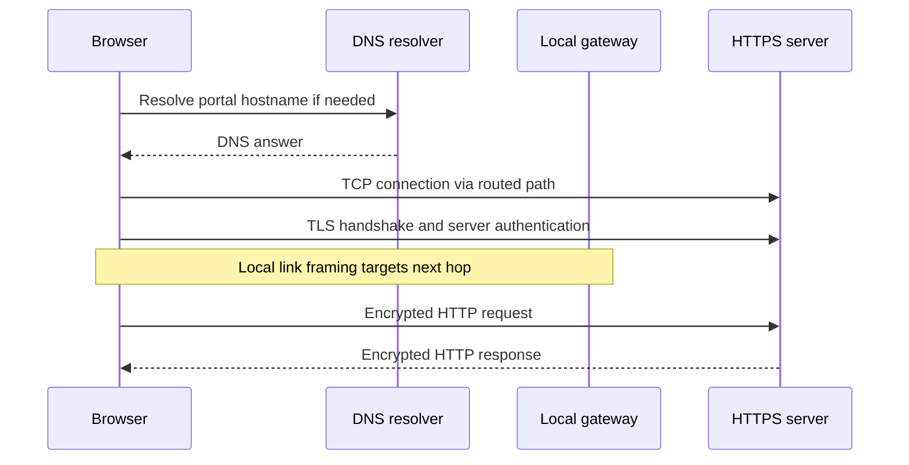
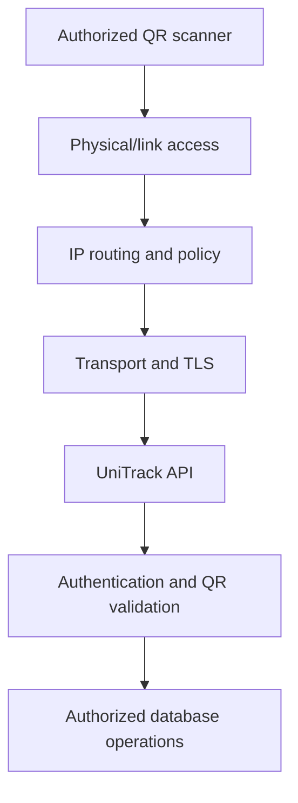
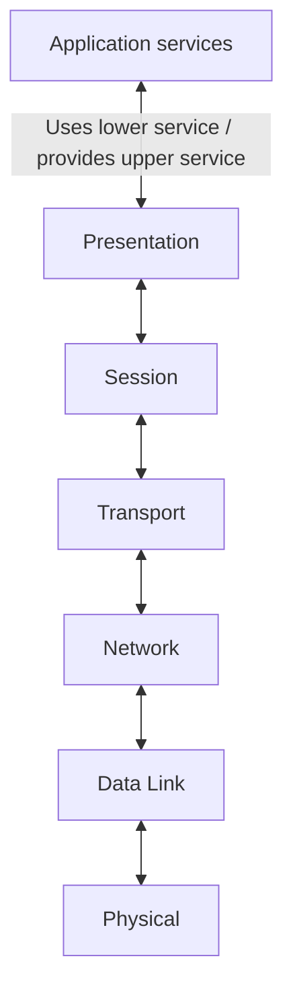
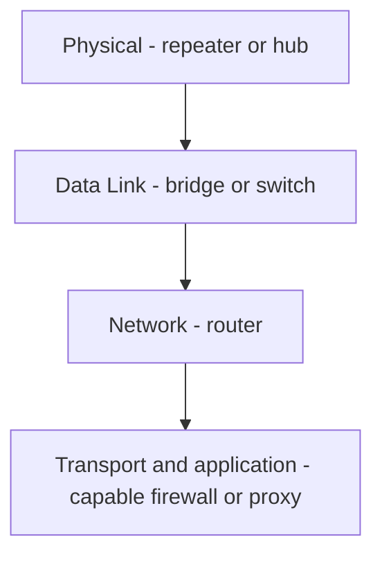

# Section 06 — The OSI Model

Source: full learner-supplied HTB Academy Section 6, [Introduction to Networking](https://academy.hackthebox.com/course/preview/introduction-to-networking). Independent English explanations, original diagrams, technical clarifications and practical reference examples. This section builds on [Section 5 — Networking Models](05-Networking-Models.md) rather than replacing it. No mandatory question or exercise appears in the supplied text; no reward or completion control was included in the pasted excerpt.

## 1. Purpose, interoperability and modularity

OSI means Open Systems Interconnection. ISO and ITU-T standardized the reference architecture (ITU-T X.200 / ISO/IEC 7498-1). Its goal is a common description of communication responsibilities and interfaces so diverse systems and technologies can interoperate when implementing compatible protocols. Different manufacturers, operating systems, applications and link media need not have identical internal implementation. A Windows laptop can communicate with a Linux server; Android and macOS clients can access the same HTTPS service. Standards, compatible protocol versions, configurations and security policies make interoperability possible; merely describing a system with the OSI model does not establish compatibility.



The model is conceptual, not a single program or a protocol suite that must be installed. TCP/IP is the deployed internet architecture; see Section 5 for approximate mapping. Layering supports modularity: a Wi-Fi link can replace Ethernet without requiring the HTTP application to change its protocol semantics, provided IP and other dependencies remain compatible. Protocol implementations may cross conceptual boundaries; not all modern traffic has seven independently implemented protocols or seven separate headers.

## 2. Layer classification

The lesson groups Layers 5–7 as application-oriented, Layers 2–4 as transport-oriented and Layer 1 as physical transmission. This is a useful teaching grouping; other references call Layers 1–4 lower layers.



| Layer | Primary function | Original example |
| --- | --- | --- |
| 7 Application | Network services used by applications | UniTrack receives HTTP request |
| 6 Presentation | Information representation and transformation | JSON serialization / UTF-8 encoding |
| 5 Session | Dialogue management and synchronization | Maintain communication state |
| 4 Transport | Transfer between application endpoints | TCP reliable ordered byte stream |
| 3 Network | Logical addressing and delivery across networks | Router forwards IPv4 packet |
| 2 Data Link | Frame delivery across local link | Switch forwards Ethernet frame |
| 1 Physical | Transmit signals representing bits | Light over optical fiber |

## 3. Detailed layer responsibilities and boundaries

### 7 — Application
Offers communication services to applications, not the entire user interface. HTTP provides request/response semantics; DNS resolves resource records; SMTP transfers mail; SSH provides secure remote access. Application behavior includes parsing, input validation, authentication and business authorization. A server may return 403 even if all lower layers function properly. Tools: [Burp Suite](Tools/20-Burp-Suite.md) and curl for authorized HTTP analysis. Security: prevent injection, broken access control, credential exposure; enforce application authorization, secure sessions and audit logging. Ports alone do not establish protocol identity.

### 6 — Presentation
Transforms system-dependent data into a representation peers can interpret. Encoding, serialization, compression, character representation and cryptographic transformations are common conceptual examples. UTF-8, JSON and Base64 illustrate representation; Base64 is not encryption. TLS cryptographic functions are frequently associated with presentation conceptually, but the real TCP/IP stack does not assign TLS neatly to a separate OSI layer. Malformed representations may lead to parsing bugs; use safe parsers, valid schemas, certificate verification and bounded decompression.

Original local Python example (reference only):
```python
import json
message = {"status": "ok", "count": 2}
encoded = json.dumps(message, separators=(",", ":")).encode("utf-8")
print(encoded)
print(len(encoded))
print(json.loads(encoded))
```
Illustrative expected output:
```text
b'{"status":"ok","count":2}'
25
{'status': 'ok', 'count': 2}
```
json.dumps serializes Python object into JSON text; separators removes optional spaces; encode converts Unicode text to UTF-8 bytes; len counts bytes here; loads parses JSON bytes. This example is synthetic, contains no private records, and was not executed by the learner. JSON is not encryption.

### 5 — Session
Establishes, coordinates, synchronizes and terminates logical dialogues. Conceptual session services may provide checkpoints or recovery according to the protocol. Layer 5 cannot guarantee that a link or connection never fails. Distinguish transport connection (TCP), cryptographic session (TLS) and application login session. A web cookie or login token is an application-layer construct in TCP/IP; it is a useful analogy for session management, not literally a standalone OSI session-layer protocol. A login session can span multiple TCP connections; a live TCP connection does not prove login authorization. Security: secure random session identifiers, rotation on privilege change, expiration, invalidation, secure cookie settings where applicable. UniTrack should enforce role authorization on every protected request and invalidate appropriate sessions after password change.

### 4 — Transport
Provides end-to-end communication between application endpoints; may segment streams, multiplex using ports and provide reliability/congestion management depending on protocol. TCP supplies ordered byte-stream delivery, sequence numbers, acknowledgments, retransmission, receiver flow control and congestion control. Flow control protects receiver capacity; congestion control adapts to network capacity. UDP supplies datagrams without built-in reliable ordering, retransmission or congestion control; UDP-based applications can implement these mechanisms. QUIC provides transport features over UDP. TCP is not encrypted by default. TCP segmentation is distinct from IP fragmentation; application message boundaries are not preserved by a TCP byte stream. A local listening port does not prove remote connectivity. [TCP, UDP and ICMP guide](Tools/31-TCP-UDP-ICMP.md).

### 3 — Network
Supports delivery between networks. In packet-switched IP networks, routers select outgoing next hops based on destination and routing policy, usually longest-prefix match. IP is best effort, not a guarantee of delivery or sender authenticity. Circuit-switched networks may establish a communication path before sending traffic; do not interpret ordinary IP forwarding as a dedicated circuit. IPv4/IPv6 address endpoints logically, and TTL/Hop Limit limits indefinite forwarding. Routers typically replace local link framing at each hop. NAT, proxies and tunnels may alter visible endpoints. Security: route integrity, segmentation, ingress/egress policy, anti-spoofing and monitoring.

### 2 — Data Link
Provides local-link framing, addressing and medium-access functions. Ethernet frames include destination/source MAC, type/length as appropriate, payload and FCS; 802.1Q tags may add metadata. FCS detects accidental corruption, not authenticity. Ethernet typically discards bad frames; Wi-Fi may retransmit using link-level acknowledgment mechanisms. Thus Layer 2 does not guarantee universally error-free delivery. Switches forward frames; VLANs separate broadcast domains, STP prevents forwarding loops. ARP resolves IPv4 next-hop link-layer addresses and is discussed at the Layer 2/3 boundary; IPv6 Neighbor Discovery uses ICMPv6. MAC addresses identify local interfaces; remote server MAC is not normally learned across a router. Security: secure switch management, approved port admission, appropriate VLAN isolation, protection against spoofing and loops.

### 1 — Physical
Transmits electrical, optical or electromagnetic signals over wired/wireless media. Defines physical signaling characteristics, connectors and transmission rates. Bits are represented through signaling; a symbol may represent multiple bits. Repeaters regenerate signals; traditional hubs repeat signals. Typical copper, fiber and radio are media, not application protocols. Security and reliability depend on physical access, cable quality, interference, independent redundant paths and power. A link-up indication is not proof of successful IP routing.

## 4. Neighboring-layer services and peer communication

A layer provides services to the layer above and uses services of the layer below. An interface is the local boundary/service contract between adjacent layers; a protocol specifies communication rules between peer entities on different systems. A service describes what a lower layer offers, without requiring the upper layer to know all implementation details. A protocol is how peers coordinate that service. Service Access Point (SAP) is a reference-model term for where a layer's service is accessed; TCP ports are a practical endpoint analogy, not identical to every OSI SAP. Service Data Unit (SDU) is upper-layer information supplied to a layer; Protocol Data Unit (PDU) is the unit exchanged logically with a peer layer, including its control information as applicable. A PDU can be split or combined by lower layers. API/socket calls are examples of local interfaces, not on-wire messages.



Horizontal dotted paths are conceptual protocol relationships, not independent physical cables. The actual information descends sender stack, crosses media/forwarding devices, and ascends receiver stack. Adjacent layer interactions are local. Example: browser uses a socket service; TCP peers exchange segments containing sequence information; IP offers best-effort packet delivery; Ethernet provides local framing. Changing the local link from Ethernet to Wi-Fi does not inherently require changing HTTP semantics. Some features span layers and middleboxes may process more than one layer.

## 5. Sender and receiver: encapsulation and decapsulation

The lesson describes all seven layers being traversed at sender and receiver (at least twice conceptually for one-way communication). The OSI model is a conceptual description, not a claim that every real system runs seven distinct protocols for each packet. A bidirectional exchange has processing in both directions. Intermediate devices may only process necessary layers (e.g. switch Layer 2, router Layer 3), while proxies and firewalls may inspect or terminate higher-layer communication.



| Sender processing | Receiver processing |
| --- | --- |
| Generates application message | Interprets application message |
| Converts/serializes representation | Parses/decodes representation |
| Maintains dialogue state as applicable | Associates information with relevant state |
| Transport adds control metadata and segments if applicable | Transport processes/reassembles content if applicable |
| Network adds logical addressing | Network checks destination and dispatches protocol |
| Link encapsulates network unit into frame | Link validates/decapsulates frame |
| Physical emits signals | Physical receives/interprets signals |

PDU names: application data; TCP segment or UDP datagram; IP packet/datagram; link frame; bits/signals. Encapsulation adds protocol-specific headers/trailers when required, not a universal header for every layer. See [Section 5](05-Networking-Models.md) for byte calculations, TCP handshake and Wireshark protocol tree.

## 6. End-to-end original example: HTTPS university portal

Assume illustrative client 192.0.2.10, remote server 198.51.100.20 (documentation addresses), local next hop 192.0.2.1, browser accessing a university portal. The example uses ordinary HTTPS over TCP, not HTTP/3.

1. Application: browser forms HTTP GET /portal with appropriate hostname and headers. DNS resolution may happen separately.
2. Presentation: data representation is encoded as needed; TLS protects HTTP data after authenticated handshake. TLS is not a literal separate OSI Layer 6 implementation.
3. Session: browser/application maintains relevant state, such as an existing authorized session; no secrets are shown.
4. Transport: TCP provides connection and ordered delivery, using an illustrative client ephemeral port 51514 and destination 443.
5. Network: IP uses logical source/destination addresses and routing; route selects local gateway.
6. Data Link: Ethernet or Wi-Fi carries packet to local next hop, not directly to remote MAC if off-link.
7. Physical: signals traverse local medium. Routers forward across additional links; each hop may reframe and decrement TTL/Hop Limit. Server processes signals and protocol units back up to application; response may return through a different route.



Logical arrows do not depict all physical routers. Server certificate validation is essential. HTTP/3 uses QUIC over UDP instead of TCP. Packet captures generally cannot show plaintext encrypted HTTP without an approved decryption context. A successful TLS handshake does not establish application authorization. No live requests were performed.

## 7. Reliability, security and performance across layers

| Layer | Reliability/performance concern | Security control |
| --- | --- | --- |
| 1 | Link quality, interference, power | Physical access, protected media |
| 2 | Frame errors, broadcast storms | Port controls, VLAN policy, STP |
| 3 | Route selection, path MTU | Routing policy, ACLs, anti-spoofing |
| 4 | Retransmission, receiver capacity, congestion | Restrict listeners, transport filtering |
| 5 | Dialogue recovery and state | Session management and invalidation |
| 6 | Encoding compatibility, cryptographic overhead | Safe parsing, modern TLS and validation |
| 7 | Server processing, request limits | Authentication, authorization, input validation |

Latency is delay, throughput is delivered data per time, bandwidth is link capacity, packet loss is missing packets relative to expected delivery. A bottleneck anywhere can affect application experience; TCP may reduce transmission rate during congestion. Security is defense in depth, not an automatic consequence of using the OSI model. Example: encrypted HTTPS over a working network may still expose data if the application fails to enforce authorization. Conversely, a legitimate 403 can mean a security control is working.

## 8. Layer-oriented troubleshooting and defensive methodology

Use evidence, not rigid OSI labels; symptoms can involve several layers. Establish authorization and affected scope, compare expected architecture and actual observations, begin at likely failure boundary, validate dependencies and document uncertainty. Never bypass authorization or disable certificate checks to make an error disappear.

| Symptom | Candidate layer / domain | Evidence to inspect |
| --- | --- | --- |
| Cable unplugged or interface down | 1 | Link status, approved physical check |
| Correct link but local next-hop unresolved | 2/3 boundary | Neighbor table, VLAN/ARP configuration |
| Destination route missing | 3 | Local IP prefix, routing table |
| Local service not listening | 4/application service | Local socket and service logs |
| HTTP server responds but user loses session | Application/session semantics | Session expiry, cookies and authorized account logs |
| Certificate mismatch | TLS / representation/security | Hostname, system time, certificate trust |
| HTTP 403 | 7 or intermediary policy | Authorization, WAF/proxy logs |
| HTTP 502 | Proxy/upstream relationship | Approved backend health and proxy logs |

No single symptom uniquely identifies a layer; a timeout may result from routing, filtering, transport, TLS or application delay. A missing ping reply is not proof a system is offline. Inspect local evidence first.

### Windows PowerShell — built-in, read-only
```powershell
Get-NetAdapter
Get-NetIPConfiguration
Get-NetNeighbor -AddressFamily IPv4
Get-NetRoute -AddressFamily IPv4
Get-NetTCPConnection -State Listen
```
Adapter state; IP/gateway/DNS; IPv4 neighbor mappings and state; IPv4 routes; local TCP listeners. AddressFamily filters version. A listener bound to 127.0.0.1 is local-only; firewall or routing may further restrict any listener. No external probing required.

### Ubuntu WSL2 — read-only
```bash
ip -br link
ip -br address
ip neigh
ip route
ss -lnt
```
-br produces brief output, link interface details, address IP assignments, neigh local neighbor table, route routes, ss lists sockets; -l listening, -n numeric, -t TCP. If local Flask application already runs, example output LISTEN 0 128 127.0.0.1:5000 0.0.0.0:* illustrates loopback-only TCP listener; actual output differs. WSL2 may show virtual interfaces and distinct routes rather than Windows host NICs. Do not publish raw private network or student data. See [Layered troubleshooting guide](Tools/33-OSI-Layered-Troubleshooting.md) and existing [Wireshark analysis guide](Tools/32-Packet-Encapsulation-Wireshark.md).

## 9. Original UniTrack and ProTrack-MX examples

UniTrack: QR scanner reaches authorized HTTPS API through local network and transport. Diagnose physical link, switch/VLAN, IP/gateway, backend listener, certificate, HTTP status, application authentication and QR validation. An invalid QR code should produce an intentional application-level denial, not be diagnosed as a transport failure. A server outage needs infrastructure and application logs; access-control fallback behavior requires institutional authorization and safety planning. These examples do not establish a vulnerability or actual deployment topology.



ProTrack-MX: connection to Supabase can be healthy while a request is rejected due to row-level security (RLS) or expired credentials. Separate DNS, routes, TLS and HTTP transport from JWT/session state and data authorization. WebSocket connections used by realtime features have application semantics and transport dependencies; reconnecting does not itself establish access permissions. Protect service-role credentials on trusted backend only, use authorized test accounts, avoid exposure of student records.

## 10. Official references and cross-links
- [ITU-T X.200 OSI reference model](https://www.itu.int/rec/T-REC-X.200/en)
- [RFC 1122 Internet host communication layers](https://www.rfc-editor.org/rfc/rfc1122)
- [TCP RFC 9293](https://www.rfc-editor.org/rfc/rfc9293), [UDP RFC 768](https://www.rfc-editor.org/rfc/rfc768)
- [IPv4 RFC 791](https://www.rfc-editor.org/rfc/rfc791), [IPv6 RFC 8200](https://www.rfc-editor.org/rfc/rfc8200)
- [HTTP semantics RFC 9110](https://www.rfc-editor.org/rfc/rfc9110), [TLS 1.3 RFC 8446](https://www.rfc-editor.org/rfc/rfc8446)
- [Python JSON documentation](https://docs.python.org/3/library/json.html)
- [Microsoft Get-NetAdapter](https://learn.microsoft.com/en-us/powershell/module/netadapter/get-netadapter), [WSL networking](https://learn.microsoft.com/en-us/windows/wsl/networking)
- [OSI/TCP-IP reference](Tools/30-OSI-TCP-IP-Models.md), [transport protocols](Tools/31-TCP-UDP-ICMP.md), [encapsulation and Wireshark](Tools/32-Packet-Encapsulation-Wireshark.md), [OSI layered troubleshooting](Tools/33-OSI-Layered-Troubleshooting.md).

## Verification
Full learner-supplied Section 6 text explained independently in English, including all layer functions, upper/lower grouping, adjacent layer services, conceptual peer communication, both endpoint stacks and security/reliability/performance. Added original diagrams, JSON example and layered diagnostics. No mandatory question or practical exercise shown; reward and Mark Complete control absent from supplied excerpt, not independently verified. Learner advanced beyond Section 5 without separate completion evidence. No new installation, command execution, capture or live test performed. Next: if Academy has Mark Complete & Next, use it and provide Section 7.

---

## Additional visual reference from the chat

### Service relationships and full peer model



The full endpoint diagram above and table preserve both states of the interactive sender/receiver demonstration. For each layer, process sender 7 to 1 and receiver 1 to 7. Dotted peer relationships are logical; actual transmission uses the medium.

### Infrastructure device visual key



This is a classification, not a required physical device chain. Multilayer devices span functions. For hardware photos consult manufacturer documentation and [IEEE Ethernet](https://www.ieee802.org/3/). The interactive diagnostic selector is preserved by the troubleshooting table above and the separate guide.

