# Section 07 — The TCP/IP Model

Source: full learner-supplied HTB Academy Section 7, [official module](https://academy.hackthebox.com/course/preview/introduction-to-networking). Independent English explanations, original examples and diagrams, technical clarifications, diagnostics and security considerations. No mandatory question or lab appears in the supplied section.

## 1. Purpose and architecture

TCP/IP means Transmission Control Protocol / Internet Protocol and is a family of interoperable protocols, often called the Internet Protocol Suite. UDP, ICMP, DNS, HTTP, DHCP and SSH are additional examples. TCP/IP enables compatible applications on different systems to communicate across interconnected networks, provided routing, addressing, protocol compatibility and policy permit. IP provides best-effort delivery, not a guarantee. TCP provides a reliable ordered byte stream while communication remains viable; permanent connectivity failure may prevent delivery. A TCP acknowledgment does not prove an application processed a request.

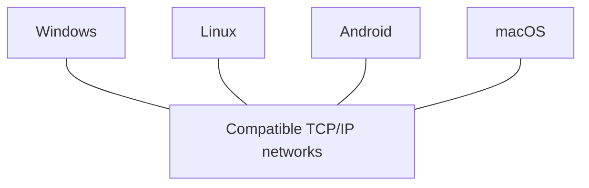

## 2. Four layers and comparison with OSI

| TCP/IP layer | Function | Approximate OSI mapping | PDU |
| --- | --- | --- | --- |
| 4 Application | Application communication and access to lower-layer services | 7 Application, 6 Presentation, 5 Session | Data/messages |
| 3 Transport | TCP connections/streams or UDP datagram services | 4 Transport | Segment/datagram |
| 2 Internet | IP addressing, packet packaging and forwarding | 3 Network | IP packet/datagram |
| 1 Link | Local medium access, link framing and transmission/reception | 2 Data Link, 1 Physical | Frame and signals |

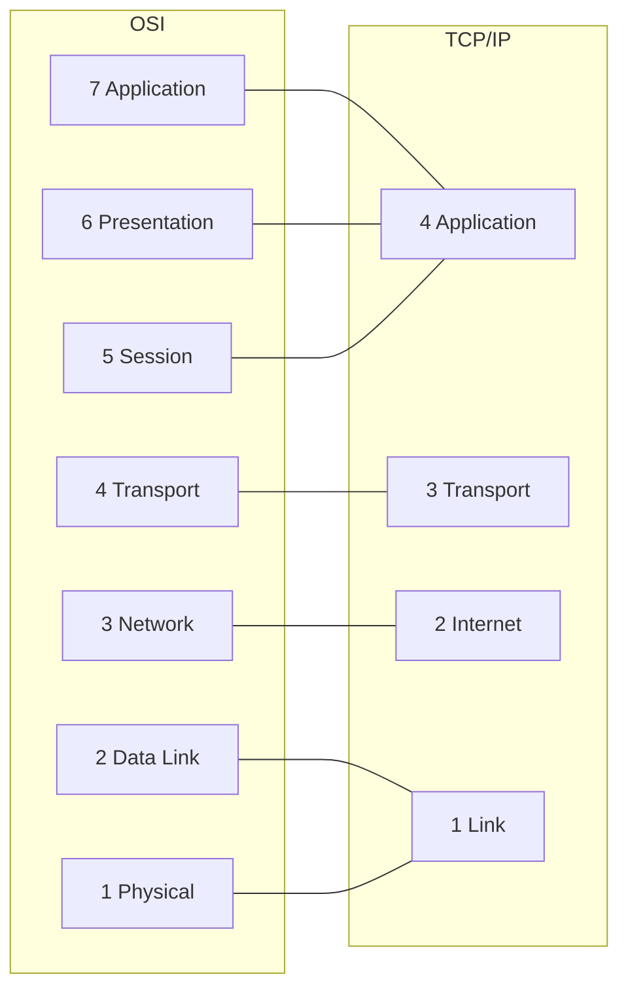

TCP is OSI Layer 4 but Layer 3 in the conventional numbered four-layer TCP/IP teaching model. IP is OSI Layer 3 but TCP/IP Layer 2 in this convention. Do not mix numbers without naming the model. Some textbooks split Link into Physical and Data Link for a five-layer representation. RFC 1122 covers link, internet and transport communication requirements; RFC 1123 covers application/support. The mapping is approximate; TLS and application sessions do not map perfectly onto separate OSI layers.

Application protocols define data exchanges and use transport services; TCP provides connections and UDP datagrams; the Internet layer delivers packets using logical addressing and forwarding; Link places packets onto and receives them from local media. IP can run over Ethernet, Wi-Fi, fiber-based links and other technologies. An application does not need to implement physical signal transmission. Different media still require compatible link-layer operation and suitable MTU.

## 3. Five core responsibilities

| Responsibility | Protocols/mechanisms | Explanation |
| --- | --- | --- |
| Logical addressing | IPv4, IPv6, CIDR, subnetting | Identify destination networks and interfaces |
| Routing | IP forwarding, static/dynamic routing | Select next hop using routes and policy |
| Error recovery and flow/congestion control | TCP | Sequence, acknowledge, retransmit and regulate data |
| Application support | TCP and UDP ports | Multiplex/demultiplex application endpoints |
| Name resolution | DNS | Resolve FQDNs into records, including IP addresses |

## 4. Logical addressing

IPv4 uses 32-bit addresses; IPv6 uses 128-bit addresses. A prefix identifies a network and determines which addresses belong to it. A host typically uses IP address, prefix length and default route; DHCP may supply these settings. Addressing is logical rather than a geographic coordinate.

Historical classful addressing:
| Class | First octet (historical) | Default mask | Typical historical role |
| --- | --- | --- | --- |
| A | 1–126 | /8 | Large unicast networks |
| B | 128–191 | /16 | Medium networks |
| C | 192–223 | /24 | Smaller networks |
| D | 224–239 | Not unicast mask | Multicast |
| E | 240–255 | Not unicast mask | Reserved/special purposes |

0 and 127 have special uses; classful addressing is obsolete for modern routing. Do not infer a modern subnet mask from first octet. CIDR (Classless Inter-Domain Routing) uses explicit prefix lengths, enabling flexible subnets and route aggregation. Subnetting divides a prefix into smaller networks; aggregation combines appropriately aligned contiguous prefixes into a shorter summary. RFC 1918 private ranges are 10/8, 172.16/12 and 192.168/16; not all non-private addresses are public. Documentation examples use RFC 5737 ranges.

Original worked example: 192.168.20.34/27.
- /27 mask = 255.255.255.224; host bits = 5; block size = 32.
- Address .34 belongs to block .32–.63.
- Network = 192.168.20.32; broadcast = 192.168.20.63.
- Conventional usable range = .33–.62, 30 hosts (32 total).
- .50 is on-link under this prefix; .70 is outside. Whether traffic is permitted is separate.
- /31 and /32 have special semantics; do not universally subtract two.

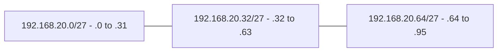
Blocks shown are a subset of a /24, not physical links.

Python standard-library example:
```python
import ipaddress
interface = ipaddress.ip_interface("192.168.20.34/27")
network = interface.network
print(network)
print(network.netmask)
print(network.broadcast_address)
print(network.num_addresses)
print(ipaddress.ip_address("192.168.20.50") in network)
```
Expected illustrative output: 192.168.20.32/27, 255.255.255.224, 192.168.20.63, 32, True (one per line). ip_interface accepts host address plus prefix; network calculates enclosing prefix; membership checks address range. No network request or new install. See [IPv4 addressing and CIDR guide](Tools/34-IPv4-CIDR-Routing.md).

## 5. Routing and forwarding

Routing is selecting/maintaining paths; forwarding is moving a packet to the selected next hop. Routers need not know a physical location or complete end-to-end path. They consult a routing/forwarding table. Routes may be connected, static, dynamically learned or default. Protocols such as OSPF and BGP distribute reachability information; IP carries packets. A default route 0.0.0.0/0 matches any IPv4 destination when no more-specific applicable route exists. IPv6 default is ::/0.

Illustrative routing table:
| Destination | Next hop | Interface |
| --- | --- | --- |
| 192.168.1.0/24 | Directly connected | eth0 |
| 10.0.0.0/8 | 192.168.1.1 | eth0 |
| 10.20.0.0/16 | 192.168.1.2 | eth0 |
| 10.20.30.0/24 | 192.168.1.3 | eth0 |
| 0.0.0.0/0 | 192.168.1.254 | eth0 |

Longest-prefix match chooses the most specific matching route under the applicable policy/table:
| Destination | Selected prefix | Next hop |
| --- | --- | --- |
| 10.20.30.50 | /24 | 192.168.1.3 |
| 10.20.99.5 | /16 | 192.168.1.2 |
| 10.99.1.5 | /8 | 192.168.1.1 |
| 192.168.1.80 | /24 connected | Direct link |
| 203.0.113.20 | /0 | 192.168.1.254 |

A /24 route is more specific than /16, /8 or /0. Among equally specific usable routes, policy and metric may matter; ECMP may distribute traffic. Policy routing and VPN routing can affect selection.

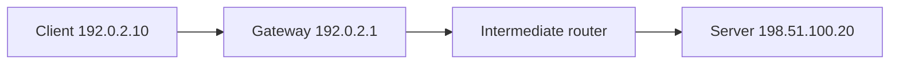
On local Ethernet, an off-link packet is placed in a frame addressed to the local gateway's MAC, not the remote server MAC. ARP resolves IPv4 next-hop address; IPv6 uses Neighbor Discovery. Routers rebuild local framing and decrement TTL/Hop Limit. IPv4 header checksum is updated as appropriate; ordinary routing preserves endpoints unless NAT or other intermediary behavior changes them. The return path may differ. IP packets may be dropped due to route absence, congestion, TTL expiry, MTU or policy; ICMP may report some errors but replies are not guaranteed. Security: segmentation, authorized route policy, anti-spoofing, route monitoring and approved firewall rules. A route does not grant authorization. See [BGP guide](Tools/06-BGP-FRRouting.md).

Read-only references:
```powershell
Get-NetRoute -AddressFamily IPv4
Find-NetRoute -RemoteIPAddress 203.0.113.20
```
```bash
ip route
ip route get 203.0.113.20
```
Find-NetRoute and ip route get inspect local route selection, not proof of reachable remote service. Example output: 203.0.113.20 via 192.168.1.254 dev eth0 src 192.168.1.50 (illustrative). WSL2 may use a different routing context from Windows.

## 6. TCP reliability, errors, flow and congestion

TCP establishes an ordinary connection using SYN, SYN-ACK, ACK; sequence numbers represent byte positions; cumulative acknowledgments report next expected byte. TCP checksum detects accidental corruption, not cryptographic authenticity. Loss can cause retransmission; duplicates are handled by sequence space. TCP uses timers and acknowledgment information, with optional mechanisms such as selective acknowledgment (SACK). A connection does not necessarily send constant control traffic when idle; TCP keepalive is optional and implementation/config dependent. Application heartbeats are distinct.

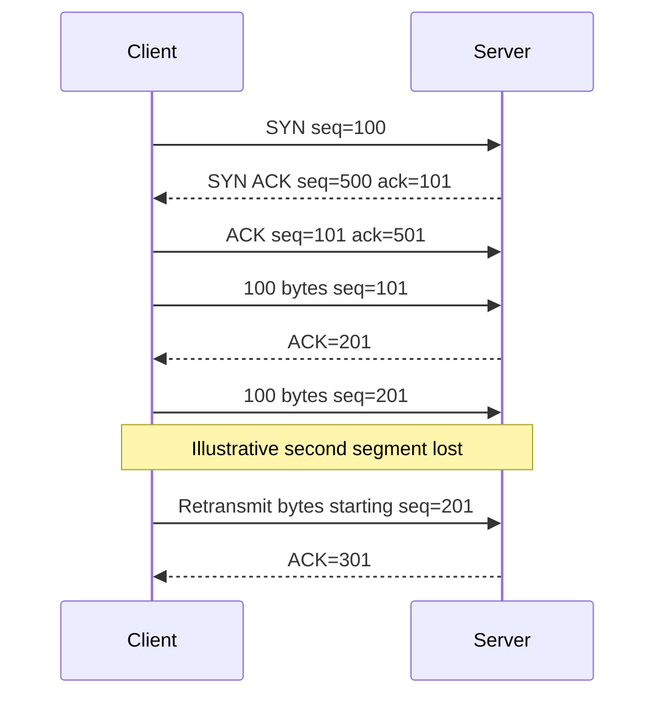
All sequence values fictional; SYN consumes one sequence number. Acknowledgments indicate transport receipt, not user action or application processing. Actual retransmissions depend on timers and algorithms. FIN can close one direction; RST resets connection.

| Mechanism | Purpose |
| --- | --- |
| Sequence numbers | Order and identify bytes |
| ACK | Acknowledge received contiguous bytes |
| Checksum | Detect accidental corruption |
| Retransmission | Recover from loss while connection remains viable |
| Flow control (receiver window / rwnd) | Avoid overwhelming receiver buffers |
| Congestion control (cwnd) | Adapt sending to network capacity |
| Keepalive | Optional idle connection probes |

Illustrative simplified sending limit = min(rwnd, cwnd), subject to other implementation limits and already outstanding bytes. If rwnd=16 KiB and cwnd=8 KiB, the smaller congestion window limits flight size to about 8 KiB; with rwnd=4 KiB and cwnd=16 KiB, receiver window limits it to about 4 KiB. UDP has no inherent equivalent reliable byte-stream, flow or congestion control; applications such as QUIC may implement their own. TCP reliability does not mean encrypted or authenticated payload; use TLS where appropriate. See [TCP/UDP/ICMP](Tools/31-TCP-UDP-ICMP.md) and new [TCP reliability and flow control](Tools/35-TCP-Reliability-Flow-Control.md).

## 7. Application support and ports

TCP and UDP provide separate 16-bit port spaces (0–65535); port 0 is reserved in ordinary service use. IANA ranges: system 0–1023, user 1024–49151, dynamic/private 49152–65535. Operating system ephemeral ranges can differ. Servers often listen on a known port; clients use ephemeral source ports. Five-tuple = source IP, source port, destination IP, destination port, transport protocol. Two clients (or multiple connections from same client) can reach same service using distinct tuples. Network namespaces/NAT can change observations.

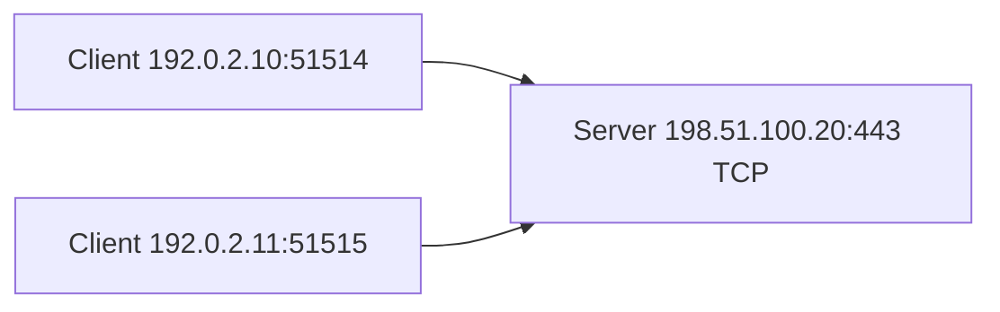

| Service | Conventional port/transport |
| --- | --- |
| SSH | TCP 22 |
| DNS | UDP/TCP 53 |
| HTTP | TCP 80 |
| HTTPS | TCP 443; HTTP/3 UDP 443 |
| SMTP | TCP 25 |
| DHCPv4 | UDP 67/68 |
| UniTrack development example | TCP 5000, configuration-specific |

A port number does not prove protocol identity. UDP 443 and TCP 443 are different endpoints. A listener bound to 127.0.0.1 is local only; 0.0.0.0 is a wildcard binding on applicable IPv4 interfaces, not a remote destination and not proof of public reachability. Protect unnecessary listeners, use authentication and firewall policy.

Windows local read-only:
```powershell
Get-NetTCPConnection -State Listen
Get-NetUDPEndpoint
```
Linux:
```bash
ss -lnt
ss -lnu
```
-l listening, -n numeric, -t TCP, -u UDP. Sample (not observed): LISTEN 0 128 127.0.0.1:5000 0.0.0.0:* indicates local TCP listener; peer wildcard for listening socket does not mean application is publicly exposed. No commands required.

## 8. DNS — Domain Name System

DNS is a distributed hierarchical naming system. FQDN (Fully Qualified Domain Name) identifies a name through the hierarchy; explicit trailing dot denotes DNS root, e.g. portal.example.com. DNS resolves records, not only IP addresses, and a name can return several addresses or none. DNS does not establish route availability or application authorization. A URL includes scheme, hostname, path and other optional components; FQDN is not entire URL.

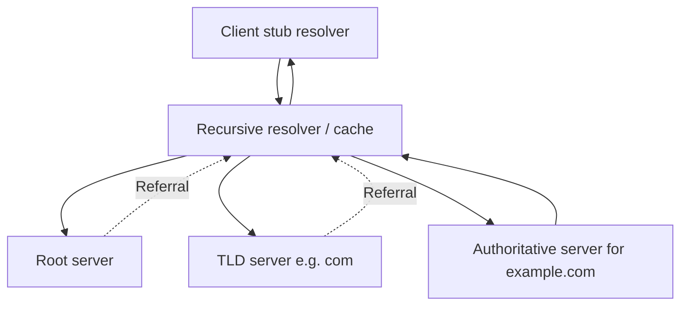
Conceptual cache-miss path: application/stub checks local configuration/cache, recursive resolver answers from cache or obtains referrals from root/TLD and queries authoritative servers. Resolver returns record or error and caches according to TTL/policy. Actual sequence varies; cached delegations can avoid root/TLD queries. DNS TTL measures cache lifetime, unlike IP TTL hop limit. TTL is seconds, not hop count.

| Record | Purpose | Illustrative value |
| --- | --- | --- |
| A | IPv4 | 192.0.2.25 |
| AAAA | IPv6 | 2001:db8::25 |
| CNAME | Alias to canonical name | app.example.com. |
| MX | Mail exchanger with preference | 10 mail.example.com. |
| TXT | Text/verification/policy | example verification text |
| NS | Authoritative nameserver | ns1.example.com. |
| PTR | Reverse lookup name | host.example.com. |
| SOA | Zone authority and administrative/timing metadata | primary server, serial, timers |

All values illustrative; example.com is reserved for examples and actual records differ. Traditional DNS often uses UDP 53, with TCP 53 also supported and used when appropriate. DoT commonly TCP 853, DoH HTTPS (often 443). DNSSEC validates signed DNS data origin/integrity under a configured chain of trust; it does not encrypt DNS queries. DoH/DoT encrypt transport to resolver, not necessarily validate DNSSEC or establish application security. Risks: spoofed or incorrect answers, misconfiguration, unauthorized resolvers, privacy leakage; defenses include approved resolver policies, DNSSEC validation, encrypted transport where appropriate, monitoring and TLS certificate validation.

Windows:
```powershell
Resolve-DnsName example.com -Type A
Resolve-DnsName example.com -Type AAAA
```
Linux:
```bash
getent ahosts example.com
dig example.com A
dig example.com AAAA
```
-Type selects record; getent uses system name service (may include non-DNS sources); dig asks configured DNS resolver unless otherwise specified. dig is supplied by dnsutils/bind9-dnsutils on Debian/Ubuntu depending on version. Optional installation reference sudo apt update; sudo apt install dnsutils. No install or DNS query required for this section. Illustrative dig answer: portal.example.com. 300 IN A 192.0.2.25. Owner name, TTL in seconds, IN internet class, type A, address. It is not an actual record. NXDOMAIN means queried name does not exist according to response; NOERROR with no relevant answer may indicate no record of that type; SERVFAIL indicates processing/resolution failure, not necessarily nonexistent domain. See [DNS resolution guide](Tools/36-DNS-Name-Resolution.md).

## 9. Complete original HTTPS example

Browser requests https://portal.example.com/students. DNS resolves hostname if needed; IP selects route; link layer delivers to next hop; TCP establishes connection (e.g. source 51514, destination 443); TLS authenticates server and protects HTTP; application parses response. HTTP/3 instead uses QUIC over UDP. These operations may be cached, reused or overlap, not a universal strict sequence.

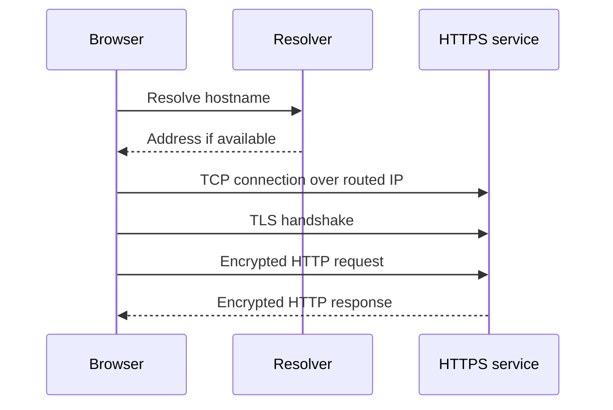
Physical and link mechanisms carry traffic throughout. DNS success does not prove TCP success; TCP success does not prove TLS trust; TLS success does not prove application authorization. A 403 from expected application may indicate intended access denial.

## 10. Security and project applications
UniTrack: proposed staff/scanner/student network segmentation and private backend. Use approved IP plan, route policies and DNS, expose only intended HTTPS endpoint, keep development listener private, enforce MFA, CSRF, QR validation and role permissions. Diagnose link, route, port, TLS and HTTP separately. ProTrack-MX: clients reach approved Supabase cloud DNS names via HTTPS, with authentication and RLS; correct DNS/port is not permission to access records. Realtime WebSocket sessions have transport and application dependencies. No actual deployment changes or vulnerabilities verified.

## Official references and guides
- [RFC 1122](https://www.rfc-editor.org/rfc/rfc1122), [RFC 1123](https://www.rfc-editor.org/rfc/rfc1123)
- [IPv4 RFC 791](https://www.rfc-editor.org/rfc/rfc791), [IPv6 RFC 8200](https://www.rfc-editor.org/rfc/rfc8200), [CIDR RFC 4632](https://www.rfc-editor.org/rfc/rfc4632), [RFC 1918](https://www.rfc-editor.org/rfc/rfc1918)
- [TCP RFC 9293](https://www.rfc-editor.org/rfc/rfc9293), [TCP congestion control RFC 5681](https://www.rfc-editor.org/rfc/rfc5681), [UDP RFC 768](https://www.rfc-editor.org/rfc/rfc768)
- [IANA port registry](https://www.iana.org/assignments/service-names-port-numbers/service-names-port-numbers.xhtml)
- [DNS RFC 1034](https://www.rfc-editor.org/rfc/rfc1034), [RFC 1035](https://www.rfc-editor.org/rfc/rfc1035), [DNS over TCP RFC 7766](https://www.rfc-editor.org/rfc/rfc7766), [DNSSEC RFC 4033](https://www.rfc-editor.org/rfc/rfc4033), [DoT RFC 7858](https://www.rfc-editor.org/rfc/rfc7858), [DoH RFC 8484](https://www.rfc-editor.org/rfc/rfc8484)
- [Python ipaddress](https://docs.python.org/3/library/ipaddress.html)
- [OSI/TCP-IP models](Tools/30-OSI-TCP-IP-Models.md), [TCP/UDP/ICMP](Tools/31-TCP-UDP-ICMP.md), [Network diagnostics](Tools/01-Network-Diagnostics.md)
- [IPv4 CIDR and routing](Tools/34-IPv4-CIDR-Routing.md), [TCP reliability and flow control](Tools/35-TCP-Reliability-Flow-Control.md), [DNS name resolution](Tools/36-DNS-Name-Resolution.md).

## Verification
Full learner-supplied Section 7 content independently documented in English with original diagrams, all five tasks, corrections, worked CIDR and routing examples, TCP sequence/control examples, port multiplexing and DNS resolution, plus three new technical guides. No mandatory question or exercise; +10 displayed not confirmed earned. Learner advanced beyond Section 6 without separate completion evidence. No installations, commands, queries or live tests performed. Next: Mark Complete & Next and provide Section 8.

---

## Additional visual reference from the chat

### UniTrack communication architecture

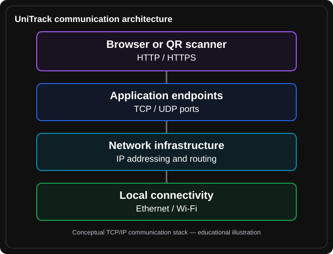

Original SVG recreated from the chat illustration, with the same four blocks and labels. Conceptual TCP/IP architecture, not a verified deployment.


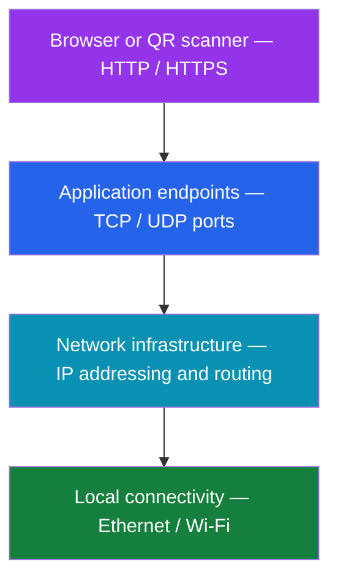

### CIDR binary visualization
```text
192      168      20       34
11000000 10101000 00010100 001|00010
<--------- 27 network bits -------->|5 host bits
```
The first 27 bits are network prefix; the last 5 are host bits. Interactive calculator rules: total = 2^(32-prefix), conventional usable = total-2 for /0–/30; /31 point-to-point and /32 individual addresses differ.
### Routing and TCP interactive states
The longest-prefix table above preserves all four destination examples. The interactive window model uses min(rwnd,cwnd): (16,8) KiB -> 8 KiB; (4,16) KiB -> 4 KiB; (16,16) KiB -> 16 KiB. Actual outstanding data and implementation limits matter.
### URL and FQDN visual breakdown
```text
https://  portal.example.com  /students
scheme    FQDN (hostname)    path
          portal | example | com
          label    domain    TLD
```
A trailing dot denotes the DNS root. DNS queries concern names, not the URL path.

## Original visual atlas and interactive learning companion

[Open full-size SVG atlas](Assets/07-The-TCP-IP-Model-Visual-Atlas.svg) — 11 labeled original illustrations with explanatory captions. The atlas supplements the detailed lesson above, rather than replacing it.

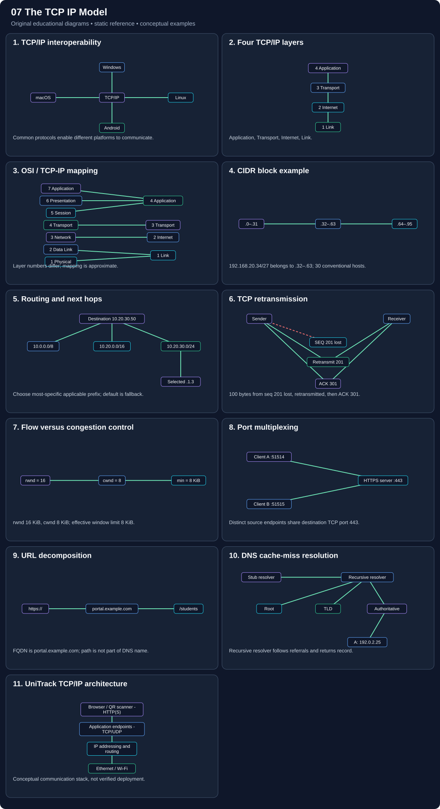

[Complete visual library](Assets/README.md). [Download offline interactive companion](Assets/Networking-Interactive-Companion.html) and open in a browser; relevant demonstrations: cidr, routes, windows. GitHub does not execute scripts in the file preview.

