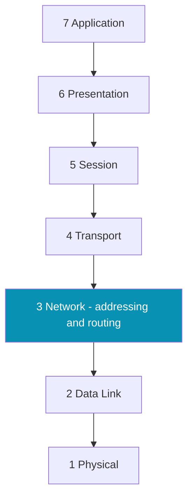
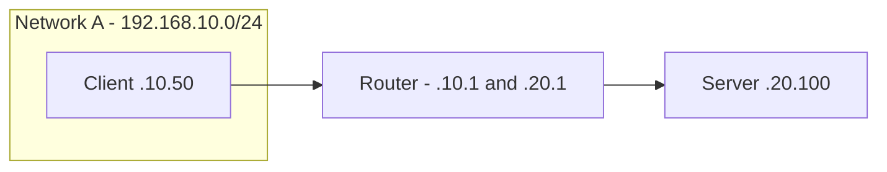
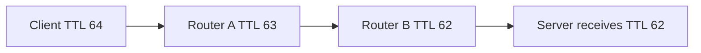
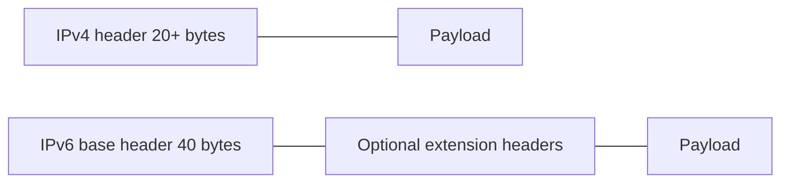
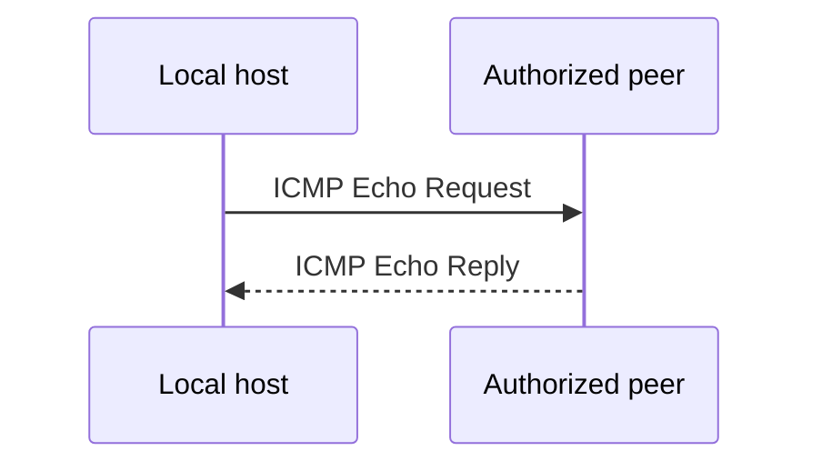
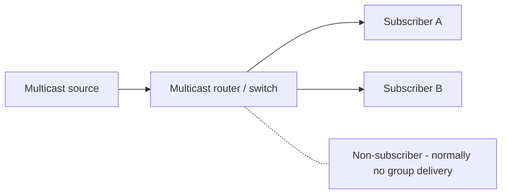
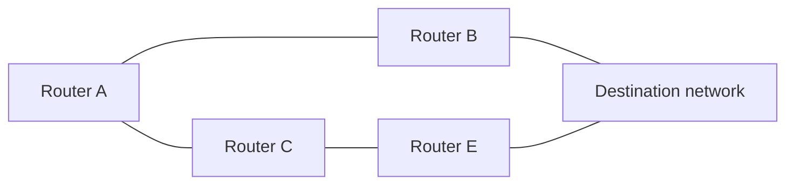
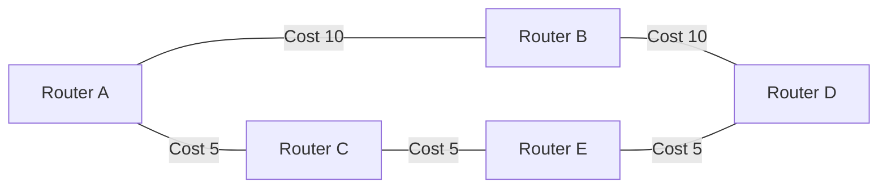
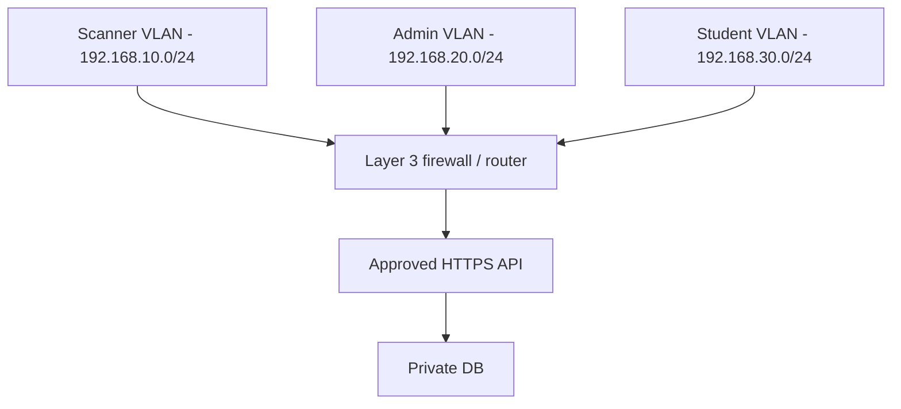
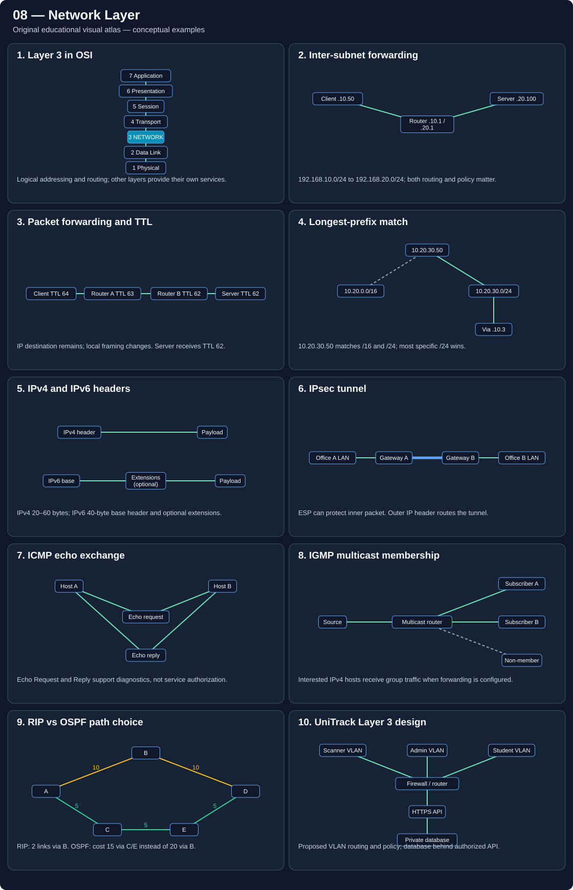

# Section 08 — Network Layer

Source: learner-supplied HTB Academy Section 8, [official module](https://academy.hackthebox.com/course/preview/introduction-to-networking). Original expanded explanations, visual frames, worked examples and security references. Source concepts are distinguished from technical clarifications and additional learning material. No mandatory question or lab; +10 displayed.

## 1. Layer 3 and its responsibilities

Layer 3 of OSI corresponds approximately to the Internet layer of TCP/IP. Its principal responsibilities in this lesson are logical addressing and routing. It allows packets to traverse interconnected subnets through forwarding nodes (routers). Same-link hosts can normally communicate directly; a router is not needed for every IP packet. IP is connectionless and best effort, not a dedicated circuit or a delivery guarantee. Circuit-switched and other network technologies may implement connection-oriented services. Ordinary routers need not process application payloads; firewalls, proxies and other multilayer devices may inspect higher layers. Protocol layering is a conceptual separation: some protocols cross boundaries. RIP supports routing but uses UDP, for instance.



## 2. Logical addressing and cross-subnet communication

IPv4 addresses contain 32 bits; IPv6 addresses contain 128 bits. A prefix identifies the network portion. Same-subnet decisions depend on configured address and routing policy, not simply the first three octets. See [CIDR guide](Tools/34-IPv4-CIDR-Routing.md).

| Property | Client | Server |
|---|---|---|
| IPv4 | 192.168.10.50 | 192.168.20.100 |
| Mask | 255.255.255.0 | 255.255.255.0 |
| Network | 192.168.10.0/24 | 192.168.20.0/24 |
| Gateway | 192.168.10.1 | 192.168.20.1 |



Client recognizes off-link destination and consults its route table; Ethernet frame targets local gateway MAC, IP packet targets remote server. The router examines destination and selects next hop. Return route and firewall permissions also matter. Example addresses are fictional, not actual university network data.

## 3. Router forwarding and TTL

Typical forwarding: process incoming link framing, examine IP destination, select applicable route, decrement TTL (IPv4) or Hop Limit (IPv6), construct outgoing link framing. IPv4 header checksum is updated when TTL changes. IPv6 base header has no checksum. IP addresses usually persist during ordinary routing; NAT and tunnels may change or add addresses. Local MAC addresses change across Ethernet links. Router processing is not equivalent to application authorization.



| Step | Position | TTL after processing |
|---|---|---:|
| 0 | Client constructs packet | 64 |
| 1 | Router A forwards | 63 |
| 2 | Router B forwards | 62 |
| 3 | Destination receives | 62 |

When a router would reduce TTL/Hop Limit to zero, it discards the packet and normally generates an appropriate ICMP Time Exceeded message (subject to protocol rules and filtering). This limits routing loops. A host receiving a packet as its final destination does not decrement it as a forwarding hop. A simplified initial TTL 1 packet cannot traverse the first router. Traceroute uses varying TTL/Hop Limit to infer intermediate hops; responses can be missing or asymmetric.

| Header information | Ordinary router behavior |
|---|---|
| Source/destination IP | Normally retained |
| Link source/destination MAC | Rebuilt for outgoing Ethernet link |
| IPv4 TTL / IPv6 Hop Limit | Decremented on forwarding |
| IPv4 header checksum | Updated as needed |
| Transport ports and payload | Normally unchanged |

## 4. Routing tables, routing vs forwarding

Routing is building/selecting paths; forwarding is moving a specific packet. Control plane learns reachability and installs routes; data plane uses forwarding information. RIB (routing information base) contains routing information; FIB (forwarding information base) contains selected forwarding entries. Connected, static, default and dynamically learned routes are common. Longest-prefix match selects most specific applicable destination; equal-prefix selection can depend on policy, route preference, metric and ECMP. Route selection by preference/metric is distinct from packet lookup. Default IPv4 route 0.0.0.0/0; IPv6 ::/0.

| Destination | Next hop/interface |
|---|---|
| 192.168.10.0/24 | Direct eth0 |
| 192.168.20.0/24 | Direct eth1 |
| 10.20.0.0/16 | 192.168.10.2 |
| 10.20.30.0/24 | 192.168.10.3 |
| 0.0.0.0/0 | 192.168.10.254 |

10.20.30.50 selects /24; 10.20.99.5 selects /16; 203.0.113.20 selects default in this table. A route does not guarantee actual reachability or access. IPv4 and IPv6 are different protocol versions: IPv4-only and IPv6-only hosts cannot directly exchange ordinary IP traffic without an appropriate mechanism (e.g. dual stack or configured translation such as NAT64/DNS64). Different IPv4 prefixes can be routed normally.

## 5. Protocol reference

| Protocol | Full name | Role | Encapsulation / conventional identifier |
|---|---|---|---|
| IPv4 / IPv6 | Internet Protocol | Addressing and packet delivery | Ethernet EtherType 0x0800 / 0x86DD |
| IPsec | Internet Protocol Security | IP-layer security | ESP IP protocol 50; AH 51; IKE commonly UDP 500/4500 |
| ICMP | Internet Control Message Protocol | Errors and diagnostics | ICMPv4 IP protocol 1; ICMPv6 58 |
| IGMP | Internet Group Management Protocol | IPv4 multicast membership | IP protocol 2 |
| RIP | Routing Information Protocol | Distance-vector routing | RIPv2 UDP 520; RIPng UDP 521 |
| OSPF | Open Shortest Path First | Link-state routing | IP protocol 89 |

IP protocol numbers are not TCP/UDP ports. Ethernet EtherTypes are separate identifiers too. The routing role of RIP does not imply it runs directly in IP.

### 5.1 IPv4 and IPv6
IPv4 minimum header 20 bytes (with options up to 60). IPv6 base header 40 bytes and optional extension headers. IPv4 uses TTL; IPv6 Hop Limit. IPv4 header checksum only covers header; IPv6 no base-header checksum. IPv4 routers may fragment when permitted; IPv6 routers do not fragment, instead report Packet Too Big; source fragmentation may occur. IPv4 has broadcast; IPv6 uses multicast instead of broadcast. ARP resolves local IPv4 next-hop MAC; IPv6 uses Neighbor Discovery via ICMPv6. Neither IP version inherently guarantees encryption or delivery.

Documentation examples: 192.0.2.10 and 2001:db8::10. [IPv6 guide](Tools/37-IPv6-Network-Layer.md).

### 5.2 IPsec
A family of mechanisms protecting IP traffic. ESP can provide confidentiality, integrity/authentication and anti-replay according to selected security association; AH provides integrity/authentication, not confidentiality. IKEv2 negotiates security associations and keys. Transport mode protects upper-layer payload (AH/ESP coverage differs); tunnel mode protects inner IP packet within new outer IP header. A site-to-site VPN can use IPsec tunnel mode. Encryption does not remove the need for authorization, secure keys and approved routing. NAT traversal often encapsulates ESP in UDP 4500; not every IPsec deployment has the same ports or modes.

```text
Transport mode (ESP, simplified): [IP header][ESP header][protected transport + data][ESP trailer/authentication as configured]
Tunnel mode (ESP, simplified): [Outer IP header][ESP header][protected inner IP packet][ESP trailer/authentication as configured]
```
[IPsec guide](Tools/38-IPsec.md).

### 5.3 ICMP
ICMP reports errors and supports diagnostics. Echo request/reply underlie ping; Time Exceeded supports traceroute; Destination Unreachable indicates delivery/forwarding problems. ICMPv6 is essential to Neighbor Discovery and Path MTU Discovery. ICMP is not TCP or UDP and has no TCP/UDP ports. ICMPv4 echo type 8/reply 0; ICMPv6 echo 128/129. Time Exceeded v4 type 11/v6 type 3. Packet Too Big v6 type 2; IPv4 fragmentation-needed is type 3 code 4. No reply does not prove host offline. Do not indiscriminately block all ICMP.

Read-only/local diagnostic references: Windows ping -n 4 127.0.0.1; Linux ping -c 4 127.0.0.1. -n/-c specify count on respective platforms. Loopback does not test physical network. Windows tracert and Linux traceroute are references for approved destinations only, not required today. [Existing ICMP guide](Tools/31-TCP-UDP-ICMP.md).

### 5.4 IGMP
Internet Group Management Protocol communicates IPv4 multicast interest between hosts and neighboring multicast routers. A host joins a multicast group; routers learn memberships; multicast routing protocols handle forwarding between networks; IGMP snooping switches can limit local multicast delivery. IGMP is not a general multicast routing protocol. IPv4 multicast 224.0.0.0/4; example administratively scoped group 239.10.10.10. IPv6 uses Multicast Listener Discovery (MLD), not IGMP. IGMPv3 adds source filtering. RFC 9776 (March 2025) obsoletes RFC 3376; use current standard reference.

Unicast one-to-one, broadcast one-to-local-domain (IPv4), multicast one-to-interested group. Actual forwarding depends on configuration. Risks: unwanted multicast flooding or membership misuse. Monitor membership, use appropriate snooping/querier settings and restrict unneeded multicast across zones. [IGMP guide](Tools/39-IGMP-Multicast.md).

### 5.5 RIP
Routing Information Protocol is a distance-vector IGP (Interior Gateway Protocol). Routers exchange reachability with neighbors; metric is hop count, maximum usable 15; 16 represents unreachable. RIPv2 supports CIDR/masks; RIPng supports IPv6. Periodic updates typically 30 seconds; triggered updates may occur. RIPv2 UDP 520; RIPng UDP 521. Split horizon/poison reverse and timers help limit loops, not a guarantee of instantaneous convergence. Small networks or legacy deployments; less suitable for complex modern enterprise topology.

Illustrative route alternatives: 2 hops versus 3, RIP selects smaller metric, independent of link speed. Use controlled routing interfaces and supported authentication; do not expose updates to untrusted hosts. [RIP guide](Tools/40-RIP.md).

### 5.6 OSPF
Open Shortest Path First is a link-state IGP. Routers discover neighbors using Hello messages, form appropriate adjacencies, exchange LSAs (Link State Advertisements), build a link-state database and run SPF (Shortest Path First, Dijkstra algorithm) to calculate paths. OSPF uses IP protocol 89, not a TCP/UDP port. OSPFv2 primarily IPv4; OSPFv3 introduced IPv6 and has extensions for additional address families. Area 0 is backbone for standard multi-area designs. Path cost sums configured interface costs, not simply hop count. Cost often derived from bandwidth/reference bandwidth but configuration varies.

Path A-B-D cost 20 (2 links); A-C-E-D cost 15 (3 links). In this fictional graph OSPF selects cost 15 while RIP's hop-count preference favors 2 hops. Actual routes include network/interface cost and protocol policy. Secure neighbor relationships, authentication where supported, passive interfaces where appropriate and control-plane monitoring. [OSPF guide](Tools/41-OSPF.md).

## 6. RIP versus OSPF

| Feature | RIP | OSPF |
|---|---|---|
| Algorithm | Distance vector | Link state / SPF |
| Metric | Hop count | Sum of costs |
| Maximum hop metric | 15 usable, 16 unreachable | No RIP-style 15-hop limit |
| Transport | UDP 520 (v2) | IP 89 |
| Updates | Periodic and triggered | LSA flooding, refresh and topology changes |
| Hierarchy | Limited | Areas, backbone area 0 |
| Typical use | Small/legacy | Enterprise and larger routed networks |

Convergence depends on configuration/topology; OSPF often converges faster but no absolute guarantee. Both are routing control-plane protocols, not encryption or firewall systems.

## 7. Windows/WSL diagnostics (reference only)

```powershell
Get-NetIPConfiguration
Get-NetRoute -AddressFamily IPv4
Get-NetRoute -AddressFamily IPv6
Find-NetRoute -RemoteIPAddress 203.0.113.20
Get-NetNeighbor -AddressFamily IPv4
```
Get-NetIPConfiguration shows IP/gateway/DNS; Get-NetRoute shows configured routes; Find-NetRoute selects local route and source for a destination (no probe); Get-NetNeighbor shows IPv4 neighbor entries. Windows loopback ping: ping -n 4 127.0.0.1. Tracert reference for approved targets: tracert -d <authorized-host> (-d skips reverse lookup).

```bash
ip -br address
ip -4 route
ip -6 route
ip route get 203.0.113.20
ip neigh
ip maddr show
```
-br compact; -4/-6 filter address family; route get computes local routing decision; neigh shows local neighbor table; maddr shows interface multicast addresses, not full multicast routing state. Example output (fictional): 203.0.113.20 via 192.168.10.254 dev eth0 src 192.168.10.50. Destination uses gateway .254 on eth0 and chosen source .50. iproute2 is free/open-source and typically installed on Linux; if missing use sudo apt install iproute2 in an approved Ubuntu environment. Linux loopback ping: ping -c 4 127.0.0.1. traceroute -n <authorized-host> skips name resolution; optional package traceroute. WSL2 networking can differ from Windows host. No commands required.

Wireshark offline display filters: ip, ipv6, icmp, icmpv6, igmp, rip, ospf, esp, ah, udp.port == 500 || udp.port == 4500. Protocol dissection depends on capture content; encrypted payload remains protected. Use approved files only; no capture performed. [Wireshark guide](Tools/32-Packet-Encapsulation-Wireshark.md).

## 8. Security and project applications

Logical addressing alone is not identity authentication. Route existence does not grant access. Defenses: segmentation, approved inter-subnet ACL/firewall, ingress anti-spoofing, authenticated/controlled routing where supported, monitoring route changes, appropriate ICMP treatment, IPsec key management and application authorization.


UniTrack conceptual network: scanner, admin and student VLANs use policy-controlled routing to approved API; database accessible only by authorized backend. Routing alone does not enforce roles; authentication, MFA, CSRF, QR validation and audit still matter. ProTrack-MX: clients route to approved HTTPS cloud endpoints; DNS/route/transport success does not prove authorization. Supabase RLS and credential protection remain necessary. No actual network architecture, vulnerability or deployment change verified.

## 9. Visual assets and interactive example



[Full-size original visual atlas](Assets/08-Network-Layer-Visual-Atlas.svg) — 10 labeled illustrations. [Offline Layer 3 simulator](Assets/08-Network-Layer-Interactive.html) recreates the packet forwarding/TTL demonstration and path selection comparison. Download and open locally; GitHub Markdown does not execute HTML scripts. No network activity. Static representative states: TTL 64 -> 63 -> 62 -> received 62; TTL 1 -> expired at first router. RIP 2 hops vs OSPF cost 15 (3 links). These are conceptual examples, not measured network output.

## 10. Official references
- [IPv4 RFC 791](https://www.rfc-editor.org/rfc/rfc791), [IPv6 RFC 8200](https://www.rfc-editor.org/rfc/rfc8200), [Router requirements RFC 1812](https://www.rfc-editor.org/rfc/rfc1812)
- [IPsec RFC 4301](https://www.rfc-editor.org/rfc/rfc4301), [ESP RFC 4303](https://www.rfc-editor.org/rfc/rfc4303), [AH RFC 4302](https://www.rfc-editor.org/rfc/rfc4302), [IKEv2 RFC 7296](https://www.rfc-editor.org/rfc/rfc7296)
- [ICMPv4 RFC 792](https://www.rfc-editor.org/rfc/rfc792), [ICMPv6 RFC 4443](https://www.rfc-editor.org/rfc/rfc4443), [IGMPv3 RFC 9776](https://www.rfc-editor.org/rfc/rfc9776)
- [RIPv2 RFC 2453](https://www.rfc-editor.org/rfc/rfc2453), [RIPng RFC 2080](https://www.rfc-editor.org/rfc/rfc2080), [OSPFv2 RFC 2328](https://www.rfc-editor.org/rfc/rfc2328), [OSPFv3 RFC 5340](https://www.rfc-editor.org/rfc/rfc5340)
- [IANA protocol numbers](https://www.iana.org/assignments/protocol-numbers/protocol-numbers.xhtml)
- [FRRouting documentation](https://docs.frrouting.org/), [strongSwan documentation](https://docs.strongswan.org/), [Wireshark](https://www.wireshark.org/download.html)

## 11. Individual guides
- [IPv6 and Layer 3](Tools/37-IPv6-Network-Layer.md)
- [IPsec](Tools/38-IPsec.md)
- [IGMP and multicast](Tools/39-IGMP-Multicast.md)
- [RIP](Tools/40-RIP.md)
- [OSPF](Tools/41-OSPF.md)
- Existing [CIDR and routing](Tools/34-IPv4-CIDR-Routing.md), [TCP/UDP/ICMP](Tools/31-TCP-UDP-ICMP.md), [BGP and FRRouting](Tools/06-BGP-FRRouting.md).

## Verification
Full supplied lesson plus independent technical expansion; no mandatory questions or required exercises. +10 displayed, not confirmed earned. Learner advanced to Section 8 without separately confirming Section 7 completion. No installs, live commands or tests performed. Next: Mark Complete & Next; provide Section 9.
