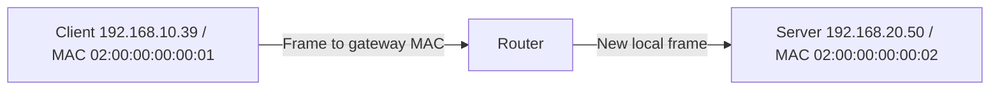
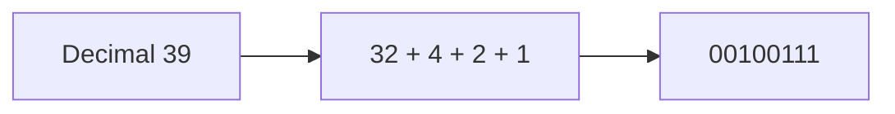
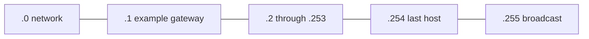
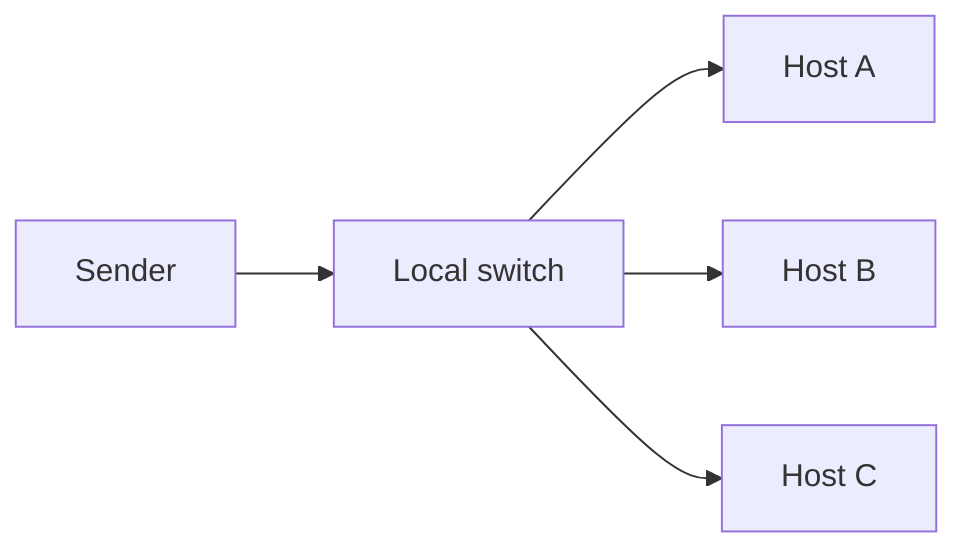
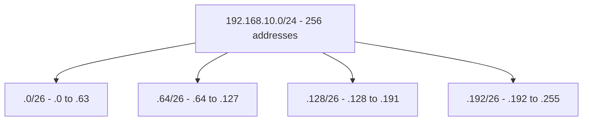
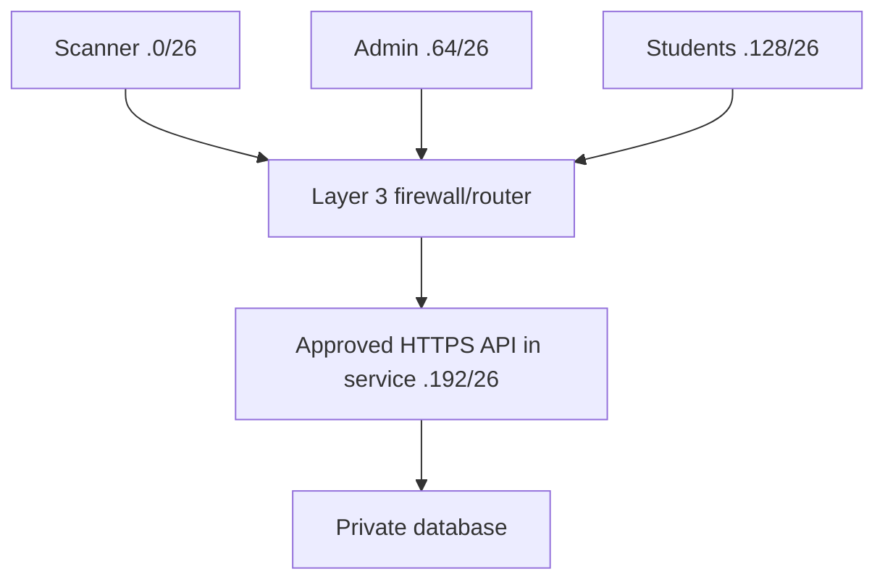
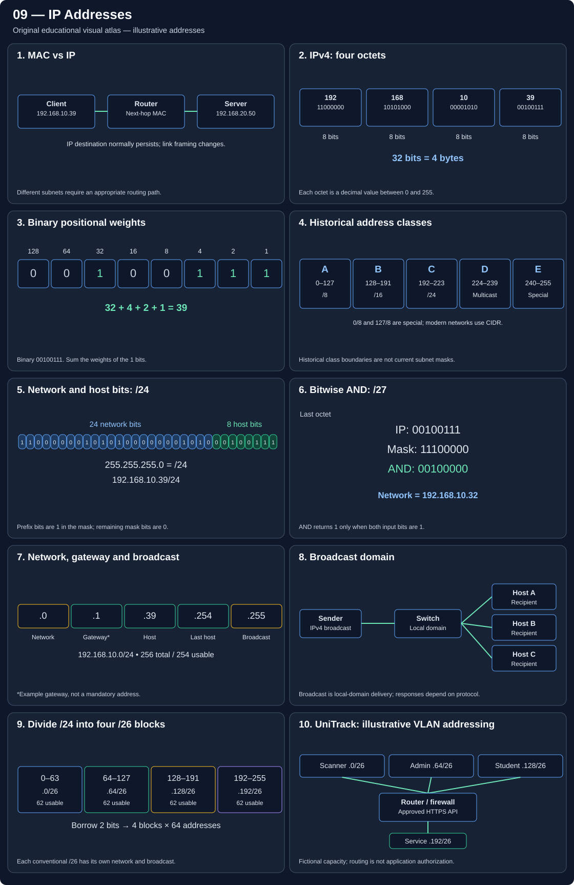

# Section 09 — IP Addresses

Source: learner-supplied HTB Academy Section 9, [official course](https://academy.hackthebox.com/course/preview/introduction-to-networking). Independent English explanations cover all supplied topics; corrections and original supplemental examples are explicitly identified. No mandatory question or lab appears; +10 displayed.

## 1. MAC and IP addresses

MAC (Media Access Control) addresses typically identify link-layer interfaces (48-bit Ethernet MACs); IP addresses identify logical network interfaces or destinations (32-bit IPv4, 128-bit IPv6). The supplied lesson uses a postal/building/apartment analogy. It is helpful for local vs routed delivery, but MAC is not a physical apartment or permanent identity. MAC addresses can be randomized or administratively changed. A remote host's MAC is generally not needed for ordinary routed delivery: the sender uses its local gateway MAC for off-link destinations. Routers rebuild local link framing and retain ordinary end-to-end IP destination unless a middlebox modifies it. IP is best effort, not a delivery guarantee. A device can have several addresses; multiple devices may intentionally receive multicast/broadcast or use anycast; duplicate ordinary unicast assignments in the same addressing context can cause conflicts. Private address space can be reused on separate networks.

| Feature | MAC | IP |
|---|---|---|
| OSI layer | 2 | 3 |
| Typical length | 48 bits | 32 IPv4 / 128 IPv6 |
| Scope | Local link | Logical routed networks |
| Example | 02:00:00:00:00:01 | 192.168.10.39 |
| Can change | Yes | Yes |


Addresses are fictional; same-link IPv4 next-hop resolution uses ARP, IPv6 Neighbor Discovery.

## 2. IPv4 structure

IPv4 = 32 bits = 4 octets = 4 bytes. Each octet has 8 bits and 256 possible values, 0–255. Dotted decimal renders each octet separately. Total bit patterns 2^32 = 4,294,967,296, not all assignable publicly.

| Octet | Decimal | Binary |
|---|---:|---|
| 1 | 192 | 11000000 |
| 2 | 168 | 10101000 |
| 3 | 10 | 00001010 |
| 4 | 39 | 00100111 |

```text
192       168       10        39
11000000 .10101000 .00001010 .00100111
 8 bits    8 bits    8 bits    8 bits
```

127.0.0.1 = 01111111.00000000.00000000.00000001; loopback block 127.0.0.0/8. UniTrack local development example http://127.0.0.1:5000 — local IP and TCP service port; loopback does not test a physical interface or remote accessibility. A network interface may have multiple IPs, and not all interfaces have an assigned IP. IP addresses are normally set by static configuration, DHCP or other address configuration mechanisms. Administrators plan subnets and host assignments; IANA coordinates global number resources via RIRs, which distribute allocations to network operators/registries. Home routers often provide DHCP and assign addresses from a configured pool; a router need not assign the host part itself. [IANA number resources](https://www.iana.org/numbers).

## 3. Binary positional values and conversions

Binary digits have values 0 or 1. The decimal contribution of a bit is its value times 2 raised to its position (rightmost position 0).

| Bit position | 7 | 6 | 5 | 4 | 3 | 2 | 1 | 0 |
|---|---:|---:|---:|---:|---:|---:|---:|---:|
| Weight | 128 | 64 | 32 | 16 | 8 | 4 | 2 | 1 |
| 192 | 1 | 1 | 0 | 0 | 0 | 0 | 0 | 0 |
| 168 | 1 | 0 | 1 | 0 | 1 | 0 | 0 | 0 |
| 10 | 0 | 0 | 0 | 0 | 1 | 0 | 1 | 0 |
| 39 | 0 | 0 | 1 | 0 | 0 | 1 | 1 | 1 |

192 = 128+64; 168 = 128+32+8; 10 = 8+2; 39 = 32+4+2+1. Binary IPv4 11000000.10101000.00001010.00100111. Decimal-to-binary method: starting at 128, write 1 and subtract if remaining value >= weight, otherwise write 0; repeat through weight 1. For 39: skip 128 and 64; subtract 32 (remaining 7); skip 16 and 8; subtract 4 (3), 2 (1), 1 (0). Result 00100111. For 255 every bit is 1, for 0 every bit is 0. Example 127 = 64+32+16+8+4+2+1 = 01111111. Additional example 173=128+32+8+4+1 = 10101101.



Interactive octet toggles: start 192 (11000000); toggle weight 32 -> 224 (11100000); toggle 128 -> 96 (01100000). Formula sum of selected weights. See [binary guide](Tools/42-Binary-IPv4-Addressing.md) and local HTML.

## 4. Historical IPv4 classes

The source gives class A–E with historical masks. Classful addressing is obsolete for modern routing; actual prefix must be specified. The source's A range includes 127/8, which is loopback, and its listed 127 networks is not the conventional number of assignable class A networks (126, first octet 1–126). Corrected historical ranges and per-network counts below. The aggregate end of a class is not the broadcast of every subnet within it.

| Class | Leading bits | First octet | Historical mask | Possible classful network IDs | Total addresses per default unicast network | Conventional host addresses |
|---|---|---|---|---:|---:|---:|
| A | 0 | 0–127 (1–126 ordinary historical) | /8 = 255.0.0.0 | 128 bit-pattern IDs; 126 ordinary historically | 16,777,216 | 16,777,214 |
| B | 10 | 128–191 | /16 = 255.255.0.0 | 16,384 | 65,536 | 65,534 |
| C | 110 | 192–223 | /24 = 255.255.255.0 | 2,097,152 | 256 | 254 |
| D | 1110 | 224–239 | Not a unicast default mask | multicast | N/A | N/A |
| E | 1111 | 240–255 | Not a unicast default mask | reserved/special | N/A | N/A |

Examples: 10.0.0.0/8; 172.16.0.0/16; 192.168.10.0/24. These are examples within private space, not automatic modern masks. Class D 224.0.0.0/4 is multicast; 240.0.0.0/4 is reserved/special, including limited broadcast 255.255.255.255. 0/8 and 127/8 have special uses; class B/C ranges also contain special-use addresses. [IANA special-purpose registry](https://www.iana.org/assignments/iana-ipv4-special-registry), [multicast registry](https://www.iana.org/assignments/multicast-addresses).

## 5. Subnet mask and CIDR

A subnet mask is a 32-bit contiguous sequence of ones (prefix bits) followed by zeros (host bits). CIDR (Classless Inter-Domain Routing) specifies the count of leading 1-bits, independent of historical class. /24 mask: 255.255.255.0.

```text
Address: 11000000.10101000.00001010.00100111
Mask:    11111111.11111111.11111111.00000000
         |-------- network -------| host |
```
Three mask octets equal 255 (128+64+32+16+8+4+2+1), last is 0. Host interface notation 192.168.10.39/24; network prefix notation 192.168.10.0/24. They are related but not interchangeable. /0 mask all zero, /32 all one; a noncontiguous mask such as 255.0.255.0 is not a valid CIDR subnet mask.

| Partial mask bits | Binary | Decimal |
|---:|---|---:|
| 0 | 00000000 | 0 |
| 1 | 10000000 | 128 |
| 2 | 11000000 | 192 |
| 3 | 11100000 | 224 |
| 4 | 11110000 | 240 |
| 5 | 11111000 | 248 |
| 6 | 11111100 | 252 |
| 7 | 11111110 | 254 |
| 8 | 11111111 | 255 |

For /26: 24 full bits + 2 in last octet = 255.255.255.192. For /20: 16 full bits + 4 in third = 255.255.240.0.

## 6. Network, broadcast, host range and gateway

Network address = IP bitwise AND mask. Broadcast address (ordinary IPv4 broadcast subnet) = network OR inverse mask; first all host bits zero, last all host bits one. Conventional usable range is network+1 through broadcast-1. Total addresses = 2^(32-prefix); for ordinary /0–/30 mathematical blocks, conventional host count = total-2, subject to special-use restrictions and subnet context. /31 point-to-point per RFC 3021 has two endpoint addresses and no conventional reserved network/broadcast endpoints; /32 represents one address (host route), not a normal broadcast subnet. IPv6 does not use broadcast; do not reuse IPv4 host-count assumptions for IPv6.

| AND input A | AND input B | Output |
|---|---|---|
| 0 | 0 | 0 |
| 0 | 1 | 0 |
| 1 | 0 | 0 |
| 1 | 1 | 1 |

Worked source example 192.168.10.39/24:
```text
IP:      11000000.10101000.00001010.00100111
MASK:    11111111.11111111.11111111.00000000
AND:     11000000.10101000.00001010.00000000
Network: 192.168.10.0
```

| Property | Result |
|---|---|
| Interface | 192.168.10.39/24 |
| Mask | 255.255.255.0 |
| Network | 192.168.10.0 |
| First conventional host | 192.168.10.1 |
| Last conventional host | 192.168.10.254 |
| Broadcast | 192.168.10.255 |
| Total | 256 |
| Conventional usable | 254 |
| Possible gateway | 192.168.10.1 or .254 (configuration-dependent) |

Default gateway is the next-hop router for destinations not covered by more specific routes. First or last usable is convention, not a requirement; any suitable on-link assigned address can be chosen. Gateway occupies a usable address, not an additional reserved slot by the protocol. A DHCP server may supply the gateway. A /24 with one gateway and no other reservations leaves 253 conventional host addresses for other devices.



Broadcast sends to all relevant recipients in an IPv4 broadcast domain; it does not guarantee reception or require/forbid a response by itself. DHCP discovery may use broadcast and solicit a reply; ARP uses link-layer broadcast (not an IPv4 broadcast packet). Limited broadcast 255.255.255.255 remains local. Directed subnet broadcast e.g. 192.168.10.255 for /24; routers generally disable directed broadcast forwarding by default (RFC 2644). Broadcast is not multicast, and IPv6 has no broadcast. Avoid unnecessary broadcast storms; use segmentation.



## 7. Original worked subnetting examples

### /26 example 192.168.10.39/26
Host bits = 6; total = 64; mask 255.255.255.192. Last octet 00100111 AND 11000000 = 00000000. Network .0, broadcast .63, conventional .1–.62. Same address /24 has broadcast .255; actual prefix changes the result.

### /27 example 192.168.10.39/27
Host bits = 5; total 32; mask 255.255.255.224. 00100111 AND 11100000 = 00100000 (32). Network .32, broadcast .63; conventional .33–.62, 30 hosts. The usable range includes .39.

### /20 example 172.16.35.19/20
Mask 255.255.240.0. Third octet 35 (00100011) AND 240 (11110000) = 32 (00100000). Third-octet block size 16; range 32–47. Network 172.16.32.0; broadcast 172.16.47.255; conventional 172.16.32.1–172.16.47.254; 4096 total, 4094 conventional. This demonstrates prefix boundaries across octets.

### Divide /24 into four equal /26 subnets

| Prefix | Network | First | Last | Broadcast | Conventional hosts |
|---|---|---|---|---|---:|
| 192.168.10.0/26 | .0 | .1 | .62 | .63 | 62 |
| 192.168.10.64/26 | .64 | .65 | .126 | .127 | 62 |
| 192.168.10.128/26 | .128 | .129 | .190 | .191 | 62 |
| 192.168.10.192/26 | .192 | .193 | .254 | .255 | 62 |

Borrowed bits = 26-24 = 2; number of equal subnets 2^2 = 4. Each has 64 addresses; address totals 4*64 = 256. Each ordinary broadcast subnet reserves network and broadcast.

| Prefix | Mask | Total | Conventional usable / special case |
|---|---|---:|---:|
| /8 | 255.0.0.0 | 16,777,216 | 16,777,214 |
| /16 | 255.255.0.0 | 65,536 | 65,534 |
| /20 | 255.255.240.0 | 4096 | 4094 |
| /24 | 255.255.255.0 | 256 | 254 |
| /25 | 255.255.255.128 | 128 | 126 |
| /26 | 255.255.255.192 | 64 | 62 |
| /27 | 255.255.255.224 | 32 | 30 |
| /28 | 255.255.255.240 | 16 | 14 |
| /29 | 255.255.255.248 | 8 | 6 |
| /30 | 255.255.255.252 | 4 | 2 |
| /31 | 255.255.255.254 | 2 | 2 point-to-point |
| /32 | 255.255.255.255 | 1 | 1 host prefix |

## 8. Special IPv4 ranges and security

| Range | Purpose |
|---|---|
| 10.0.0.0/8 | RFC 1918 private |
| 172.16.0.0/12 | RFC 1918 private (172.16 through 172.31) |
| 192.168.0.0/16 | RFC 1918 private |
| 127.0.0.0/8 | Loopback |
| 169.254.0.0/16 | IPv4 link-local |
| 100.64.0.0/10 | Shared address space, often CGNAT |
| 192.0.2.0/24, 198.51.100.0/24, 203.0.113.0/24 | Documentation |
| 224.0.0.0/4 | Multicast |
| 255.255.255.255/32 | Limited broadcast |

Outside RFC1918 does not imply globally routable. Avoid address overlap, duplicate assignments, unauthorized static configuration and trusting IP/MAC alone as identity. Use approved DHCP reservation, inventory/IPAM, VLANs, firewall policy and app authorization. Incorrect subnet mask causes mistaken on-link decisions, route problems or broad broadcasts. Do not change HTB VPN addresses or subnets manually to expand scope. A CIDR written in authorization documentation does not grant permission for systems outside scope; exclusions apply.

## 9. Local tools and original code

Windows PowerShell (read-only):
```powershell
ipconfig /all
Get-NetIPAddress -AddressFamily IPv4
Get-NetIPConfiguration
Get-NetRoute -AddressFamily IPv4
Get-NetNeighbor -AddressFamily IPv4
```
/all shows detailed adapter settings; AddressFamily IPv4 selects IPv4; Get-NetIPConfiguration shows gateways/DNS; Get-NetRoute route table; Get-NetNeighbor local neighbor state. Linux/WSL2:
```bash
ip -br -4 address
ip -4 route
ip neigh
```
-br brief; -4 IPv4; address interfaces; route routes; neigh neighbor entries. WSL2 networking may differ from host. Example output eth0 UP 192.168.10.39/24 is fictional. Do not publish actual private network identifiers. iproute2 usually installed; optional sudo apt install iproute2 in approved Ubuntu if absent, not required today.

Python standard library (no extra package):
```python
import ipaddress
interface = ipaddress.ip_interface("192.168.10.39/27")
net = interface.network
print("Binary:", ".".join(f"{int(x):08b}" for x in str(interface.ip).split(".")))
print("Network:", net)
print("Mask:", net.netmask)
print("Broadcast:", net.broadcast_address)
print("Total:", net.num_addresses)
print("Conventional usable:", net.num_addresses - 2)  # /27 only
print("Same subnet:", ipaddress.ip_address("192.168.10.50") in net)
```
Expected output:
```text
Binary: 11000000.10101000.00001010.00100111
Network: 192.168.10.32/27
Mask: 255.255.255.224
Broadcast: 192.168.10.63
Total: 32
Conventional usable: 30
Same subnet: True
```
ip_interface preserves host bits; network calculates prefix; :08b pads binary to eight digits; num_addresses counts all addresses; membership tests address containment, not reachability. /31 and /32 must use different usable-host logic. Python ipaddress and local HTML companion are offline; no packets sent. Existing Python environment sufficient. Optional ipcalc (free/open-source, distro versions differ) apt package reference sudo apt install ipcalc, then ipcalc 192.168.10.39/27 for local math; no installation today. [Python ipaddress](https://docs.python.org/3/library/ipaddress.html), [ipcalc](https://jodies.de/ipcalc), [iproute2 source](https://git.kernel.org/pub/scm/network/iproute2/iproute2.git/).

## 10. UniTrack and ProTrack-MX

Original fictional UniTrack addressing plan:
| Zone | Prefix | Gateway example | Usable |
|---|---|---|---:|
| Scanner VLAN | 192.168.10.0/26 | .1 | 62 |
| Staff/admin VLAN | 192.168.10.64/26 | .65 | 62 |
| Student VLAN | 192.168.10.128/26 | .129 | 62 |
| Service VLAN | 192.168.10.192/26 | .193 | 62 |


Capacity is illustrative and may be inadequate for real campus. Gateways reduce address capacity for other hosts; estimate actual users/devices and growth before design. Enforce ACLs and authentication/QR validation; private addresses do not guarantee security. ProTrack-MX managed cloud endpoints require authenticated HTTPS and RLS; a public IP is not user identity. No deployment changes or vulnerabilities verified.

## 11. Original visual and interactive learning assets



[Open SVG atlas](Assets/09-IP-Addresses-Visual-Atlas.svg) — 10 original panels. [Offline interactive companion](Assets/09-IP-Addresses-Interactive.html) — octet bit toggles, subnet calculator and equal subnet divider. Download HTML and open locally; no remote requests. GitHub does not execute scripts in its file preview. Static equivalents: binary toggle examples in section 3; calculator cases /24, /26, /27, /20 in sections 6–7; /24 into four /26 in section 7. SVG diagrams are recreations, not pixel-identical chat exports.

## 12. Individual guides and official references
- [Binary IPv4 addressing](Tools/42-Binary-IPv4-Addressing.md)
- [Subnet masks and CIDR calculation](Tools/43-Subnet-Masks-CIDR-Calculator.md)
- Existing [IPv4 CIDR routing](Tools/34-IPv4-CIDR-Routing.md), [IPv6](Tools/37-IPv6-Network-Layer.md), [network diagnostics](Tools/01-Network-Diagnostics.md).
- [RFC 791 IPv4](https://www.rfc-editor.org/rfc/rfc791), [RFC 4632 CIDR](https://www.rfc-editor.org/rfc/rfc4632), [RFC 3021 /31](https://www.rfc-editor.org/rfc/rfc3021), [RFC 1918 private](https://www.rfc-editor.org/rfc/rfc1918), [RFC 5737 documentation](https://www.rfc-editor.org/rfc/rfc5737), [RFC 2644 directed broadcasts](https://www.rfc-editor.org/rfc/rfc2644)
- [IANA special-purpose addresses](https://www.iana.org/assignments/iana-ipv4-special-registry), [IANA number resources](https://www.iana.org/numbers), [IANA multicast](https://www.iana.org/assignments/multicast-addresses).

## Verification
Complete supplied Section 9 independently explained, with corrected classful table and address allocation/broadcast details, binary conversion, bitwise AND, subnet calculations, illustrative commands and project application. No mandatory question or practical lab; +10 displayed, not confirmed earned. Learner advanced beyond Section 8 without separate completion evidence. No live network test or installation. Next: Mark Complete & Next and provide Section 10.
