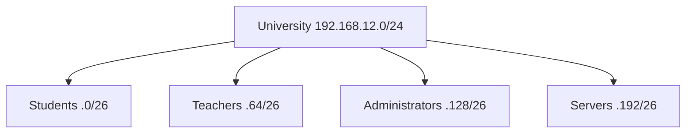
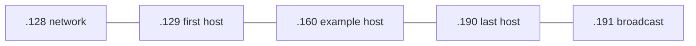
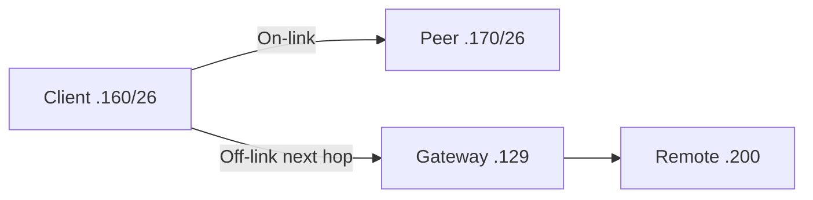
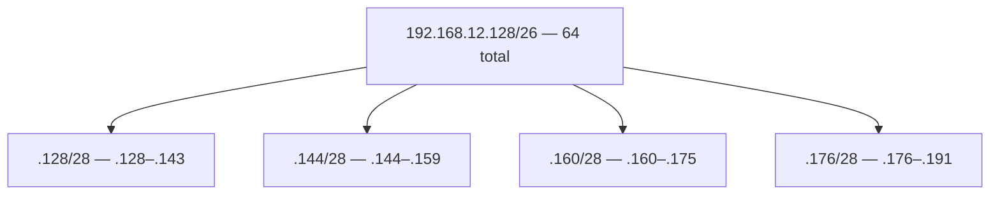
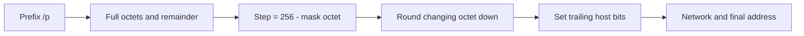
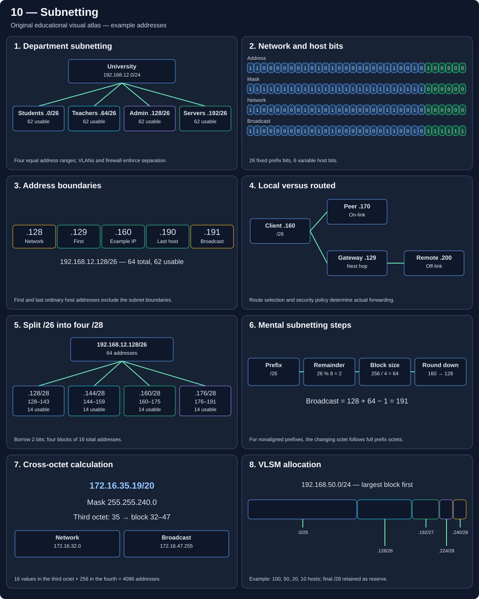

# Section 10 — Subnetting

Source: learner-supplied HTB Academy Section 10, [official course](https://academy.hackthebox.com/course/preview/introduction-to-networking). Independent English explanations and original educational diagrams, examples, commands and offline tools. The supplied lesson includes four mandatory questions (+20 each) and a +10 section reward. Exact assessment prompts and answers are retained in the learner's chat; the public repository teaches equivalent calculations using different example addresses. Platform submission/acceptance has not been verified.

## 1. Definition and purpose

Subnetting divides an address range into smaller logical IP networks. A subnet consists of addresses sharing a network prefix. Think of a building corridor with separate departments: each department has an allocated range and an appropriate entrance. Subnetting organizes addressing; it is not in itself a security boundary. Appropriate VLANs, routing and firewall policy enforce separation. Subnetting supports address allocation, manageable broadcast domains when matched with Layer 2 design, route summarization and troubleshooting.

| Property | Definition |
|---|---|
| Network address | First address of the subnet, host bits zero |
| Broadcast address | Last address in ordinary IPv4 broadcast subnet, host bits one |
| First host | Network + 1 for ordinary broadcast subnets |
| Last host | Broadcast - 1 for ordinary broadcast subnets |
| Number of hosts | Conventional assignable capacity (not actual active devices) |

IPv4 has 32 bits. For prefix /p, h=32-p, total=2^h. Conventional usable=total-2 for ordinary broadcast subnets, subject to special-use reservations. /31 point-to-point permits both endpoints (RFC 3021); /32 is a single-address prefix, not a conventional broadcast subnet. IPv6 does not use broadcast. Gateways consume assignable addresses; neither first nor last usable is mandatory.


Each /26 contains 64 total and 62 conventional host addresses. Fictional design only.

## 2. Source worked example: 192.168.12.160/26

Mask 255.255.255.192. /26 = 26 prefix bits, 6 host bits; 64 total addresses, 62 usable. The source occasionally calls total addresses hosts; distinguish total from usable.

| Octet | IPv4 | Mask |
|---|---|---|
| 1 | 11000000 (192) | 11111111 (255) |
| 2 | 10101000 (168) | 11111111 (255) |
| 3 | 00001100 (12) | 11111111 (255) |
| 4 | 10 100000 (160) | 11 000000 (192) |

The space in last octet denotes the prefix/host boundary (two prefix bits, six host bits). The first 26 address bits remain constant for this subnet; remaining six can vary. Mask 1 means prefix bit, mask 0 means host bit. The prefix can include bits with value zero; do not mistake mask bits for address bits.

```text
                 fixed prefix                    host
Address  11000000.10101000.00001100.10 | 100000
Mask     11111111.11111111.11111111.11 | 000000
Network  11000000.10101000.00001100.10 | 000000
Last     11000000.10101000.00001100.10 | 111111
```

Network: set all host bits to zero (bitwise AND with mask). Last octet 10100000 AND 11000000 = 10000000 = 128. Broadcast: set all host bits to one; 10111111 = 191. Equivalent formula broadcast = network + block size - 1 or network OR inverse mask. Example inverse mask 0.0.0.63. First host .129, last .190. Given .160 is a valid host in /26, but is a network address in the /28 child with that boundary.

| Field | Result |
|---|---|
| Input | 192.168.12.160/26 |
| Mask | 255.255.255.192 |
| Network | 192.168.12.128 |
| First host | 192.168.12.129 |
| Last host | 192.168.12.190 |
| Broadcast | 192.168.12.191 |
| Total addresses | 64 |
| Conventional usable | 62 |



## 3. Local or routed delivery

A sender determines whether a destination is on-link using its configured prefixes and route table. Under an ordinary connected route, 192.168.12.170 is within the /26, 192.168.12.200 is outside. On Ethernet, the local destination MAC is resolved via ARP; off-link destinations use the selected router's MAC. A default gateway is used only if no more specific applicable route exists, not necessarily for every other subnet. The receiver's configured mask may differ (misconfiguration); routes, policy and return path matter. Network math does not prove connectivity or authorization.



## 4. Dividing a subnet into four equal subnets

Powers of 2: 2^0=1, 2^1=2, 2^2=4, 2^3=8, 2^4=16, 2^5=32, 2^6=64, 2^7=128, 2^8=256. To divide a prefix /p into 2^b equal children, borrow b host bits, new prefix p+b (must not exceed 32). To obtain at least k equal subnets, b=ceil(log2(k)); reserve unused children if k is not a power of two. Variable-length subnetting (VLSM) can allocate unequal aligned blocks; see additional example below. There is no general need to subtract two from the number of child subnets.

Parent 192.168.12.128/26, four children: 4=2^2, borrow 2 bits. /26+2=/28; mask 255.255.255.240. Each child has 64/4=16 total, 14 conventional host addresses. Last octet network bits extend from 10 to 1000,1001,1010,1011; host suffix four bits. Start at parent network .128, add 16 per child.



| Child | Prefix | First host | Last host | Broadcast |
|---:|---|---|---|---|
| 1 | 192.168.12.128/28 | .129 | .142 | .143 |
| 2 | 192.168.12.144/28 | .145 | .158 | .159 |
| 3 | 192.168.12.160/28 | .161 | .174 | .175 |
| 4 | 192.168.12.176/28 | .177 | .190 | .191 |

All shortened addresses share 192.168.12. Four children contain 64 total and 56 usable (4*14), compared with 62 in parent. Six additional addresses become network/broadcast boundaries. One-based index formula: child start = parent base + (i-1)*child size; last = start+size-1. Do not add a block before child 1. Original /26 host .160 is now child 3 network, so cannot remain an ordinary host after readdressing to /28. A real migration requires approved address planning and gateway changes.

## 5. Mental subnetting

Remember octet boundaries /8 /16 /24 /32. Prefix p determines fully fixed octets floor(p/8), remainder r=p%8. For non-octet-aligned prefix, changing octet index = floor(p/8)+1 (one-based), block size in that octet = 2^(8-r) = 256-mask octet. At an exact octet boundary, lower octets vary; r=0 gives 256 in next octet when one exists, not 256 total addresses unless /24. /32 no variable octet. Avoid the source wording "dividing eight by the network"; the intended operation is p modulo 8 (remainder of p divided by 8).

| Remainder r | Mask octet | Step in changing octet |
|---:|---:|---:|
| 0 | 0 | 256 |
| 1 | 128 | 128 |
| 2 | 192 | 64 |
| 3 | 224 | 32 |
| 4 | 240 | 16 |
| 5 | 248 | 8 |
| 6 | 252 | 4 |
| 7 | 254 | 2 |

/25: 25%8=1; step=128. Last-octet blocks 0–127 and 128–255. 192.168.1.1/25 is interface notation, network 192.168.1.0/25; 192.168.2.4 differs in a fixed octet. First usable .1–.126, second .129–.254. .128 itself belongs to second block but is network, not assignable host. For /26 step 64, .160 lies in 128–191; mental calculation floor(160/64)*64=128. Last 128+64-1=191.

Example across octets: 172.16.35.19/20. 20%8=4, changing third octet, step=16, mask 255.255.240.0. floor(35/16)*16=32, third-octet range 32–47. Network 172.16.32.0, last 172.16.47.255, first .32.1, last .47.254, 4096 total and 4094 usable. Trailing host octets zero for network and 255 for last. Step 16 in third octet is not 16 total addresses.



## 6. Original additional examples (not platform answers)

Example 192.0.2.64/27: /27 = 255.255.255.224, 5 host bits, 32 total, network .64, final .95. Divide into four equal children: /29, mask 255.255.255.248, 8 total per child and 6 usable.

| Child | Network | First | Last | Broadcast |
|---:|---|---|---|---|
| 1 | 192.0.2.64/29 | .65 | .70 | .71 |
| 2 | 192.0.2.72/29 | .73 | .78 | .79 |
| 3 | 192.0.2.80/29 | .81 | .86 | .87 |
| 4 | 192.0.2.88/29 | .89 | .94 | .95 |

Third child's start = 64+(3-1)*8=80. Second child's last = 64+(2-1)*8+8-1=79. This original documentation example uses RFC 5737 addresses, not actual HTB assessment input. Four mandatory questions addressed in chat; no exact assessment answer key in public repository.

VLSM supplemental example: 192.168.50.0/24 needs 100, 50, 20 and 10 usable addresses. Allocate largest first: .0/25 (126 usable), .128/26 (62), .192/27 (30), .224/28 (14), leave .240/28 spare. All are aligned and disjoint. Include gateways in capacity requirements; extra growth and reservations may change plan.

## 7. Python and diagnostic references

Python standard library, offline:
```python
import ipaddress
i = ipaddress.ip_interface("192.168.12.160/26")
n = i.network
print("Parent:", n)
for idx, child in enumerate(n.subnets(new_prefix=28), start=1):
    first = child.network_address + 1
    last = child.broadcast_address - 1
    print(idx, child, first, last, child.broadcast_address)
```
Expected output:
```text
Parent: 192.168.12.128/26
1 192.168.12.128/28 192.168.12.129 192.168.12.142 192.168.12.143
2 192.168.12.144/28 192.168.12.145 192.168.12.158 192.168.12.159
3 192.168.12.160/28 192.168.12.161 192.168.12.174 192.168.12.175
4 192.168.12.176/28 192.168.12.177 192.168.12.190 192.168.12.191
```
ip_interface preserves host address; network returns enclosing prefix; subnets(new_prefix=28) iterates equal children; enumerate start=1 uses human numbering; +1/-1 appropriate for /28, not /31 or /32. Do not materialize billions of networks; bound display/iteration. ip_network("192.168.12.160/26") defaults to strict=True and raises for host bits; strict=False normalizes, or use ip_interface. Free built-in Python, no additional package. [ipaddress docs](https://docs.python.org/3/library/ipaddress.html).

Windows: Get-NetIPAddress -AddressFamily IPv4; Get-NetRoute -AddressFamily IPv4; Get-NetIPConfiguration. Linux/WSL2: ip -br -4 address; ip -4 route; ip route get 192.0.2.80. -br brief; -4 IPv4; route get computes local decision without probing. Optional free ipcalc: sudo apt install ipcalc (Ubuntu, only if required); ipcalc 192.168.12.160/26. WSL2 has own routing context. Outputs illustrative, no installation, live probes or learner commands required.

## 8. Project application and cybersecurity

UniTrack proposed departmental subnets as in section 1; gateway and DHCP pools must respect network/broadcast boundaries, firewall rules enforce authorized cross-subnet flows, application roles/MFA/QR validation still needed. Capacity must account for scanners, staff and students; /26 may be inadequate. ProTrack-MX managed cloud connections depend on routing and DNS, while RLS and authentication enforce access. Check subnet overlap with VPN ranges, mask consistency, DHCP allocation, approved scopes and exclusions. Do not expand a lab range to other networks. No changes to actual projects.

## 9. Visual and interactive assets



[Full-size visual atlas](Assets/10-Subnetting-Visual-Atlas.svg) — eight original diagram panels. [Offline interactive companion](Assets/10-Subnetting-Interactive.html) — prefix calculator and equal-subnet splitter with selectable child. Download and open locally; GitHub file preview does not execute JavaScript. Static states and worked examples are provided above. Original recreations rather than pixel-identical chat UI. No network activity.

## 10. Technical guide and official standards

- [Mental subnetting and VLSM](Tools/44-Mental-Subnetting-VLSM.md)
- [Binary IPv4 addressing](Tools/42-Binary-IPv4-Addressing.md), [Subnet masks and CIDR](Tools/43-Subnet-Masks-CIDR-Calculator.md), [CIDR and routing](Tools/34-IPv4-CIDR-Routing.md).
- [CIDR RFC 4632](https://www.rfc-editor.org/rfc/rfc4632), [IPv4 RFC 791](https://www.rfc-editor.org/rfc/rfc791), [RFC 3021](https://www.rfc-editor.org/rfc/rfc3021), [RFC 5737](https://www.rfc-editor.org/rfc/rfc5737), [IANA IPv4 special-purpose registry](https://www.iana.org/assignments/iana-ipv4-special-registry), [ipcalc](https://jodies.de/ipcalc).

## Checkpoint
Section 10 source completely documented; four mandatory calculations explained in chat, submissions not verified. +80 question rewards and +10 section reward displayed, not confirmed earned. Learner advanced beyond Section 9 without separate completion evidence. Next: submit four answers in Academy; after acceptance Mark Complete & Next and provide Section 11. No live network test or install performed.
