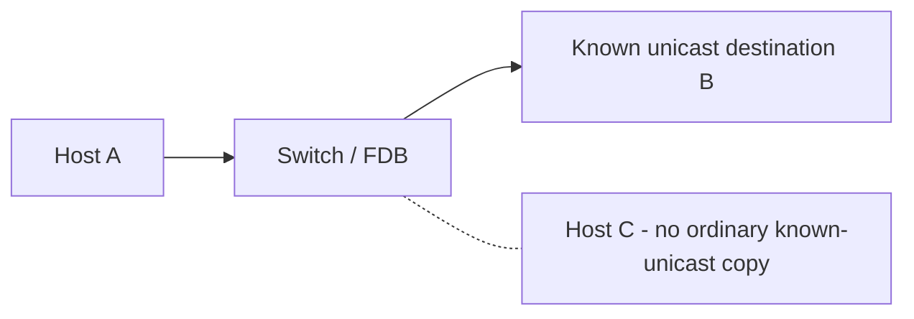
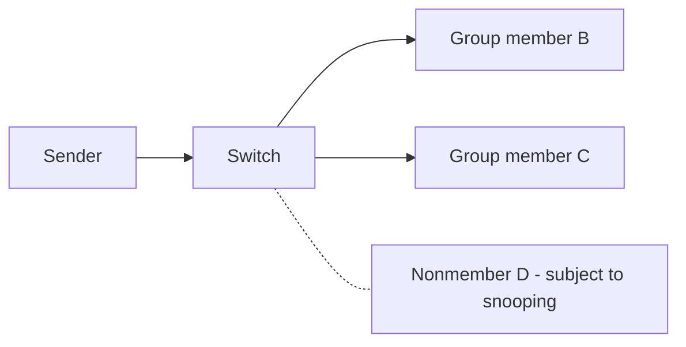
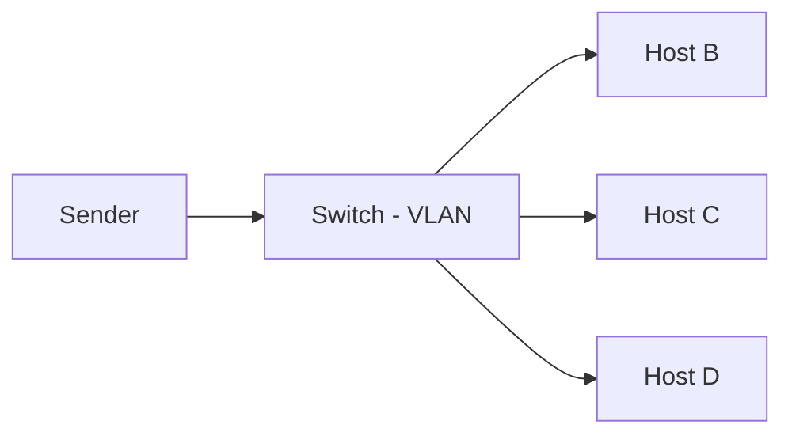
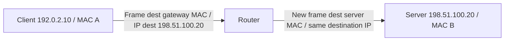
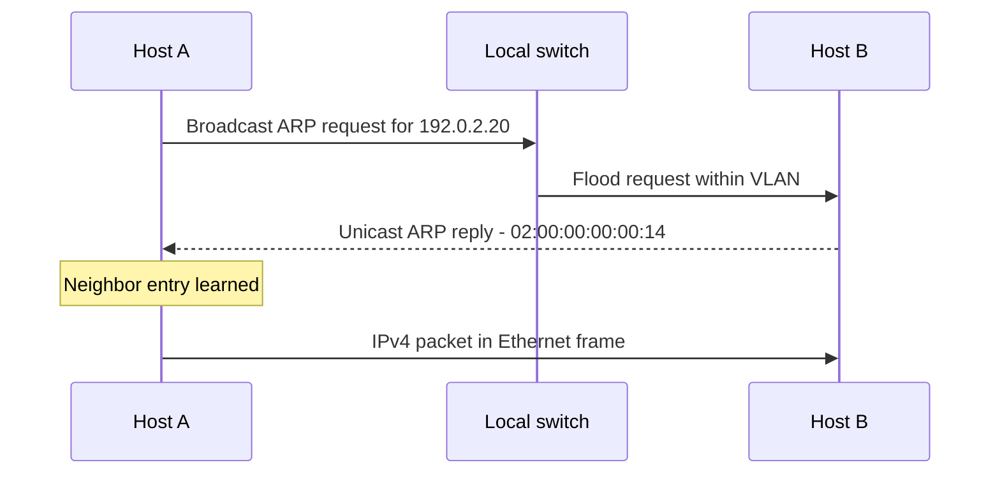
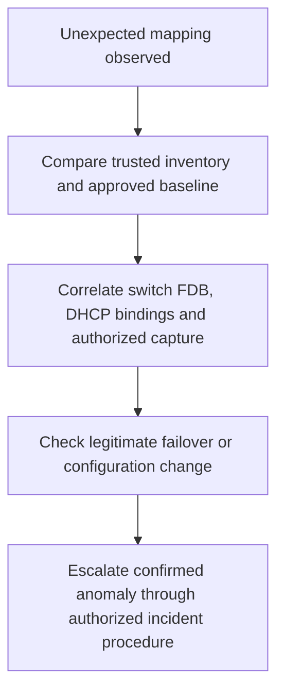
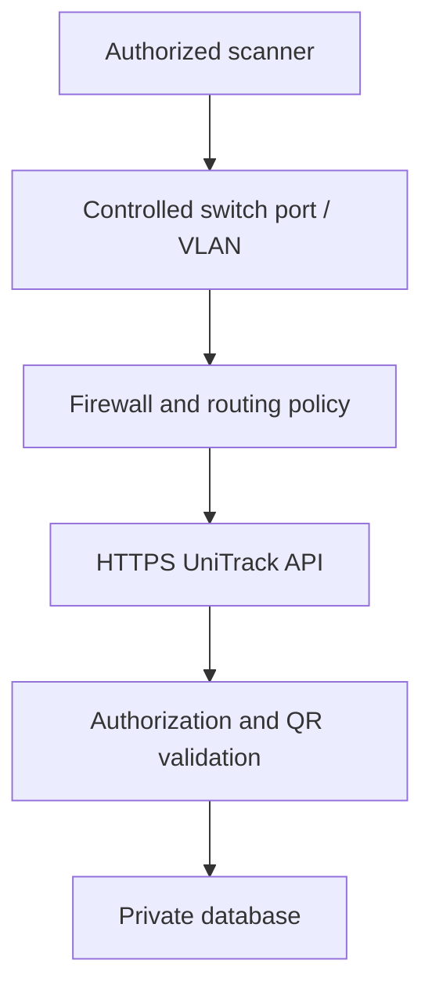
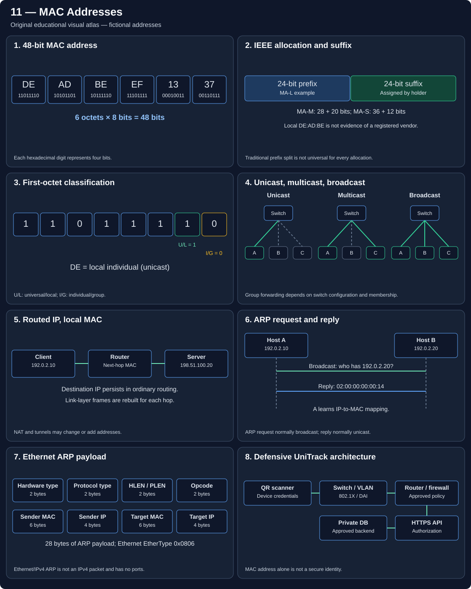

# Section 11 — MAC Addresses

Source: learner-supplied HTB Academy Section 11, [official module](https://academy.hackthebox.com/course/preview/introduction-to-networking). Independent English explanation of all supplied concepts, corrected technical details, original diagrams, defensive examples, and offline tools. No mandatory questions or lab; +10 displayed. Do not interpret illustrative examples as a real capture or an authorization to test a network.

## 1. Link-layer addressing
MAC = Media Access Control. Conventional Ethernet MAC address is 48 bits = six octets = 12 hexadecimal digits. Ethernet IEEE 802.3, Wi-Fi IEEE 802.11, Bluetooth (Bluetooth SIG, historically IEEE 802.15.1) use link-layer identifiers under their respective specifications. A host may have multiple interfaces, each with its own addresses; virtual interfaces also have addresses. Factory-assigned addresses and effective software-configured addresses can differ. Randomization improves some privacy but does not guarantee anonymity. MAC is not permanent identity, physical location or authentication.

Source example: DE:AD:BE:EF:13:37, DE-AD-BE-EF-13-37, DEAD.BEEF.1337 and DEADBEEF1337 represent the same value. Hex uses 0–9 and A–F (10–15); each digit four bits. Each octet has two hex digits, 0–255.

| Octet | Hex | Binary | Decimal |
|---|---|---|---:|
| 1 | DE | 11011110 | 222 |
| 2 | AD | 10101101 | 173 |
| 3 | BE | 10111110 | 190 |
| 4 | EF | 11101111 | 239 |
| 5 | 13 | 00010011 | 19 |
| 6 | 37 | 00110111 | 55 |

DE = 13*16+14 = 222; D=1101, E=1110. 48 bits give 2^48 = 281,474,976,710,656 bit patterns, not all ordinary globally assigned individual addresses. Separators and letter case are representations only.

## 2. OUI, interface-specific suffix and address classification

Traditional MA-L allocation uses a 24-bit IEEE Organizationally Unique Identifier (OUI) and 24-bit assignee-controlled suffix (2^24 values). The source calls the suffix NIC; NIC actually stands for Network Interface Controller (hardware/virtual interface), not a formal name for the suffix. IEEE also provides MA-M /28 and MA-S /36 prefixes. The prefix may identify an assignee, not necessarily the current device manufacturer, owner or user. Local addresses do not establish IEEE-assigned vendor identity, and effective addresses can be duplicated or altered.

| Block | Assigned prefix | Assignee-controlled bits | Address count |
|---|---:|---:|---:|
| MA-L | 24 | 24 | 16,777,216 |
| MA-M | 28 | 20 | 1,048,576 |
| MA-S | 36 | 12 | 4096 |

```text
Traditional MA-L layout
[ 24-bit assigned prefix ][ 24-bit assignee suffix ]
DE       AD       BE      EF       13       37
```
This split illustrates length, not a valid vendor claim for DE:AD:BE (local bit set). [IEEE Registration Authority](https://standards.ieee.org/products-programs/regauth/mac/), [RFC 9542](https://www.rfc-editor.org/rfc/rfc9542.html).

First octet least significant bit (I/G, individual/group) 0 individual/unicast, 1 group (multicast; broadcast all ones is special). Second least significant bit (U/L, universal/local) 0 universal, 1 local in conventional interpretation. Bits are shown MSB first; do not confuse display order with Ethernet transmission bit order. Local unicast low nibble 2,6,A,E, with arbitrary high nibble subject to applicable local allocation policy. Source examples 02,06,0A,0E prefixes are examples, not the entire space. IEEE structured local address plan can further distinguish local categories.

| Example | First octet binary | I/G | U/L | Classification |
|---|---|---:|---:|---|
| DE:AD:BE:EF:13:37 | 11011110 | 0 | 1 | Local individual |
| DC:AD:BE:EF:13:37 | 11011100 | 0 | 0 | Universal-bit individual; allocation not verified |
| 01:00:5E:01:13:37 | 00000001 | 1 | 0 | IPv4 multicast mapping range |
| FF:FF:FF:FF:FF:FF | 11111111 | 1 | 1 | Broadcast special case |

The source multicast example 01:00:5E:EF:13:37 has group bit set, but is outside the standard IPv4 multicast mapping range 01:00:5E:00:00:00–01:00:5E:7F:FF:FF; the high bit of fourth octet must be zero in that mapping. IPv4 multicast maps low 23 IP bits; multiple IP groups can map to same MAC. IPv6 multicast maps to 33:33 plus low 32 bits. [RFC 1112](https://www.rfc-editor.org/rfc/rfc1112), [RFC 2464](https://www.rfc-editor.org/rfc/rfc2464).

## 3. Unicast, multicast, broadcast and switching

Unicast targets one individual destination; group addresses target interested listeners; broadcast targets the relevant Layer 2 broadcast domain. Source address is normally individual. Switches learn source MAC and ingress port per VLAN in forwarding database (FDB, often called CAM table). Known unicast is forwarded to learned egress port if permitted; unknown unicast may flood within VLAN; broadcast is flooded within permitted VLAN; multicast may be constrained by snooping and configuration. Not every multicast packet goes to every host, nor does unicast guarantee delivery. VLANs and policy define boundaries. Wi-Fi distribution behavior differs from simple switched Ethernet.





## 4. IP vs MAC in routed delivery

| Property | MAC | IP |
|---|---|---|
| OSI | Layer 2 | Layer 3 |
| Scope | Local link | Logical networks |
| Size | Ethernet 48 bits | IPv4 32 / IPv6 128 |
| Example | 02:00:00:00:00:0A | 192.0.2.10 |

Same-link IPv4 host resolves destination MAC; off-link host resolves selected next hop MAC, generally gateway. Router decapsulates local frame, selects next hop, decrements TTL and builds outgoing frame. IP destination normally persists; NAT is distinct and may modify IP/ports. IP packet travels inside frame; ARP does not replace IP with MAC. Router's MAC is not remote server's MAC. IP and MAC do not authenticate a person.



## 5. ARP — Address Resolution Protocol

ARP maps IPv4 next-hop addresses to link-layer addresses on local networks. EtherType 0x0806; IPv4 data EtherType 0x0800. ARP is not encapsulated in IPv4 and has no TCP/UDP ports. IPv6 uses ICMPv6 Neighbor Discovery. ARP table/cache stores IP-to-MAC associations per interface, distinct from switch FDB MAC-to-port. Dynamic entries age and change; cache hit can avoid new request.

Original example: A 192.0.2.10 MAC 02:00:00:00:00:0A; B 192.0.2.20 MAC 02:00:00:00:00:14; both /24.
1. A checks its route and neighbor cache.
2. On a cache miss, A sends an Ethernet broadcast FF:FF:FF:FF:FF:FF asking for B's IPv4 address.
3. B normally replies unicast to A with its MAC.
4. A updates neighbor mapping and can send IPv4 packets in Ethernet frames to B.



ARP fields for Ethernet/IPv4: hardware type 1 (Ethernet), protocol type 0x0800, hardware length 6, protocol length 4, opcode 1 request or 2 reply, sender hardware (SHA), sender protocol (SPA), target hardware (THA), target protocol (TPA). Base ARP payload 28 bytes: 2+2+1+1+2+6+4+6+4. Request target hardware commonly zero; reply identifies both endpoints. Ethernet header 14 B; padding 18 B to minimum 46-byte Ethernet payload; FCS 4 B -> 64 B MAC frame (60 B without FCS), excluding preamble/SFD/IFG. Capture length depends on capture setup. [RFC 826](https://www.rfc-editor.org/rfc/rfc826), [IANA ARP parameters](https://www.iana.org/assignments/arp-parameters).

## 6. TShark capture interpretation

The supplied sample shows two ordinary request/reply pairs. In the first/third lines "Who has" asks for a target mapping, second/fourth lines give the claimed mapping. Its displayed .255 destination should not be confused with ARP's Ethernet broadcast address. The supplied attack sample also calls .255 a gateway; whether .255 is usable depends on the actual prefix, which is not provided. In a conventional /24, .255 is broadcast and not a normal gateway. A printed claim is not proof of poisoning or actual traffic interception; verify cache, topology and evidence. Do not publish lab identifiers in public notes.

Independent illustrative display:
```text
1  0.000000  02:00:00:00:00:0A -> ff:ff:ff:ff:ff:ff  ARP 60  Who has 192.0.2.20? Tell 192.0.2.10
2  0.000015  02:00:00:00:00:14 -> 02:00:00:00:00:0A  ARP 60  192.0.2.20 is at 02:00:00:00:00:14
```
Numbers are fictional; not captured. Columns frame number, relative time, source/destination display, protocol, length, information. TShark may resolve names or show different columns. Ethernet broadcast FF:FF:FF:FF:FF:FF is not IPv4 broadcast.

## 7. MAC and ARP security

| Risk | Description | Defensive response |
|---|---|---|
| MAC spoofing | Effective link-layer address differs from expected identity | 802.1X/NAC, strong credentials, monitor changes |
| MAC flooding | Excess distinct source addresses pressure switch FDB | Port security, appropriate limits, monitoring |
| MAC-only filtering | Weak access policy because address alone is not authentication | 802.1X, certificate-based admission, application authorization |
| ARP spoofing/cache poisoning | False IP/MAC association may redirect or disrupt local traffic | Dynamic ARP Inspection (DAI), validated bindings, segmentation, monitoring |
| MITM | Intermediary may observe or modify unprotected traffic | Authenticated TLS/IPsec, certificate validation, network controls |

FDB overflow behavior depends on switch design; it is not guaranteed to behave as a hub. ARP lacks inherent authentication. A changed gateway mapping can reflect legitimate failover, virtualization or replacement; compare approved baseline and logs before declaring attack. An inconsistent mapping may cause denial of service or enable interception, but outcome is not proven by one ARP reply. Firewalls and IDS are useful but a conventional Layer 3 firewall alone does not prevent same-VLAN ARP poisoning. DAI commonly uses DHCP snooping bindings and approved static bindings; configure trusted ports carefully, verify device support and manage changes. DHCP snooping validates DHCP server paths and tracks bindings; DAI validates ARP. 802.1X controls port admission. TLS and IPsec protect authenticated traffic, not the ARP cache itself; avoid deprecated SSL and disabling certificate checks.



The source names Ettercap and Cain & Abel as historical/dual-use examples. Ettercap is a free/open-source network analysis and MITM tool, [official project](https://github.com/Ettercap/ettercap). Cain & Abel is a legacy Windows network/password audit utility; source links a third-party archive, not a verified current vendor distribution. No installation or active spoofing/flooding/interception instructions are necessary for this lesson. See defensive guide. Inspect offline capture or local read-only state only; never intercept third-party traffic or impersonate network devices without authorization.

## 8. Commands for Windows 11 and Ubuntu WSL2

Windows built-in:
```powershell
Get-NetAdapter | Select-Object Name, MacAddress, Status
getmac /v
arp -a
Get-NetNeighbor -AddressFamily IPv4
```
Select-Object chooses columns; /v verbose adapter list; arp -a lists IPv4 cache; Get-NetNeighbor lists neighbor addresses/state for chosen family. Read-only.

Linux:
```bash
ip -br link
ip link show
ip -4 neigh show
```
-br brief; link shows interface layer information; -4 selects IPv4 neighbor entries. Illustrative output: 192.0.2.1 dev eth0 lladdr 02:00:00:00:00:01 REACHABLE. dev interface; lladdr link-layer address; REACHABLE recent reachability evidence, not authentication. STALE is not necessarily failure; FAILED means recent resolution failed. WSL2 often has virtual interface/MAC and separate network context from Windows. iproute2 optional sudo apt install iproute2 on approved Ubuntu if missing. Do not publish real network information. No learner command required.

TShark (free/open-source CLI companion to Wireshark):
```bash
tshark --version
tshark -r example.pcapng -Y arp -n
tshark -r example.pcapng -Y "arp.opcode == 2" -T fields -e frame.number -e arp.src.proto_ipv4 -e arp.src.hw_mac
```
-r reads an existing authorized file; -Y display filter; -n disables name resolution; -T fields produces selected fields; -e selects field. example.pcapng placeholder, not a provided file. No capture performed. Wireshark display filters arp, arp.opcode == 1, arp.opcode == 2, eth.dst == ff:ff:ff:ff:ff:ff. Optional Ubuntu sudo apt install tshark only if required; decline unnecessary capture privileges. Windows download from [Wireshark official site](https://www.wireshark.org/download.html); TShark is bundled when selected. [TShark manual](https://www.wireshark.org/docs/man-pages/tshark.html), [ARP display fields](https://www.wireshark.org/docs/dfref/a/arp.html).

## 9. Python original offline MAC classifier

```python
import re
s = "DE:AD:BE:EF:13:37"
if not re.fullmatch(r"(?:[0-9a-fA-F]{2}:){5}[0-9a-fA-F]{2}", s):
    raise ValueError("Expected six colon-separated hex octets")
octets = bytes.fromhex(s.replace(":", ""))
first = octets[0]
print("Binary:", " ".join(f"{v:08b}" for v in octets))
print("Type:", "broadcast" if all(v == 255 for v in octets) else
      "group" if first & 1 else "individual")
print("U/L bit:", (first >> 1) & 1)
```
Expected Binary: 11011110 10101101 10111110 11101111 00010011 00110111; Type: individual; U/L bit: 1. re.fullmatch validates format; bytes.fromhex converts hex to bytes; & 1 reads group bit; >>1 then &1 reads local bit. This does not change any interface or contact a network. Broadcast special-case classification precedes group; U/L bit alone not vendor verification. Python built-in modules only.

## 10. Project applications

UniTrack: separate scanner VLAN from student/administrative networks; approved DHCP/DAI/802.1X if supported, audit port changes. Do not use scanner MAC as sole device identity or QR authorization; use authenticated HTTPS, approved device credentials, server-side role controls, revocation and logs. ProTrack-MX: cloud API does not ordinarily see the client's local Ethernet MAC through routers; do not use MAC for online presence or access control. Use authenticated session state and Supabase RLS. No actual deployment changes or discovered vulnerabilities.



## 11. Visual assets and references



[Original visual atlas](Assets/11-MAC-Addresses-Visual-Atlas.svg) — eight panels. [Offline interactive companion](Assets/11-MAC-Addresses-Interactive.html) — address classifier and ARP exchange simulator. Download HTML and open locally. No scripts from outside, no packets sent. Representative states: DE local individual, DC universal-bit individual, 01 group, FF broadcast; ARP cache miss -> broadcast request -> unicast reply -> cache entry. Original diagrams, not exact chat interface exports.

Individual guides: [MAC addressing and IEEE allocation](Tools/45-MAC-Addressing.md), [ARP and defensive analysis](Tools/46-ARP-Defensive-Analysis.md), [TShark offline analysis](Tools/47-TShark.md). Existing [Wireshark guide](Tools/32-Packet-Encapsulation-Wireshark.md), [network segmentation](Tools/02-Network-Segmentation.md).

References: [IEEE MAC address blocks](https://standards.ieee.org/products-programs/regauth/mac/), [RFC 9542](https://www.rfc-editor.org/rfc/rfc9542), [RFC 826](https://www.rfc-editor.org/rfc/rfc826), [RFC 5227](https://www.rfc-editor.org/rfc/rfc5227), [RFC 4861](https://www.rfc-editor.org/rfc/rfc4861), [RFC 1112](https://www.rfc-editor.org/rfc/rfc1112), [RFC 2464](https://www.rfc-editor.org/rfc/rfc2464), [Wireshark manual](https://www.wireshark.org/docs/man-pages/tshark.html).

## Checkpoint
Section 11 supplied content explained; source corrections labeled. No mandatory questions, +10 displayed not confirmed earned. Learner advanced beyond Section 10; acceptance of previous four answers not separately confirmed. No live network operation or install; next Mark Complete & Next and Section 12.
