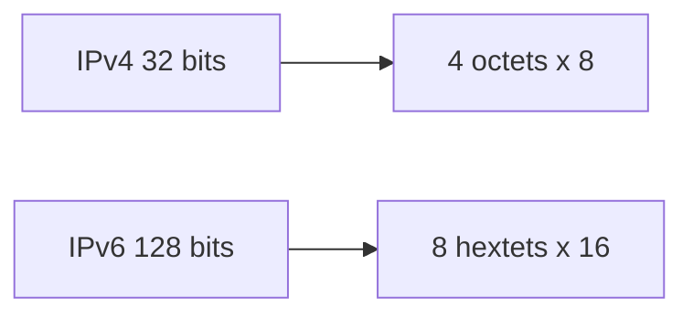
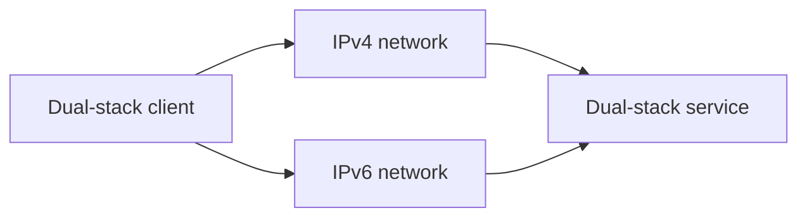
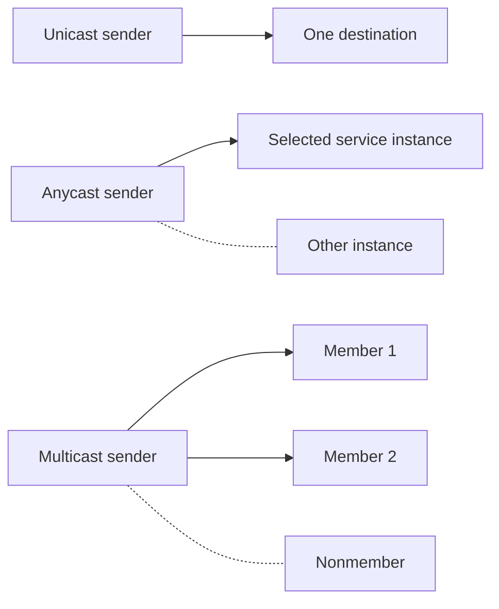
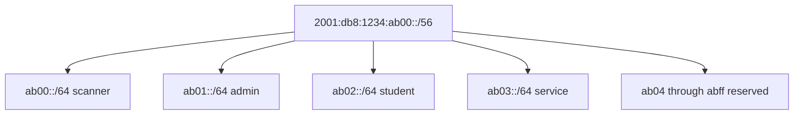
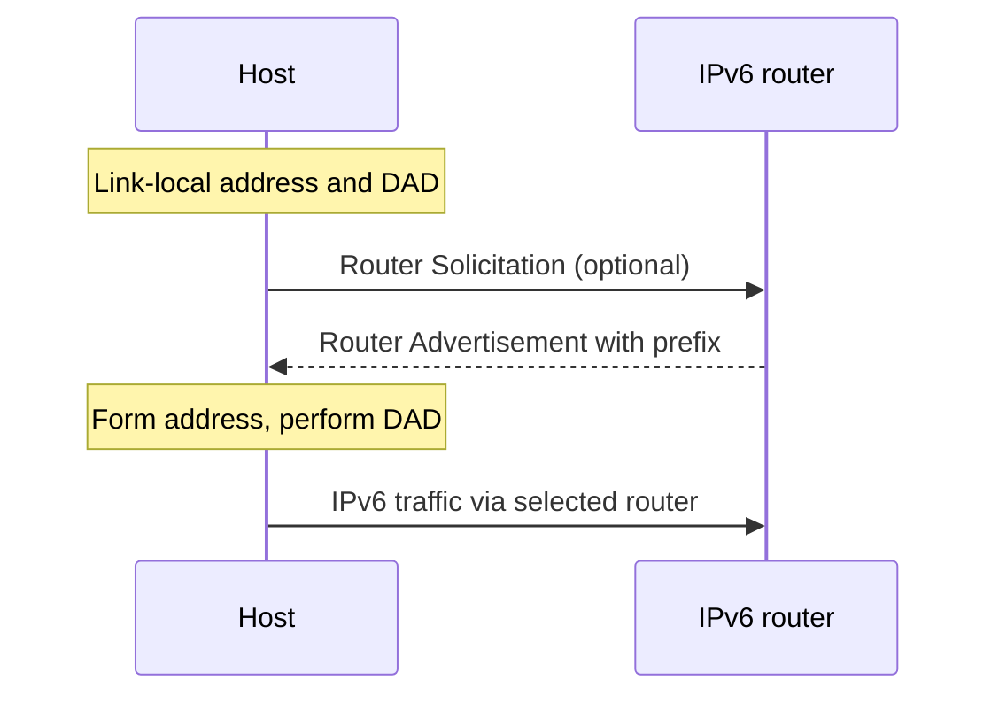
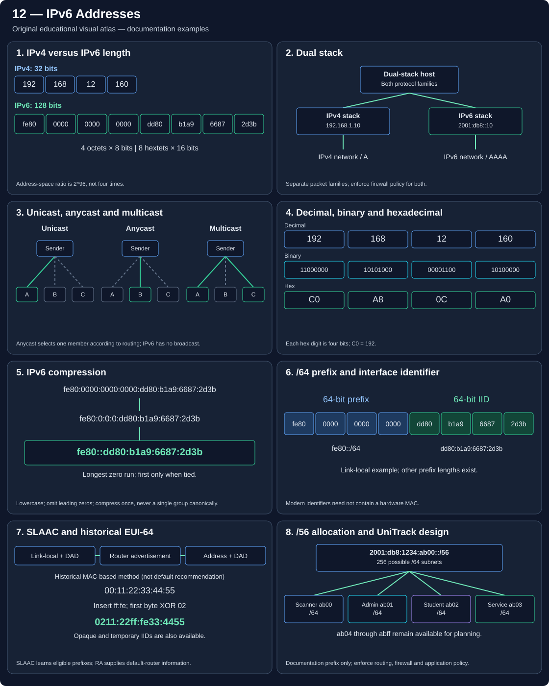

# Section 12 — IPv6 Addresses

Source: learner-supplied HTB Academy Section 12, [official course](https://academy.hackthebox.com/course/preview/introduction-to-networking). Complete independent English explanations, standards-based corrections, original examples and visual/interactive companions. The supplied excerpt contains no mandatory questions or lab; platform completion not confirmed.

## 1. IPv6 and IPv4
IPv6 is Internet Protocol Version 6, the successor to IPv4, operating at OSI Layer 3. IPv4 has 32 bits = 4 bytes = four decimal octets. IPv6 has 128 bits = 16 bytes = eight 16-bit hexadecimal groups (hextets). Each group contains up to four hex digits; each digit represents four bits. IPv4 has 2^32 = 4,294,967,296 bit patterns. IPv6 has 2^128 = 340282366920938463463374607431768211456, approximately 340 undecillion; ratio 2^96. Not all bit patterns represent publicly assignable ordinary unicast addresses. IANA coordinates global address resources through RIRs, not individual device assignments. IPv4 and IPv6 coexist; the date of complete IPv4 replacement is unknown.

| Feature | IPv4 | IPv6 |
|---|---|---|
| Address bits/bytes | 32 / 4 | 128 / 16 |
| OSI | Network | Network |
| Representation | Dotted decimal | Colon-separated hex |
| Address assignment | Static/DHCP | Static/SLAAC/DHCPv6 |
| Minimum/base header | 20 bytes | 40 bytes |
| Broadcast | Supported | None |
| Neighbor resolution | ARP | NDP (ICMPv6) |
| Lifetime field | TTL | Hop Limit |
| Loopback | 127.0.0.1 | ::1 |
| Default route | 0.0.0.0/0 | ::/0 |
| IPsec | Supported | Supported |

Corrections to source: IPv6 does not guarantee faster routing; simplified base header may improve processing, but performance depends on path and equipment. RFC 8504 recommends IPsec architecture support (SHOULD), not mandatory encryption of all packets. Global addressing can remove need for conventional IPv4 NAT, but not firewall policies; not all IPv6 addresses are globally reachable. RFC 2675 jumbograms use a 32-bit Jumbo Payload option, up to 2^32-1 payload bytes on compatible links; not ordinary IPv6 packets. Normal IPv6 payload-length field is 16 bits, max 65,535 bytes without jumbogram. Typical Ethernet MTU 1500 includes IP header and payload; IPv6 minimum link MTU 1280. Routers do not fragment IPv6 packets; source may fragment, and ICMPv6 Packet Too Big supports path MTU discovery. See RFC 8200, 8504, 2675.



## 2. End-to-end connectivity and dual stack
IPv6 allows globally unique addresses without conventional IPv4 NAT, but global scope does not imply access permission. A stateful firewall can allow outbound connections and deny unsolicited inbound traffic. One interface can hold link-local, stable global, temporary global and/or unique local addresses simultaneously. Dual stack means both IPv4 and IPv6 protocol stacks operate on a host/network; IPv4 and IPv6 packets are separate, not translated automatically. DNS A records identify IPv4, AAAA IPv6. Application/OS select address family according to configuration, reachability and policy (e.g. Happy Eyeballs RFC 8305). Dual-stack security requires equivalent access policy, logging and monitoring in both families; IPv6-only and IPv4-only endpoints need appropriate translation or proxy if interoperability required.



## 3. IPv6 address types
| Type | Delivery | Example |
|---|---|---|
| Unicast | One addressed interface | 2001:db8::10 (documentation) |
| Anycast | One member of group sharing address, typically nearest by routing metric | Distributed DNS/service conceptual |
| Multicast | Interested interfaces in group within scope and policy | ff02::1 all nodes on link |
IPv6 has no broadcast address. Anycast shares unicast address syntax, cannot be recognized from address string alone; routing policy chooses receiver, not geographic distance. Multicast does not guarantee delivery to every member. ff02::2 all routers on local link. Multiple interfaces may use same multicast or anycast address by design.



## 4. Hexadecimal conversion
Hexadecimal base 16: digits 0–9,a–f. Decimal/binary table:
| Decimal | Hex | Binary |
|---:|---|---|
| 0 | 0 | 0000 |
| 1 | 1 | 0001 |
| 2 | 2 | 0010 |
| 3 | 3 | 0011 |
| 4 | 4 | 0100 |
| 5 | 5 | 0101 |
| 6 | 6 | 0110 |
| 7 | 7 | 0111 |
| 8 | 8 | 1000 |
| 9 | 9 | 1001 |
| 10 | A | 1010 |
| 11 | B | 1011 |
| 12 | C | 1100 |
| 13 | D | 1101 |
| 14 | E | 1110 |
| 15 | F | 1111 |
Source IPv4 192.168.12.160 in hex: c0.a8.0c.a0.
| Decimal | Binary | Hex |
|---:|---|---|
| 192 | 11000000 | C0 |
| 168 | 10101000 | A8 |
| 12 | 00001100 | 0C |
| 160 | 10100000 | A0 |
C0=12*16+0=192; A8=10*16+8=168. Concatenate c0a8:0ca0 as two hextets representing those 32 bits; not automatically an IPv6 address. IPv4-mapped example ::ffff:192.168.12.160 (equivalent value ::ffff:c0a8:ca0), used by APIs, not automatic IPv6 Internet connectivity. RFC 5952 recommends mixed notation for known embedded IPv4 formats.

## 5. IPv6 notation and RFC 5952
Source full address fe80:0000:0000:0000:dd80:b1a9:6687:2d3b/64. Remove leading zeros from each hextet (0000 becomes 0), then compress longest consecutive run of at least two zero hextets to ::, yielding fe80::dd80:b1a9:6687:2d3b/64. Rules for canonical text: lowercase hex; suppress leading zeros (even one, not four); use :: at most once; use longest run of at least two all-zero hextets, leftmost only when equal length. One zero hextet cannot be compressed under RFC 5952 canonical rules (valid general RFC 4291 syntax may be noncanonical). Do not remove trailing zeros in a nonzero group. Prefix /64 is separate from address. Expansion: count explicit hextets, insert 8-count all-zero groups at ::, pad each to four digits.

| Input | Canonical form |
|---|---|
| 2001:0DB8:0000:0000:0000:0000:0000:0010 | 2001:db8::10 |
| 2001:db8:0:1:0:0:0:5 | 2001:db8:0:1::5 |
| 2001:db8:0:0:1:0:0:1 | 2001:db8::1:0:0:1 |
| 2001:db8:0:1:2:3:4:5 | 2001:db8:0:1:2:3:4:5 |
| 0000:0000:0000:0000:0000:0000:0000:0001 | ::1 |
| 0000:0000:0000:0000:0000:0000:0000:0000 | :: |
Invalid 2001::db8::1 (two double colons); 2001:db8:12345::1 (group too long); 2001:db8:g::1 (not hex); 2001:db8:1 (too few groups without ::). Example expansion 2001:db8::ab:1 has four explicit groups, inserts four zero groups: 2001:0db8:0000:0000:0000:0000:00ab:0001. IPv6 URL literal bracket syntax http://[::1]:5000/ separates address from port.


## 6. Prefix, interface identifier and allocation
/64 common SLAAC subnet: first 64 bits prefix, last 64 bits IID (interface identifier); not every prefix must be /64. Source example fe80::dd80:b1a9:6687:2d3b/64 has prefix fe80::/64 and IID dd80:b1a9:6687:2d3b, link-local scope (fe80::/10 allocated, standard link-local format has following 54 bits zero). Prefix bits not always whole hextets. Common ISP allocation may be /48 or /56; /32 often provider-scale allocation; actual delegations vary. /127 sometimes point-to-point (RFC 6164), /128 single address. For parent /p divided into /q, number=2^(q-p). /64 contains 2^64 = 18446744073709551616 address values; no IPv4-style network/broadcast subtraction. Some values have special semantics; address count is not usable host count.

| Parent | /64 subnets |
|---|---:|
| /32 | 4294967296 |
| /48 | 65536 |
| /56 | 256 |
| /60 | 16 |
| /64 | 1 |

Original /56 example 2001:db8:1234:ab00::/56: first /64 2001:db8:1234:ab00::/64; second ab01; third ab02; last abff. /56 fixes high byte ab in fourth hextet, leaves low byte 00–ff for subnet ID. /48 example 2001:db8:1234::/48: fourth hextet 0000–ffff. Documentation addresses only (RFC 3849).



## 7. Address types by scope (supplement)
| Prefix/address | Purpose |
|---|---|
| 2000::/3 | Current principal global unicast allocation range, contains special ranges |
| 2001:db8::/32 | Documentation |
| fe80::/10 | Link-local; not forwarded off link |
| fc00::/7 | Unique local; locally assigned fd00::/8 |
| ff00::/8 | Multicast |
| ::1/128 | Loopback |
| ::/128 | Unspecified, not ordinary destination |
| ::/0 | Default route (prefix, not unspecified address) |
Link-local gateway may need interface scope e.g. fe80::1%eth0; zone identifier is not part of 128 address bits. ULA not public Internet routing; no claim that ULA alone provides security. [IANA special-purpose registry](https://www.iana.org/assignments/iana-ipv6-special-registry).

## 8. SLAAC, DHCPv6 and interface identifiers
SLAAC = Stateless Address Autoconfiguration. Typical simplified process: create link-local address, perform Duplicate Address Detection (DAD), Router Solicitation (RS) may request Router Advertisement (RA); router advertises prefix and flags/lifetimes; host constructs address for eligible autonomous prefix (typically /64), performs DAD, learns default router via RA. DAD detects likely local conflicts, not authentication. RAs may arrive unsolicited; sequence simplified. DHCPv6 can supply stateful addresses and/or information according to configuration; default router generally learned from RA, not DHCPv6. NDP via ICMPv6 replaces ARP with Neighbor Solicitation/Advertisement and other functions.



Historical modified EUI-64 method (supplement): MAC 00:11:22:33:44:55 -> insert ff:fe between halves -> 00:11:22:ff:fe:33:44:55 -> invert U/L bit of first byte (00 XOR 02=02) -> IID 0211:22ff:fe33:4455. With 2001:db8:1234:ab00::/64 gives 2001:db8:1234:ab00:211:22ff:fe33:4455. Not the only method and not recommended default for stable SLAAC addresses (RFC 8064); modern implementations use opaque stable identifiers (RFC 7217) and temporary randomized addresses (RFC 8981). Temporary addresses reduce linkability but not complete anonymity; network prefix may still identify network.

## 9. Local diagnostics, Python and Wireshark
Windows PowerShell (read-only):
```powershell
Get-NetIPAddress -AddressFamily IPv6
Get-NetRoute -AddressFamily IPv6
Get-NetNeighbor -AddressFamily IPv6
ping -6 ::1
```
Linux/WSL2:
```bash
ip -6 -br address
ip -6 route
ip -6 neigh
ping -6 -c 4 ::1
```
-6 selects IPv6, -br compact, -c count. Windows ping defaults to four requests; loopback tests local stack only. Illustrative route: default via fe80::1 dev eth0; next hop link-local scoped to eth0. WSL2 may have separate network and IPv6 capabilities. No commands run. Wireshark offline filters ipv6, icmpv6, icmpv6.type == 134 (RA), icmpv6.type == 135 (NS), icmpv6.type == 136 (NA), dhcpv6. Use existing authorized capture only; no captures supplied. Free [Wireshark](https://www.wireshark.org/download.html); iproute2 usually installed, optional apt install iproute2 if required. No installation needed.

Python standard library:
```python
import ipaddress
i = ipaddress.IPv6Interface("2001:0db8:1234:ab01:0000:0000:0000:002a/64")
print("Compressed:", i.ip.compressed)
print("Expanded:", i.ip.exploded)
print("Network:", i.network)
parent = ipaddress.IPv6Network("2001:db8:1234:ab00::/56")
print("Number of /64s:", 2 ** (64 - parent.prefixlen))
print("Within allocation:", i.ip in parent)
```
Expected:
```text
Compressed: 2001:db8:1234:ab01::2a
Expanded: 2001:0db8:1234:ab01:0000:0000:0000:002a
Network: 2001:db8:1234:ab01::/64
Number of /64s: 256
Within allocation: True
```
IPv6Interface preserves address and prefix; compressed/exploded render; network normalizes host bits; membership is numerical, not authorization/reachability. Python ipaddress renders mapped addresses in hex, not necessarily RFC 5952 mixed notation. [Python documentation](https://docs.python.org/3/library/ipaddress.html).

## 10. Defensive applications
Risks: overlooked IPv6 firewall policy, unauthorized router advertisements, neighbor cache anomalies, DNS AAAA exposure and incomplete monitoring. Controls: equivalent IPv4/IPv6 policy, authorized RA Guard where supported, DHCPv6 Guard where appropriate, segment networks, monitor NDP and route changes, allow necessary ICMPv6 (do not indiscriminately block), authenticated TLS, server authorization. No active attacks or live tests. UniTrack conceptual /56 allocation in section 6: separate scanner/admin/student/service /64s with approved policy, authenticated HTTPS and QR validation, private database. Actual campus needs and provider delegation unknown. ProTrack-MX: managed cloud AAAA availability not verified; apply authentication and Supabase RLS to all connections regardless of family. Do not infer identity from IID or address. Avoid assuming IPv6 is faster or automatically encrypted.

## 11. Visual and interactive learning material

[Full visual atlas](Assets/12-IPv6-Addresses-Visual-Atlas.svg) — eight original panels. [Offline IPv6 companion](Assets/12-IPv6-Addresses-Interactive.html) — pure hexadecimal IPv6 compression/expansion and prefix allocator. Download HTML and open locally; no external requests. Static cases in sections 5 and 6. Original recreations, not pixel-identical chat export. HTML classifier limited to hexadecimal IPv6 (not embedded dotted IPv4 or zone identifiers).

## 12. Individual technical guides and references
- [IPv6 notation and compression](Tools/48-IPv6-Notation.md)
- [SLAAC, DHCPv6 and interface identifiers](Tools/49-SLAAC-DHCPv6.md)
- [IPv6 allocation and dual stack](Tools/50-IPv6-Prefixes-Dual-Stack.md)
- Existing [IPv6 Layer 3](Tools/37-IPv6-Network-Layer.md), [IPsec](Tools/38-IPsec.md).
- [RFC 8200 IPv6](https://www.rfc-editor.org/rfc/rfc8200), [RFC 4291 addressing](https://www.rfc-editor.org/rfc/rfc4291), [RFC 5952 notation](https://www.rfc-editor.org/rfc/rfc5952), [RFC 8504 node requirements](https://www.rfc-editor.org/rfc/rfc8504), [RFC 2675 jumbograms](https://www.rfc-editor.org/rfc/rfc2675), [RFC 4861 NDP](https://www.rfc-editor.org/rfc/rfc4861), [RFC 4862 SLAAC](https://www.rfc-editor.org/rfc/rfc4862), [RFC 7217](https://www.rfc-editor.org/rfc/rfc7217), [RFC 8064](https://www.rfc-editor.org/rfc/rfc8064), [RFC 8981](https://www.rfc-editor.org/rfc/rfc8981), [RFC 3849](https://www.rfc-editor.org/rfc/rfc3849), [IANA IPv6 registry](https://www.iana.org/assignments/iana-ipv6-special-registry).
## Checkpoint
Supplied Section 12 fully explained with standards-based corrections and supplemental examples; no mandatory questions in supplied excerpt. No installation or live network operation. Await next section or any remaining Section 12 questions. Platform status not verified.
