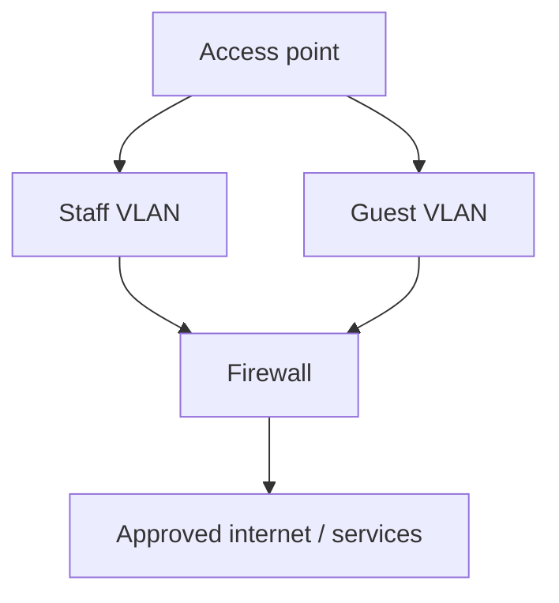

# LAN, WLAN and Wi-Fi security

A local network connects nearby devices; Ethernet switches learn MAC addresses. WLAN adds radio communication using IEEE 802.11. An access point bridges clients into a network; SSID names the WLAN. WPA2/WPA3 authenticate/protect wireless links; enterprise deployments may use 802.1X and a RADIUS authentication server. Client isolation limits peer reachability. Guest and corporate SSIDs should map to appropriate trust zones. A rogue AP is unauthorized; an evil twin impersonates a trusted WLAN. Wi-Fi encryption does not replace TLS.



Windows built-in read-only inspection:
```powershell
netsh wlan show interfaces
Get-NetAdapter
ipconfig /all
```
show interfaces displays connected WLAN information; Get-NetAdapter lists interfaces; /all shows IP configuration. Do not publish SSID/BSSID or sensitive network identifiers.

Linux: ip -br link; ip -br address; if hardware is exposed and iw installed, iw dev. Ubuntu package reference: sudo apt install iw. WSL2 normally sees virtual Ethernet, not the underlying Wi-Fi radio; inspect Windows host instead. [Microsoft netsh WLAN](https://learn.microsoft.com/en-us/windows-server/administration/windows-commands/netsh-wlan), [Linux wireless](https://wireless.docs.kernel.org/), [Wi-Fi Alliance](https://www.wi-fi.org/), [IEEE 802.11](https://www.ieee802.org/11/).

Illustrative configuration: staff SSID uses enterprise authentication, guest SSID routes only to approved internet, scanner SSID permits only approved application endpoint. Use WPA3 where supported, securely configured WPA2 otherwise, disable unused features, maintain patches and monitor unauthorized APs. Troubleshoot signal, authentication, DHCP, DNS and routing separately. UniTrack scanners and student Wi-Fi should not share unrestricted trust; ProTrack-MX should use HTTPS and application authorization. No new installation or actual wireless testing performed.
