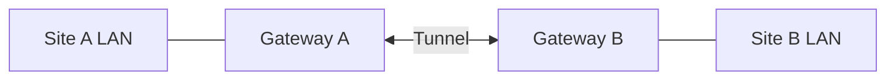

# VPN architecture: site-to-site, remote access and routing policy

VPNs create logical private connectivity over an underlying network. Typical encrypted tunnels authenticate endpoints and encapsulate payloads; some carrier private network services do not inherently encrypt. Site-to-site gateways join distinct prefixes. Remote-access clients receive virtual interfaces and route policies. TUN is Layer 3 IP; TAP is Layer 2 Ethernet. Clientless browser gateways and installed TLS VPNs have different access scopes.

Example: 192.168.10.0/24 and 192.168.20.0/24 connect only approved application flows. Avoid overlapping prefixes. IPsec protects IP traffic; IKEv2 negotiates security associations; OpenVPN uses TLS-based control; WireGuard uses its own cryptographic protocol. [IPsec RFC 4301](https://www.rfc-editor.org/rfc/rfc4301), [IKEv2 RFC 7296](https://www.rfc-editor.org/rfc/rfc7296), [WireGuard downloads](https://www.wireguard.com/install/), [strongSwan documentation](https://docs.strongswan.org/), [OpenVPN](https://openvpn.net/community/). These are implementation options, not required installs.

Split tunneling selects specific destinations; full tunneling directs general internet traffic through VPN egress, subject to exceptions. Check IPv4/IPv6 and DNS policy. Local endpoints remain security boundaries. An encrypted tunnel does not imply anonymity or unrestricted access.

Read-only diagnostics: Windows Get-NetRoute -AddressFamily IPv4; Linux ip route; ip route get 192.0.2.25. AddressFamily filters IP version, route get calculates selected route without sending a probe. Illustrative full-tunnel OpenVPN routes can use 0.0.0.0/1 and 128.0.0.0/1; both are more specific than the ordinary default. A local gateway may still be needed to reach VPN server. Verify policy rather than assuming all traffic is tunneled.

Troubleshooting: authentication, certificate validity/time, route overlap, MTU, DNS, local firewall, VPN gateway and permitted scope. Use MFA where supported, short-lived credentials, least privilege, endpoint protection, revocation, logging and appropriate fail-closed policy. UniTrack campuses could join only approved service routes; ProTrack-MX should preserve cloud authorization even if admin access is protected by VPN. No deployment or test claimed.
