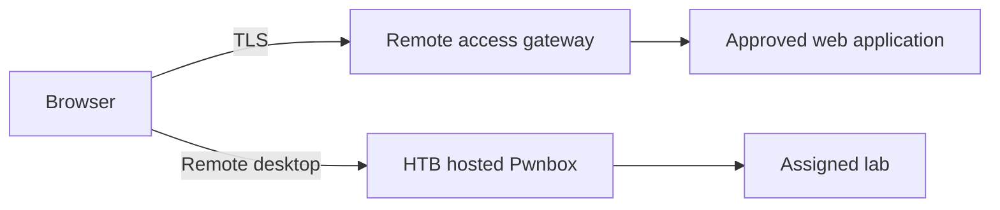

# TLS remote access, clientless VPN and Pwnbox

TLS (Transport Layer Security) protects communications and authenticates the server when certificates are validated. SSL is obsolete terminology retained in product names. Clientless SSL/TLS VPN gateways proxy specific applications through the browser; installed clients may create routed tunnels. A browser remote desktop is not necessarily a VPN.

Pwnbox is a hosted Parrot Linux environment. Tools execute remotely. Your computer does not automatically receive lab routes. [HTB Pwnbox](https://help.hackthebox.com/en/articles/5185608-introduction-to-pwnbox), [Academy VPN](https://help.hackthebox.com/en/articles/12710285-connecting-to-academy-vpn), [Cisco clientless VPN overview](https://www.cisco.com/c/en/us/td/docs/security/asa/asa916/asdm716/vpn/asdm-716-vpn-config/webvpn-overview.html), [TLS 1.3 RFC](https://www.rfc-editor.org/rfc/rfc8446). Pwnbox requires Academy access; no local installer; usage is subject to plan/availability.

Instructions: sign in to Academy, open the authorized lesson, locate the Pwnbox controls, spawn when required, open desktop. In the remote terminal, hostname and ip -br address show remote host and interface information, not local Windows data. End sessions according to HTB controls; do not publish instance credentials.

Troubleshoot browser connectivity, session availability, selected lab region and remote route configuration. Use official HTTPS, MFA where available, trusted browsers, session logout and scoped access. UniTrack remote administration could use approved application-level access instead of broad network reach; ProTrack-MX uses authenticated HTTPS, not automatically a VPN. No session spawned.
