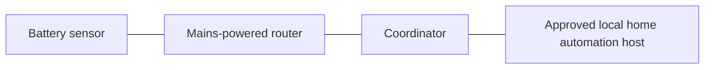

# Zigbee IoT networking

Zigbee is a low-power networking stack based on IEEE 802.15.4; commonly deployed in mesh networks for sensors, lights and automation. A coordinator establishes a network, routers may relay traffic, and end devices may sleep to save energy. Actual topology and roles depend on implementation. Gateways can bridge application data to IP systems.

Commissioning joins devices and establishes keys; protect network keys, allow joining only during approved windows, update devices and isolate gateways. [Official standard and ecosystem](https://csa-iot.org/all-solutions/zigbee/). Free open-source example platform: [Zigbee2MQTT official installation](https://www.zigbee2mqtt.io/guide/installation/), [supported adapters](https://www.zigbee2mqtt.io/guide/adapters/). Requires compatible coordinator hardware and a supported host; no purchase or installation needed for this lesson.

Optional own-device workflow: choose supported adapter, install a supported MQTT broker and Zigbee2MQTT using official instructions, configure serial adapter and broker credentials privately, pair only owned device, inspect status and disable join after enrollment. MQTT is a publish/subscribe messaging protocol; broker routes messages to subscribed applications. Read-only local Linux command ls -l /dev/serial/by-id/ lists available stable serial paths when exposed. WSL2 may need supported USB attachment; use a dedicated Linux host if appropriate. Troubleshoot adapter firmware, serial permission, channel interference, broker auth and pairing. UniTrack future IoT sensors should be gateway-isolated; ProTrack-MX should accept authenticated application data only. No hardware tested.
