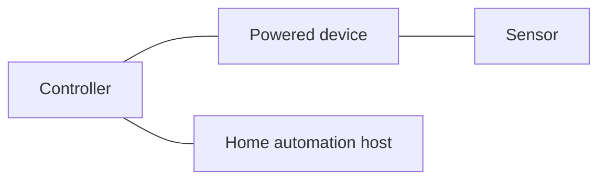

# Z-Wave IoT networking

Z-Wave is a low-power radio technology designed for control and status monitoring, commonly using region-specific sub-GHz frequencies. Classic Z-Wave uses mesh-capable devices; Z-Wave Long Range differs in topology. A controller manages device inclusion; supported nodes relay messages depending on network design. Use region-compatible certified hardware and S2 security where supported.

[Z-Wave Alliance technology](https://z-wavealliance.org/technology-overview/), free open-source [Z-Wave JS source](https://github.com/zwave-js/node-zwave-js), [Z-Wave JS UI docs](https://zwave-js.github.io/zwave-js-ui/). Requires compatible controller hardware. For an owned network, follow official installation on supported host/container, attach controller, keep S2 keys private, use authenticated local UI, include only approved devices, disable inclusion afterwards. No mandatory install.

Read-only reference: ls -l /dev/serial/by-id/ on supported Linux shows connected serial controller paths. Troubleshoot correct radio region, firmware, USB permissions, controller availability and inclusion status. Protect controller management, back up keys securely, patch devices and restrict gateway access; no publication of actual keys. UniTrack may use an isolated sensor gateway if applicable; ProTrack-MX needs application-level identity independent of IoT protocol. No execution or hardware access.
