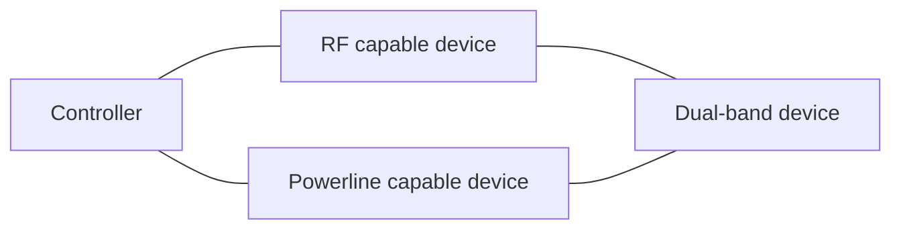

# Insteon home automation

Insteon is a smart-home control technology. Supported dual-band devices communicate over both RF and existing powerline wiring; not all devices have identical capabilities. A hub/controller can mediate device control and connect to IP applications. Unlike a pure WPAN radio protocol, Insteon can also use powerline media. Product support and hardware compatibility matter.

[Official technology overview](https://support.insteon.com/technology), [vendor website](https://www.insteon.com/), [Home Assistant Insteon integration](https://www.home-assistant.io/integrations/insteon/). Home Assistant is a free/open-source optional integration where compatible hardware exists; no generic free Insteon hardware or vendor cloud subscription is promised.

Own-device reference: confirm supported controller and firmware; install Home Assistant using [official instructions](https://www.home-assistant.io/installation/) only if needed; add supported integration, enter private credentials in its protected settings, verify authorized device status, restrict gateway network access. No hardware acquisition or installation required. For existing Docker-based deployment, docker ps lists running containers; it does not configure Insteon. Troubleshoot controller connectivity, powerline interference, RF coverage, firmware and integration compatibility. Do not experiment with mains wiring. Protect physical devices, controller credentials, updates and permitted IP flows. UniTrack/ProTrack-MX should trust authenticated gateway/application events rather than raw peripheral identities. No testing performed.
