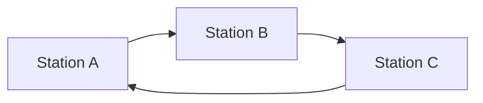

# Shared media, CSMA/CD and historical Token Ring

A shared bus exposes signals to attached devices. Historical coax Ethernet used a terminated backbone. A hub creates a physical star but logical shared medium. Carrier Sense Multiple Access with Collision Detection (CSMA/CD) senses medium, transmits when appropriate, detects a collision and retries after backoff. It applies to traditional half-duplex Ethernet, not normal modern full-duplex switched links. CAN uses different arbitration; Wi-Fi uses collision-avoidance techniques rather than Ethernet CSMA/CD.

Token passing is controlled medium access: a circulating control pattern grants transmission opportunity. In historical Token Ring, a physical star through a multistation access unit could form a logical ring. Token claim/recovery varies with protocol; not all ring networks use tokens. Modern Ethernet rings may use dedicated protection protocols.

Original scenario: a shared-medium device transmits while another is active, resulting in a collision in traditional half-duplex Ethernet. On a switched full-duplex link, both ends may send concurrently without Ethernet collisions. Shared access is not secure access; protect sensitive payloads with cryptography and authorization. Legacy hardware is not required or recommended for this theory lesson.

No software installation is necessary. Optional read-only inspection on a supported Linux host: ethtool eth0 (replace eth0 with actual interface); reports supported link settings, speed and duplex when driver permits. If absent: sudo apt install ethtool. WSL2 may expose limited settings. [Linux ethtool source](https://git.kernel.org/pub/scm/network/ethtool/ethtool.git/), [IEEE 802.3](https://www.ieee802.org/3/). Troubleshoot duplex mismatch, damaged cable, overloaded links or incorrect expectations. UniTrack and ProTrack-MX should use modern switched infrastructure where applicable; application TLS remains necessary. No learner execution.
