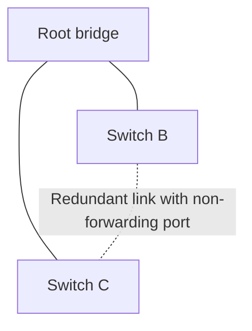

# Spanning Tree Protocol (STP) and Rapid STP

STP creates a loop-free Layer 2 forwarding topology from physically redundant Ethernet links. Bridges exchange BPDUs, select a root bridge (lowest bridge ID under the relevant instance), calculate path cost and assign forwarding/non-forwarding roles. RSTP improves convergence using rapid transition mechanisms. Physical links may remain connected even when one is not forwarding. STP does not perform IP routing or authenticate application traffic.

If active link fails, a previously non-forwarding path may become active after convergence. No guarantee of zero disruption. Without loop prevention, Layer 2 frames can circulate, cause broadcast storms and MAC instability.

Defenses: intentional root placement, BPDU Guard on suitable edge ports, root/loop protections where appropriate, secure management, alert on topology changes. Do not disable STP or configure redundant production links without approved design. [Cisco STP documentation](https://www.cisco.com/c/en/us/td/docs/routers/ios-xe/lan-wan/lan-wan/m_lsw-span-tree-prot.html), [IEEE 802.1](https://1.ieee802.org/).

Read-only examples on authorized Cisco equipment: show spanning-tree; show spanning-tree summary. Syntax depends on platform. Linux bridge link displays port properties; ip -d link show type bridge shows detailed bridge configuration; no bridge means no relevant result. Optional free software for isolated virtual labs: [Open vSwitch downloads](https://www.openvswitch.org/download/), [installation docs](https://docs.openvswitch.org/en/stable/intro/install/general/); Ubuntu package openvswitch-switch, install only on disposable supported VM when needed. ovs-vsctl show displays local OVS configuration when service is available; no network changes required. Native Linux bridge via iproute2 is another option. WSL2 is not always suitable for realistic switched labs.

Troubleshooting: check root ID, port roles, link state, configuration consistency, BPDU visibility and logs. UniTrack access switches could use appropriate loop prevention and redundant uplinks to improve availability; no actual topology or vulnerability verified. No installation or commands executed.
