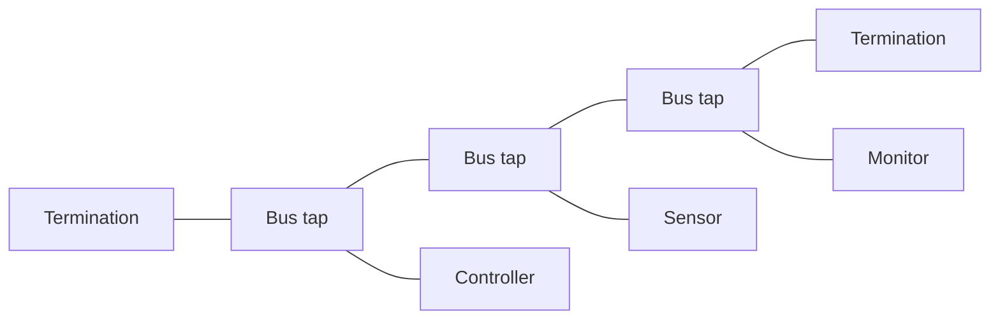

# CAN — Controller Area Network and SocketCAN

CAN is a message-oriented bus used in embedded, automotive and industrial systems. Standard high-speed CAN usually uses a linear differential bus with short stubs and nominal 120-ohm termination at each end, according to hardware specifications. A cable may physically pass through devices but CAN is a shared bus, not active Ethernet packet forwarding. Multiple nodes may contend; identifier-based nondestructive arbitration selects a message. The identifier describes message priority/meaning, not a verified sender. Classical CAN and CAN FD differ in payload and data-phase capabilities. CAN does not inherently encrypt/authenticate application messages.

[Linux SocketCAN documentation](https://docs.kernel.org/networking/can.html), [CAN physical implementation](https://www.analog.com/en/resources/app-notes/an-1123.html), [can-utils source](https://github.com/linux-can/can-utils). SocketCAN integrates CAN controllers with Linux networking; virtual CAN (vcan) is available when the kernel supports it. Free can-utils provides inspection utilities. Optional installation reference: sudo apt update; sudo apt install can-utils. No install needed today. An existing isolated virtual interface may be inspected with ip -details link show vcan0; -details shows device-specific information. If an already configured isolated simulation supplies synthetic traffic, candump vcan0 displays timestamp/interface or frame fields depending on options. Example illustrative display: vcan0 123 [2] 01 02; identifier 123 (hex), payload length 2, bytes 01 02. This is fictional, not captured data. Do not connect to vehicles, industrial controllers or send real CAN frames. WSL2 may lack CAN/vcan kernel modules; use supported disposable Linux VM when appropriate.

Troubleshoot missing interface/module, hardware support, bus termination (qualified personnel), firmware and bit timing. Protect physical access, gateway boundaries, authenticated higher-layer commands where supported and monitor anomalies. UniTrack/ProTrack-MX are not established CAN systems; future embedded devices should use authenticated gateway events. No hardware accessed, frames sent, software installed or lab run.
