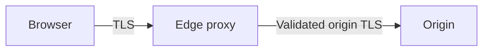

# Cloudflare edge reverse proxy

Cloudflare is a managed service with DNS, proxied HTTP traffic, CDN, DDoS mitigation and WAF capabilities depending on plan. It is not an open-source self-hosted proxy. [DNS proxy status](https://developers.cloudflare.com/dns/proxy-status/), [origin protection](https://developers.cloudflare.com/fundamentals/security/protect-your-origin-server/), [Full strict TLS](https://developers.cloudflare.com/ssl/origin-configuration/ssl-modes/full-strict/). Free plan exists; domain, origin and optional features may incur cost.

With proxied DNS, eligible HTTP requests go through edge; DNS-only records do not. Edge terminates TLS for content inspection, creating separate origin connection. Full strict validates origin certificate; avoid Flexible for sensitive applications. For a domain you control, review DNS onboarding and plan, validate origin TLS before proxying, configure intended proxied records, restrict direct origin access to approved traffic, check logs and rollback plan. No live account/domain changes. Read-only local DNS example Resolve-DnsName example.com (Windows) or getent ahosts example.com (Linux), example.com is a reserved illustrative name, not proof of Cloudflare use. Check DNS, certificate, origin reachability and edge logs; do not disable certificate validation. Protect sensitive data and forwarded client identity; a CDN cannot replace authorization. UniTrack may use edge protection only after institutional approval; ProTrack-MX must respect managed Supabase endpoint boundaries and data privacy. No deployment.
