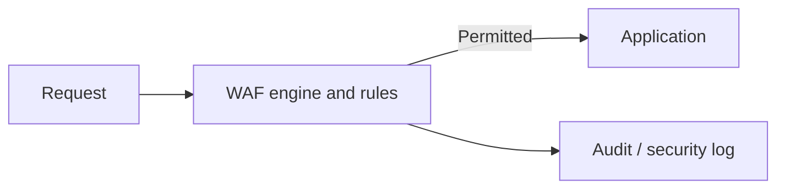

# ModSecurity and OWASP Core Rule Set

ModSecurity is a free/open-source WAF engine; CRS supplies generic detection rules. Web server/connector integrates engine, which evaluates available HTTP transaction data. CRS commonly uses anomaly scoring, rule IDs, thresholds and blocking decisions. DetectionOnly mode observes without blocking. TLS must be terminated by an authorized component for payload visibility. False positives and false negatives exist. [ModSecurity docs](https://modsecurity.org/docs/), [releases](https://github.com/owasp-modsecurity/ModSecurity/releases), [CRS docs](https://coreruleset.org/docs/), [CRS releases](https://github.com/coreruleset/coreruleset/releases), [official Docker integration](https://github.com/coreruleset/modsecurity-crs-docker).

Optional isolated Docker staging: review official image tags and environment variables, choose supported pinned ModSecurity+CRS image, configure approved local upstream and loopback-only publication, validate legitimate requests in detection mode, review rule hits, narrowly tune then enable blocking with approval. Docker Desktop existing command docker ps shows running containers; docker logs <container> reads logs, substitute owned container name. No command run. Do not publish raw audit data or real credentials.

Original scenario: legitimate search containing punctuation triggers a rule; investigate rule ID, request context and score; tune narrow exclusion rather than disabling an entire class. WAF does not replace parameterized SQL, output encoding, CSRF protection or authorization. Troubleshoot connector/rule compatibility, false positives, upstream connectivity and log retention. UniTrack test login/QR flows before enabling blocking; ProTrack-MX use WAF only for owned compatible endpoints. No deployment.
