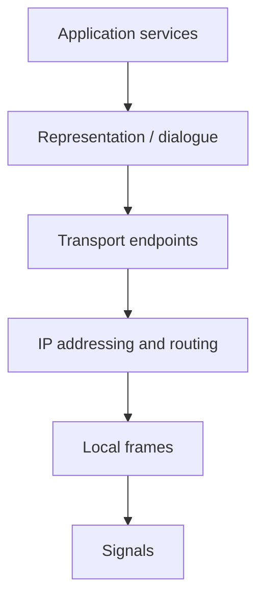

# OSI and TCP/IP models — technical reference

OSI (Open Systems Interconnection) is an ISO/ITU-T conceptual seven-layer model. TCP/IP is a practical internet protocol family and conventional four-layer architecture. Some textbooks split the link layer into two. Approximate mapping:
| OSI | TCP/IP | Examples |
| --- | --- | --- |
| Application, Presentation, Session | Application | HTTP, DNS, SSH, TLS functions, representation, dialogue |
| Transport | Transport | TCP, UDP |
| Network | Internet | IPv4, IPv6, ICMP |
| Data Link, Physical | Link | Ethernet, Wi-Fi, signaling |

Layer boundaries are conceptual; TLS and web login sessions are not exact one-to-one Layer 6/5 assignments. BGP uses TCP despite its network-routing function. PDU names: upper-layer data, TCP segment or UDP datagram, IP packet, link frame, physical bits/signals. A layer does not always add a standalone header. Encapsulation and decapsulation require protocol-specific processing.

No software is needed to study a model. Optional free tools: [Python](https://www.python.org/downloads/) for local representation examples, [Wireshark](https://www.wireshark.org/download.html) for authorized capture interpretation, built-in network diagnostics. Python Base64 example: import base64; print(base64.b64encode(b"Hello").decode("ascii")); output SGVsbG8= (illustrative). Encoding is not encryption. python --version (Windows) or python3 --version (Linux) checks interpreter. Existing learner environment needs no new install. [Python base64 docs](https://docs.python.org/3/library/base64.html).

Troubleshooting: establish scope; check link, neighbor, routes, transport service, TLS, HTTP and application logs. A certificate failure does not imply broken routing; an HTTP 403 may be expected authorization. Use layers to locate evidence, not assign every vulnerability rigidly. Protect physical access, VLANs, routes, exposed services, cryptography and application authorization. UniTrack session and QR validation belong to application security; ProTrack-MX RLS remains necessary regardless of network reach. No commands executed. Official [X.200](https://www.itu.int/rec/T-REC-X.200/en), [RFC 1122](https://www.rfc-editor.org/rfc/rfc1122), [RFC 1123](https://www.rfc-editor.org/rfc/rfc1123).
