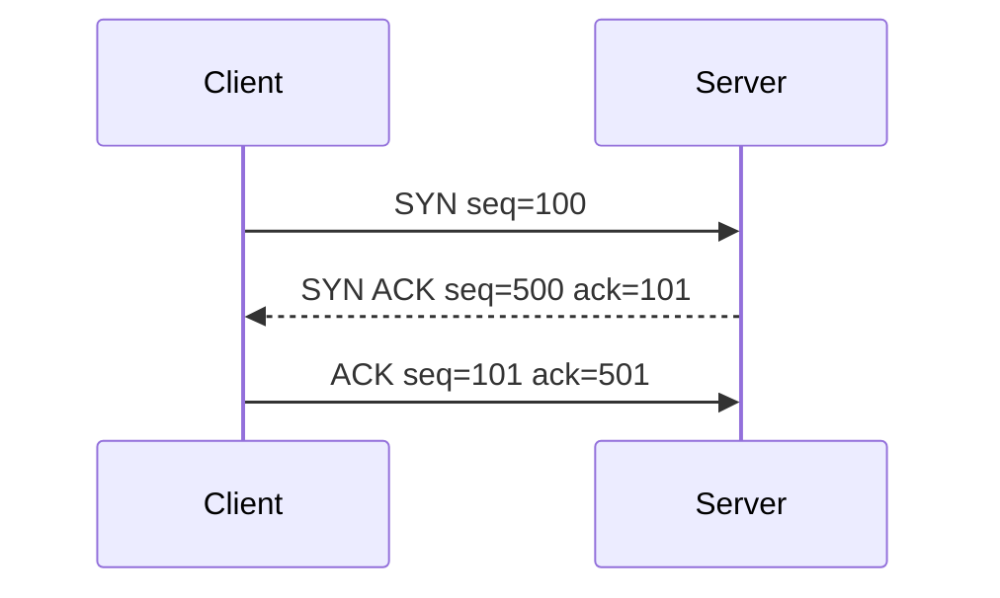

# TCP, UDP and ICMP

TCP provides reliable ordered byte streams, flow and congestion control. TCP header minimum 20 bytes: source/destination ports, sequence/acknowledgment numbers, flags, window, checksum and other fields. Ordinary handshake SYN, SYN-ACK, ACK synchronizes sequence spaces. FIN supports orderly shutdown; RST resets. TCP itself does not encrypt. UDP sends individual datagrams; header 8 bytes: source port, destination port, length, checksum. UDP does not provide built-in ordered reliable delivery; QUIC adds transport features over UDP. ICMP provides network control, errors and diagnostics, not TCP/UDP ports. ICMPv4 echo request/reply use types 8/0; ICMPv6 types 128/129. Some ICMP messages support path MTU discovery. Do not blanket-block essential ICMP.


Example sequence numbers fictional. SYN consumes one sequence number. A 5-tuple uses source/destination addresses, ports and protocol. Port 443 may be TCP HTTPS or UDP QUIC; port alone does not prove application identity.

Read-only local commands:
```powershell
Get-NetTCPConnection -State Listen
Get-NetUDPEndpoint
```
```bash
ss -lnt
ss -lnu
```
-l listening, -n numeric, -t TCP, -u UDP; UDP endpoints may be reported as unconnected. iproute2 provides ss; if absent in supported Ubuntu, sudo apt install iproute2 (optional only). Example output LISTEN 0 128 127.0.0.1:5000 0.0.0.0:* shows loopback TCP listener, not public service; example only. Windows tools built in. No install or test needed. Check bind address, port conflicts, firewall policy and routes; do not infer remote reachability from local listener. For ICMP troubleshooting distinguish absent replies from unavailable host; filters may prevent responses. No live probes required.

Defenses: restrict unused ports, approved host firewall, rate limits and service authentication, monitor anomalous flows. Protect legitimate ICMP needs. UniTrack Flask development listener should remain local; ProTrack-MX HTTPS transport does not replace RLS. [TCP RFC 9293](https://www.rfc-editor.org/rfc/rfc9293), [UDP RFC 768](https://www.rfc-editor.org/rfc/rfc768), [ICMP RFC 792](https://www.rfc-editor.org/rfc/rfc792), [ICMPv6 RFC 4443](https://www.rfc-editor.org/rfc/rfc4443), [QUIC RFC 9000](https://www.rfc-editor.org/rfc/rfc9000), [iproute2 source](https://git.kernel.org/pub/scm/network/iproute2/iproute2.git/). No execution performed.
