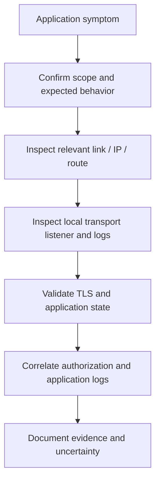

# OSI layered troubleshooting and service boundaries

OSI is a conceptual architecture, not software. Each layer offers services to its upper neighbor and uses services from its lower neighbor. Peer protocols describe communication rules between corresponding entities. A service is what is offered; interface is how a neighboring layer accesses it; protocol is how peers communicate. SDU is data received from upper layer; PDU is protocol unit exchanged with peer. SAP denotes a service access point in OSI terminology; ports are practical endpoint analogies rather than exact equivalents. See [OSI/TCP-IP reference](30-OSI-TCP-IP-Models.md) and [encapsulation guide](32-Packet-Encapsulation-Wireshark.md).

This is a diagnostic approach, not a mandatory order; select the likely subsystem based on evidence. One error can span layers. An HTTP status demonstrates some application-level communication, not success of every business operation.

| Layer/domain | Local diagnostic reference | Interpretation |
| --- | --- | --- |
| Physical | Get-NetAdapter / ip -br link | Link state, adapter availability |
| Link/network boundary | Get-NetNeighbor -AddressFamily IPv4 / ip neigh | Local neighbor mappings; absence may be normal |
| Network | Get-NetIPConfiguration / ip -br address; Get-NetRoute -AddressFamily IPv4 / ip route | Address, gateway and route decisions |
| Transport | Get-NetTCPConnection -State Listen / ss -lnt | Local listener, not remote reachability |
| TLS and representation | Approved browser certificate information and parser logs | Hostname/trust/format issues |
| Application/session | Authorized API and authentication logs | Expiry, access control, response codes |

Windows cmdlets are built in; Linux ip and ss are part of iproute2. If unavailable in a supported Ubuntu environment, package reference: sudo apt update; sudo apt install iproute2. No install necessary for this lesson. -br = brief, -l = listening, -n = numeric, -t = TCP. WSL2 may have distinct networking. [iproute2 source](https://git.kernel.org/pub/scm/network/iproute2/iproute2.git/), [Microsoft networking cmdlets](https://learn.microsoft.com/en-us/powershell/module/nettcpip/), [WSL networking](https://learn.microsoft.com/en-us/windows/wsl/networking).

Original UniTrack example: scanner reports 403 from HTTPS API. Confirm the response originates from expected application or proxy; examine approved request context and role policy. Do not assume link failure, do not bypass the denial. A missing local listener at 127.0.0.1:5000 is a different failure and may explain a local reverse proxy's 502. For ProTrack-MX, an RLS rejection is not solved by opening network ports; check authenticated role and intended policy. All examples illustrative. Do not disable TLS validation, change production firewalls without approval or publish actual credentials/student data. No command, installation or live exercise performed. Official reference [ITU-T X.200](https://www.itu.int/rec/T-REC-X.200/en).
