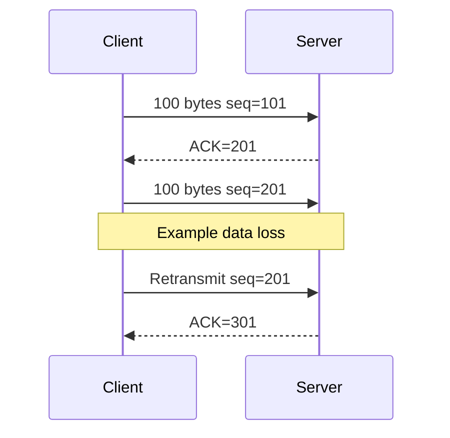

# TCP reliability, flow control and application endpoints

TCP provides reliable ordered byte-stream transport while communication remains viable. It does not inherently encrypt or preserve application message boundaries. Ordinary handshake SYN, SYN-ACK, ACK establishes sequence spaces. ACK identifies next expected contiguous byte; SACK may describe noncontiguous blocks. SYN/FIN consume sequence numbers. Checksums detect accidental corruption; retransmission, duplicate handling and sequence numbers support reliability. Idle connections do not necessarily exchange continuous control messages; TCP keepalive is optional.

Fictional values, no actual capture. ACK indicates transport receipt, not application processing. Flow control uses receiver window (rwnd); congestion control uses congestion window (cwnd). Simplified outstanding data bound min(rwnd,cwnd): 16 KiB receiver, 8 KiB congestion gives 8 KiB, subject to already outstanding bytes and other constraints. UDP datagrams do not inherently provide reliable ordering or these controls; QUIC implements additional transport behavior over UDP.

Ports are 16-bit identifiers in separate TCP/UDP spaces; IANA system 0–1023, user 1024–49151, dynamic/private 49152–65535 (actual OS ephemeral range may differ). 5-tuple includes source/destination IPs, source/destination ports and protocol. Example 192.0.2.10:51514 -> 198.51.100.20:443 TCP. Port does not prove application identity. Local listen on 127.0.0.1:5000 is loopback-only; wildcard bind not proof of internet exposure.

Read-only references: PowerShell Get-NetTCPConnection -State Listen; Get-NetUDPEndpoint; Linux ss -lnt; ss -lnu; ss -ti (TCP internal information where available; -t TCP, -i internal). Optional package iproute2 on supported Ubuntu. Wireshark offline display filters tcp, tcp.analysis.retransmission and tcp.window_size; heuristics may misclassify due to capture loss/offload. [Wireshark download](https://www.wireshark.org/download.html); no new capture needed. Troubleshoot bind, firewall, route, congestion, application timeout and capture vantage separately. Defenses: restrict listeners, authentication/TLS, connection limits and approved monitoring. UniTrack and ProTrack-MX need app authorization regardless of transport reliability. [RFC 9293](https://www.rfc-editor.org/rfc/rfc9293), [RFC 5681](https://www.rfc-editor.org/rfc/rfc5681), [IANA ports](https://www.iana.org/assignments/service-names-port-numbers/service-names-port-numbers.xhtml). No installation or execution.
