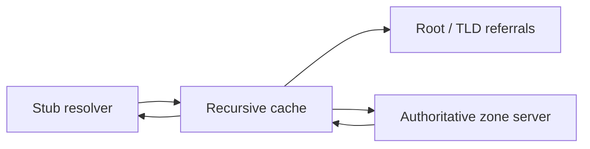

# DNS — name resolution and diagnostics

DNS is a hierarchical distributed database of resource records. A stub resolver requests a recursive resolver; cache misses may involve root, TLD and authoritative servers. Root/TLD supply referrals; authoritative server supplies zone data. Cache TTL is seconds and independent of IP TTL hop limit. An FQDN can explicitly end with root dot (portal.example.com.). URL also contains scheme/path etc. DNS can resolve multiple addresses, aliases and non-address records; DNS success does not prove service availability.


A IPv4; AAAA IPv6; CNAME alias; MX mail exchanger with preference; TXT text; NS nameserver; PTR reverse name; SOA zone authority and timing metadata. Example fictional answer: portal.example.com. 300 IN A 192.0.2.25 (owner, TTL, class, type, value). NXDOMAIN name absent; NOERROR with empty relevant answer may mean missing record type; SERVFAIL resolution/processing error. Traditional DNS UDP/TCP 53; DoT commonly TCP 853; DoH HTTPS. DNSSEC authenticates signed data via trust chain, does not encrypt; encrypted DNS transport protects client-resolver link, not a substitute for application TLS validation.

Windows 11 built-in:
```powershell
Resolve-DnsName example.com -Type A
Resolve-DnsName example.com -Type AAAA
```
Ubuntu WSL2:
```bash
getent ahosts example.com
dig example.com A
dig example.com AAAA
```
-Type and trailing A/AAAA choose record. getent uses configured system name service; dig queries DNS, default configured resolver. For missing dig, optional sudo apt update; sudo apt install dnsutils (package naming varies). dig -v checks version; no install or external query required. [BIND 9 docs](https://bind9.readthedocs.io/en/latest/), [ISC downloads](https://www.isc.org/download/), [Microsoft Resolve-DnsName](https://learn.microsoft.com/en-us/powershell/module/dnsclient/resolve-dnsname). BIND utilities are free/open-source. WSL resolver may differ from Windows. Never change institutional DNS without approval.

Troubleshoot incorrect name, record type, cache, resolver reachability, DNSSEC validation, split DNS and upstream issues. Monitor approved resolver use and unexpected query patterns while protecting privacy. UniTrack should use approved stable DNS and valid TLS; ProTrack-MX must preserve authorization even when cloud names resolve. [RFC 1034](https://www.rfc-editor.org/rfc/rfc1034), [RFC 1035](https://www.rfc-editor.org/rfc/rfc1035), [RFC 7766](https://www.rfc-editor.org/rfc/rfc7766), [RFC 4033](https://www.rfc-editor.org/rfc/rfc4033), [RFC 7858](https://www.rfc-editor.org/rfc/rfc7858), [RFC 8484](https://www.rfc-editor.org/rfc/rfc8484). No commands or live tests performed.
