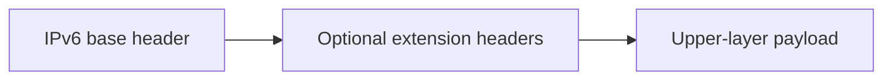

# IPv6 and network-layer fundamentals
IPv6 addresses 128 bits; hexadecimal groups separated by colon, one :: compression per address. 2001:db8::10 documentation only; fe80::/10 link-local; ::1 loopback; ::/0 default route. IPv6 uses multicast, not broadcast; ICMPv6 Neighbor Discovery replaces ARP functionality. Base header 40 bytes includes version, traffic class, flow label, payload length, next header, hop limit and addresses; extension headers may follow. IPv4 minimum header 20 bytes, options variable, checksum and TTL. IPv6 router does not fragment; source may, Path MTU Discovery depends on ICMPv6. Dual stack supports both versions; IPv4-only and IPv6-only endpoints need translation/proxy or compatible stack for communication. IPsec support does not mean IPv6 traffic automatically encrypted.

Windows read-only: Get-NetIPAddress -AddressFamily IPv6; Get-NetRoute -AddressFamily IPv6. Linux: ip -6 address; ip -6 route; ip -6 neigh. iproute2 is free/open-source; Ubuntu sudo apt install iproute2 if absent, no install today. Example ::/0 via fe80::1 dev eth0 is fictional; link-local next hop scoped by interface. Wireshark offline filter ipv6 or icmpv6. Troubleshoot address/prefix, neighbor discovery, default route, firewall and path MTU. Do not disable IPv6 or block all ICMPv6 as a generic fix. Apply dual-stack security policy; UniTrack and ProTrack-MX must protect application authorization for both versions. [RFC 8200](https://www.rfc-editor.org/rfc/rfc8200), [RFC 4291](https://www.rfc-editor.org/rfc/rfc4291), [RFC 4861](https://www.rfc-editor.org/rfc/rfc4861), [RFC 9099](https://www.rfc-editor.org/rfc/rfc9099). No commands executed.
