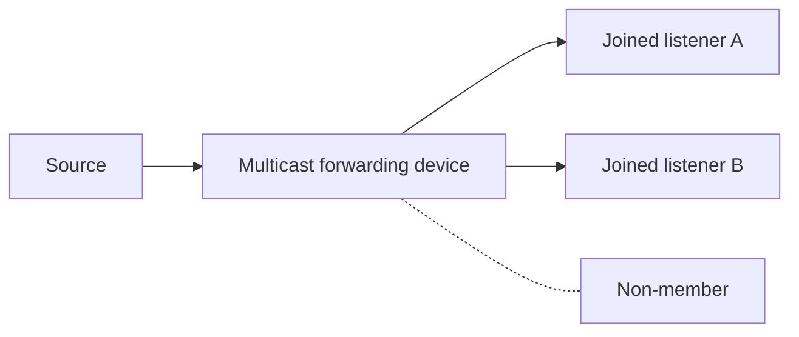

# IGMP and multicast

IPv4 multicast addresses 224.0.0.0/4 identify groups; unicast one-to-one, broadcast local-domain all, multicast interested group. IGMP (IP protocol 2) communicates IPv4 group membership between hosts and adjacent multicast routers; IGMPv3 supports source filtering. RFC 9776 (March 2025) obsoletes 3376. IPv6 uses MLD via ICMPv6. IGMP itself does not route multicast between networks; separate multicast forwarding/routing mechanisms do. IGMP snooping observes membership on switches to constrain unnecessary flooding; querier behavior/configuration matters.

Fictional administratively scoped group 239.10.10.10 for approved lecture distribution. Only interested listeners should receive group traffic where policy and forwarding are configured. No group traffic sent today.
Linux ip maddr show lists interface multicast addresses; cat /proc/net/igmp shows local IPv4 memberships if available. Windows netsh interface ipv4 show joins displays joined groups. Read-only, no software installation. Wireshark display filter igmp for approved existing capture. iproute2 package if missing (sudo apt install iproute2); [Wireshark official download](https://www.wireshark.org/download.html). Troubleshoot membership, snooping, querier, routing, TTL and firewall. Do not indiscriminately flood networks or join unapproved services. Restrict unwanted multicast and monitor policy; UniTrack and ProTrack-MX do not require multicast for normal HTTPS applications. [RFC 9776](https://www.rfc-editor.org/rfc/rfc9776), [RFC 2365](https://www.rfc-editor.org/rfc/rfc2365), [RFC 3810 MLDv2](https://www.rfc-editor.org/rfc/rfc3810) (historical MLDv2 specification; consult current RFC status). No live test.
