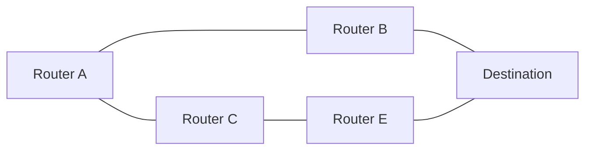

# RIP — Routing Information Protocol

Distance-vector interior routing protocol. RIPv2 uses UDP 520, IPv6 RIPng UDP 521. Metric hop count; 15 reachable maximum, 16 unreachable. RIPv2 carries subnet masks/CIDR; older RIPv1 classful. Periodic updates usually 30s and triggered updates; timers, split horizon, route poisoning/poison reverse help limit loops. Convergence depends on topology and configuration.

Fictional path via B has 2 links, via C/E has 3. Lower hop metric preferred regardless of bandwidth. Route preference and policy can affect actual installation. RIP is a routing control-plane protocol over UDP, not directly IP 89. Restrict routing interfaces/updates to authorized peers; use supported authentication and monitor unexpected advertisements. No production changes.

Free/open-source FRRouting [official docs](https://docs.frrouting.org/), [RIP docs](https://docs.frrouting.org/en/latest/ripd.html), [source](https://github.com/FRRouting/frr). Optional Ubuntu isolated VM package reference sudo apt install frr; may start service, not needed today. FRR daemon ripd requires approved configuration and activation. vtysh -c 'show ip rip' and vtysh -c 'show ip route rip' are read-only where daemon/permissions support them. -c runs a single command; output varies. Wireshark offline filter rip. Troubleshoot neighbor/update reachability, interface selection, authentication, timer/metric, overlapping routes and route preference. UniTrack campus could use a modern IGP in approved infrastructure; RIP is primarily educational/legacy here. [RFC 2453](https://www.rfc-editor.org/rfc/rfc2453), [RFC 2080](https://www.rfc-editor.org/rfc/rfc2080). No installation or commands executed.
