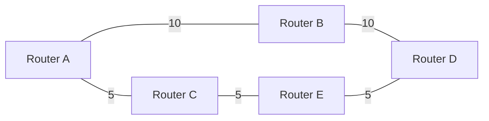

# OSPF — Open Shortest Path First

Link-state interior routing protocol, IP protocol 89, not TCP/UDP port. OSPFv2 primarily IPv4; OSPFv3 introduced IPv6 (additional address families via extensions). Hello packets discover neighbors; appropriate adjacencies exchange LSAs; LSDB (link-state database) represents topology; SPF/Dijkstra computes least-cost paths. Cost normally configured/derived from interface and reference bandwidth. Area 0 backbone; ABR connects areas, ASBR redistributes external routing information. Broadcast networks may elect DR/BDR. Convergence depends on timers/topology, not guaranteed zero disruption.

Original comparison: A-B-D cost 20, A-C-E-D cost 15; OSPF prefers latter despite more links. Actual route calculation includes destination/interface costs. RIP prefers hop count. Secure routing: authenticate peers using supported mechanisms, restrict control-plane access, passive interfaces where appropriate, consistent area and authentication settings; monitor route/adjacency changes.
Free/open-source FRRouting [docs](https://docs.frrouting.org/), [OSPFv2](https://docs.frrouting.org/en/latest/ospfd.html), [OSPFv3](https://docs.frrouting.org/en/latest/ospf6d.html). Approved isolated VM only; sudo apt install frr is optional and may start service; ospfd/ospf6d must be configured separately, not required today. Read-only reference on configured instance: vtysh -c 'show ip ospf neighbor'; vtysh -c 'show ip ospf database'; vtysh -c 'show ip route ospf'. Neighbor state FULL indicates full adjacency where expected, not every neighbor must be FULL on broadcast networks. Troubleshoot hello/dead timers, area mismatch, MTU, authentication, network type, interface state and route policy. Wireshark offline filter ospf. UniTrack multi-building routing could use OSPF under approved network administration; ProTrack-MX managed cloud routing is not controlled by application code. [RFC 2328](https://www.rfc-editor.org/rfc/rfc2328), [RFC 5340](https://www.rfc-editor.org/rfc/rfc5340). No live deployment or execution.
