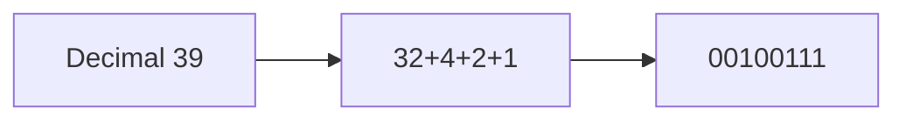

# Binary and IPv4 address representation

IPv4 32 bits, four 8-bit octets; values 0–255. Binary weights 128 64 32 16 8 4 2 1. Decimal-to-binary subtract largest remaining weight if possible; binary-to-decimal sum weights of 1s. 192=128+64 -> 11000000; 168=128+32+8 -> 10101000; 10=8+2 -> 00001010; 39=32+4+2+1 -> 00100111. Example 173=128+32+8+4+1 -> 10101101. 127.0.0.1 loopback, binary 01111111.00000000.00000000.00000001. 2^32 bit patterns, not all publicly assignable. MAC (typically 48 bits) is local link addressing, not IP identity. IP may change; interfaces can have multiple addresses.

Python local standard library:
```python
ip = "192.168.10.39"
binary = ".".join(f"{int(o):08b}" for o in ip.split("."))
print(binary)
print(int("00100111", 2))
```
Expected 11000000.10101000.00001010.00100111 then 39. split separates octets, int converts decimal strings, :08b gives eight-bit binary formatting, join combines octets, int(text,2) parses base 2. For arbitrary input validate first with ipaddress.IPv4Address. No packages needed, Python already installed in learner environment. [Python downloads](https://www.python.org/downloads/), [format specification](https://docs.python.org/3/library/string.html#format-specification-mini-language), [ipaddress docs](https://docs.python.org/3/library/ipaddress.html). [Offline binary calculator](../Assets/09-IP-Addresses-Interactive.html). No network requests. Common mistakes: missing leading zero padding, octet >255, confusing 32 bits and 32 bytes, assuming binary encoding encrypts data. Security: recognize network scope correctly, do not trust addresses as authentication, avoid publishing actual addresses. UniTrack loopback 127.0.0.1:5000 is a local development endpoint; ProTrack-MX uses authenticated cloud connections. No learner command execution required.
