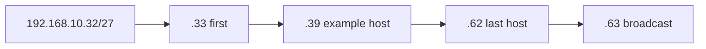

# Subnet masks, CIDR, network/broadcast and host calculations

CIDR /p is number of leading ones in a 32-bit IPv4 mask, rest zero. Network = IP AND mask; last address = network OR inverse mask. Ordinary subnet usable = first+1 through last-1, total 2^(32-p), usable total-2 for /0–/30 mathematical blocks subject to special-use reservations. /31 point-to-point permits both addresses per RFC 3021; /32 host prefix is one address. Gateway often first/last usable but configuration-dependent. IPv6 has no broadcast.

Example 192.168.10.39/27 mask 255.255.255.224: 00100111 AND 11100000 = 00100000 = 32. Network .32, broadcast .63, 32 total, 30 conventional hosts. /26 mask 255.255.255.192, .0–.63, /24 .0–.255. 172.16.35.19/20 mask 255.255.240.0 -> 172.16.32.0–172.16.47.255, 4096 total. /24 to four /26 borrows two bits, blocks .0,.64,.128,.192; each 64 addresses. Historical classes obsolete; /8 /16 /24 are examples, not inferred masks.

Python standard library:
```python
import ipaddress
i = ipaddress.ip_interface("192.168.10.39/27")
n = i.network
p = n.prefixlen
first = n.network_address + (1 if p < 31 else 0)
last = n.broadcast_address - (1 if p < 31 else 0)
print(n, n.netmask, first, last, n.num_addresses - (2 if p < 31 else 0))
```
Expected 192.168.10.32/27 255.255.255.224 192.168.10.33 192.168.10.62 30. In /31 and /32 broadcast_address API returns final address, not a conventional broadcast endpoint. No list of hosts required, avoiding huge allocations. Free ipcalc optional Ubuntu sudo apt install ipcalc; ipcalc 192.168.10.39/27 computes offline; output/version vary. Official [ipcalc](https://jodies.de/ipcalc), [Python ipaddress](https://docs.python.org/3/library/ipaddress.html). Windows Get-NetIPAddress -AddressFamily IPv4 shows PrefixLength; Linux ip -br -4 address displays address/prefix. [Offline interactive companion](../Assets/09-IP-Addresses-Interactive.html). [RFC 4632](https://www.rfc-editor.org/rfc/rfc4632), [RFC 3021](https://www.rfc-editor.org/rfc/rfc3021), [IANA registry](https://www.iana.org/assignments/iana-ipv4-special-registry). Troubleshoot duplicate IP, mask mismatch, overlapping VPN routes, incorrect gateway and firewall policy. CIDR math does not establish authorization; respect approved scope and exclusions. UniTrack fictional /26 zone plan must be sized against real capacity, and ProTrack-MX RLS remains necessary. No install or live test performed.
