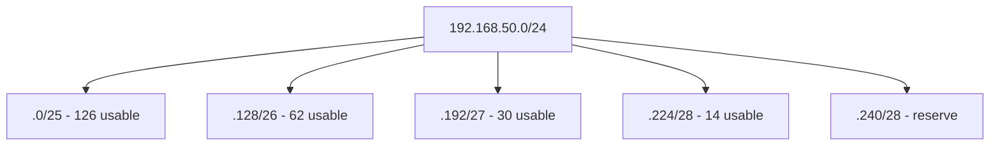

# Mental subnetting and variable-length subnet masks (VLSM)

Subnetting divides a prefix into aligned smaller prefixes. Given /p, host bits=32-p, total=2^(32-p), conventional hosts=total-2 for ordinary broadcast subnets (special /31 and /32 semantics). Network = IP AND mask; last = network + total - 1. Prefix /26 gives 255.255.255.192, 64 total; 192.168.12.160/26 belongs to .128–.191. Binary 10100000 AND 11000000 = 10000000. First .129, last .190. A gateway is configured, not deduced uniquely.

Mental method: p%8 = r; nonaligned changing octet = floor(p/8)+1 (1-based); step = 2^(8-r). Remainders 0–7 give steps 256,128,64,32,16,8,4,2. At exact boundary, next octet is wholly host (if present); /32 no changing octet. For /20, step 16 is in third octet; 172.16.35.19/20 yields 172.16.32.0–172.16.47.255, 4096 addresses. Round changing octet down to a multiple of step; set subsequent octets to zero for base, 255 for final.

Equal division: borrow b bits for 2^b children; child prefix p+b, child size 2^(32-p-b). Child i starts at parent base+(i-1)*size. /26 -> 4 /28, size 16. 192.168.12.128/26 children .128, .144, .160, .176; each 14 conventional hosts. Original independent example 192.0.2.64/27 -> four /29: .64,.72,.80,.88. Third start .80, second final .79. Assessment inputs omitted. VLSM allows varying sizes; allocate largest first and ensure alignment, no overlap.

For needs 100,50,20,10, above example fits; account for gateways and growth. On real network use approved IPAM and change plan.

Python offline:
```python
import ipaddress
n = ipaddress.ip_network("192.0.2.64/27")
for i, child in enumerate(n.subnets(new_prefix=29), 1):
    print(i, child, child.broadcast_address)
```
Expected four lines: 1 192.0.2.64/29 192.0.2.71; 2 192.0.2.72/29 192.0.2.79; 3 192.0.2.80/29 192.0.2.87; 4 192.0.2.88/29 192.0.2.95. new_prefix sets child length; enumerate one-based; generator avoids eagerly allocating all subnets. Use ip_interface for host/prefix. No new packages. Optional free ipcalc via sudo apt install ipcalc on approved Ubuntu; ipcalc 192.0.2.64/27 offline. Windows Get-NetIPAddress -AddressFamily IPv4 and Linux ip -br -4 address inspect assigned prefixes, not subnet calculator. [Official Python docs](https://docs.python.org/3/library/ipaddress.html), [ipcalc](https://jodies.de/ipcalc), [RFC 4632](https://www.rfc-editor.org/rfc/rfc4632), [RFC 3021](https://www.rfc-editor.org/rfc/rfc3021), [offline subnetting tool](../Assets/10-Subnetting-Interactive.html). Troubleshoot off-by-one, total versus usable, wrong octet, incorrect parent alignment, overlapping VPN prefixes. Subnet reachability is not authorization. UniTrack departmental design and ProTrack-MX cloud access require independent application security. No live tests or installs.
