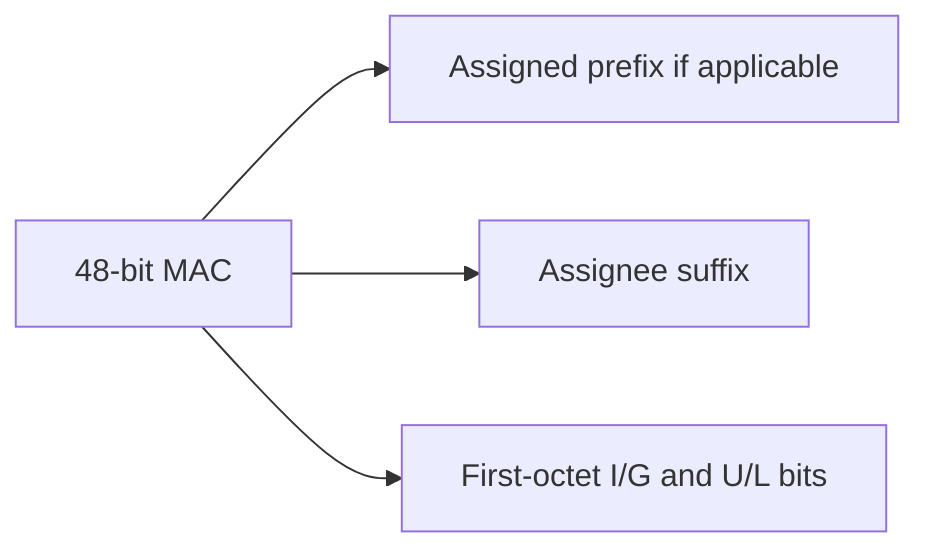

# MAC addresses and IEEE allocations
Conventional Ethernet MAC 48 bits, 6 bytes, 12 hex digits. DE:AD:BE:EF:13:37 = DE-AD-BE-EF-13-37 = DEAD.BEEF.1337. DE decimal 222, binary 11011110. Traditional MA-L OUI 24 bits plus 24-bit suffix; MA-M 28-bit prefix, MA-S 36-bit prefix. The suffix is not a NIC (Network Interface Controller). IEEE assignment identifies assignee, not actual device identity; randomized/local addresses are common. First-octet &1 reads group bit, &2 reads local bit. DE has I/G=0, U/L=1; DC has both zero; 01 has group bit; all FF is broadcast. Local unicast low nibble 2,6,A,E; structured local allocation rules may apply. Standard IPv4 multicast mapping 01:00:5E:00:00:00 to 01:00:5E:7F:FF:FF; IPv6 multicast 33:33 + low 32 bits. [IEEE official MAC blocks](https://standards.ieee.org/products-programs/regauth/mac/), [IEEE public registry](https://regauth.standards.ieee.org/standards-ra-web/pub/view.html), [RFC 9542](https://www.rfc-editor.org/rfc/rfc9542).

Switch FDB learns MAC-to-port; ARP cache IP-to-MAC. Known unicast, unknown unicast flooding, multicast snooping and broadcast are different behaviors. Read-only Windows Get-NetAdapter; getmac /v. Linux ip -br link; ip link show. iproute2 optional sudo apt install iproute2 on approved Ubuntu. No installation or change required. WSL2 interfaces virtualized. Troubleshoot duplicate addresses, interface state, VLAN and FDB via authorized inventory. Do not treat MAC filtering as identity; use 802.1X, port security, authenticated app access. UniTrack scanner identity must not depend solely on MAC; ProTrack-MX cloud server does not normally see client local MAC. [Offline classifier](../Assets/11-MAC-Addresses-Interactive.html).
