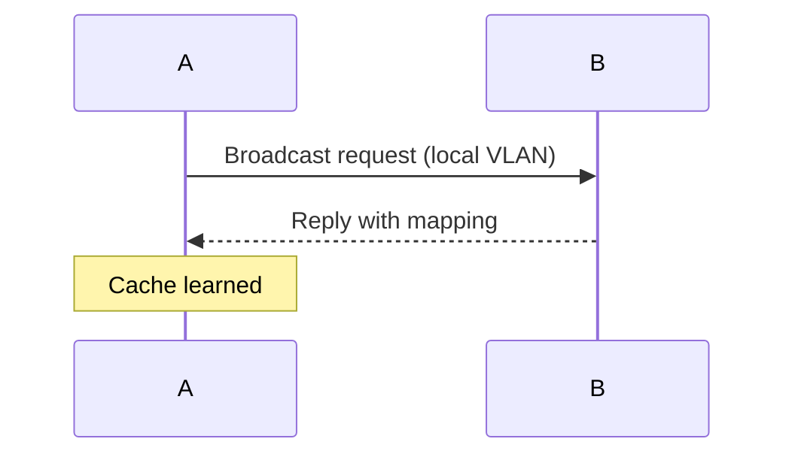

# ARP and defensive analysis
ARP resolves IPv4 next-hop address to local MAC; EtherType 0x0806, no TCP/UDP port. Request normally Ethernet broadcast, reply normally unicast. Ethernet/IPv4 payload 28 bytes, fields hardware/protocol types, lengths, opcode, sender/target hardware/protocol addresses. IPv6 uses ICMPv6 NDP. Cache avoids repeated lookups; dynamic states change. ARP cache differs from switch FDB. Original example A 192.0.2.10 asks for B 192.0.2.20, B replies with 02:00:00:00:00:14. No live capture.

ARP lacks cryptographic authentication; false mappings can disrupt or redirect traffic. MAC spoofing/flooding and MAC-only filtering are distinct risks. Source mentions Ettercap ([official project](https://github.com/Ettercap/ettercap)) and legacy Cain & Abel; these are dual-use, and the latter's third-party archive is not a trusted current distribution. No installation or active poisoning instructions in this reference. Defensive controls: DHCP snooping, Dynamic ARP Inspection, validated static bindings, segmentation, 802.1X, port security, monitoring and authenticated TLS/IPsec. TLS does not prevent poisoning itself; generic router firewall may not protect same-VLAN traffic. Unexpected MAC change is an indicator, not proof: check approved baseline, failover, virtual interfaces, DHCP and switch logs. Windows arp -a; Get-NetNeighbor -AddressFamily IPv4. Linux ip -4 neigh show; example 192.0.2.1 dev eth0 lladdr 02:00:00:00:00:01 REACHABLE; STALE often normal, FAILED indicates unresolved. Read-only; no probing. Offline Wireshark arp filter, compare approved capture with inventory; avoid public disclosure of actual private identifiers. UniTrack scanner VLAN and device credentials; ProTrack-MX application sessions independent of MAC. [RFC 826](https://www.rfc-editor.org/rfc/rfc826), [RFC 5227](https://www.rfc-editor.org/rfc/rfc5227), [RFC 4861](https://www.rfc-editor.org/rfc/rfc4861). [Offline simulator](../Assets/11-MAC-Addresses-Interactive.html).
