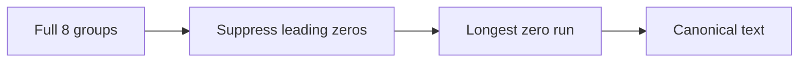

# IPv6 hexadecimal notation and compression
128 bits = 16 bytes = eight 16-bit hextets. Each hex digit 4 bits. RFC 4291 general syntax and RFC 5952 canonical representation differ. Lowercase, remove leading zeros, compress longest run of at least two zero groups once; first run only when tied. A single zero group remains 0. Preserve trailing zeros of nonzero groups. Example fe80:0000:0000:0000:dd80:b1a9:6687:2d3b -> fe80::dd80:b1a9:6687:2d3b. Expand by counting explicit groups, inserting missing zeros, padding to four digits. 2001:db8:0:1:0:0:0:5 -> 2001:db8:0:1::5 (not first isolated zero). 2001:db8:0:0:1:0:0:1 -> 2001:db8::1:0:0:1 (tie). ::1 loopback, :: unspecified. Two :: invalid. IPv6 URL http://[::1]:5000/ uses brackets. Zone identifiers (fe80::1%eth0) scope interface, not address bits. IPv4-mapped ::ffff:192.168.12.160 uses mixed notation; not automatic conversion to globally reachable IPv6. 

Python offline: import ipaddress; a=ipaddress.IPv6Address("2001:0DB8:0:0:0:0:0:10"); print(a.compressed, a.exploded). Expected 2001:db8::10 and 2001:0db8:0000:0000:0000:0000:0000:0010. Python renders mapped addresses in hex. No packages. Windows Get-NetIPAddress -AddressFamily IPv6; Linux ip -6 -br address. Treat textual variants as same address by parsing before security decisions; validate scope and prefixes separately, not naive string comparison. UniTrack local IPv6 loopback may need explicit binding; no deployment change. [RFC 5952](https://www.rfc-editor.org/rfc/rfc5952), [RFC 4291](https://www.rfc-editor.org/rfc/rfc4291), [Python](https://docs.python.org/3/library/ipaddress.html), [offline companion](../Assets/12-IPv6-Addresses-Interactive.html).
