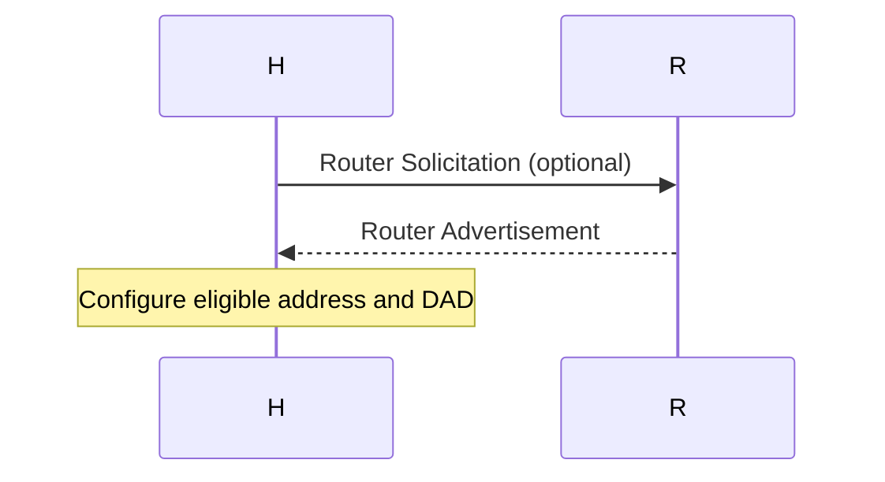

# SLAAC, DHCPv6 and IPv6 interface identifiers
Stateless Address Autoconfiguration uses router advertisements and local identifier generation. Typical flow: link-local address, DAD, RS (optional), RA with prefix and flags/lifetimes, construct eligible /64 address, DAD. RA generally provides default router; DHCPv6 may provide addresses or other settings, not ordinary default gateway. NDP ICMPv6 NS/NA replaces ARP for neighbor resolution. Multiple addresses may coexist. Stable opaque IID RFC 7217 and temporary IID RFC 8981 improve privacy compared with hardware-derived addresses; RFC 8064 recommends against embedding stable MAC by default.

Historical modified EUI-64 example MAC 00:11:22:33:44:55 -> insert ff:fe -> 00:11:22:ff:fe:33:44:55 -> XOR first octet with 02 -> 02:11:22:ff:fe:33:44:55 -> 0211:22ff:fe33:4455. Under 2001:db8:1234:ab00::/64 gives 2001:db8:1234:ab00:211:22ff:fe33:4455. Not universal modern method. 
Read-only Windows Get-NetIPAddress -AddressFamily IPv6; Get-NetNeighbor -AddressFamily IPv6; Linux ip -6 address; ip -6 neigh; ip -6 route. Wireshark offline filters icmpv6.type == 134, 135, 136 (separate complete expressions), dhcpv6. Official free [Wireshark](https://www.wireshark.org/download.html), optional iproute2 apt install iproute2 if missing. No install or capture today. Troubleshoot prefix advertisement, address lifetimes, DAD, neighbor state, router and policy. RA Guard and DHCPv6 Guard on supported approved switches; maintain needed ICMPv6; no active spoofing. UniTrack and ProTrack-MX must use application authentication, not stable hardware address assumptions. [RFC 4861](https://www.rfc-editor.org/rfc/rfc4861), [4862](https://www.rfc-editor.org/rfc/rfc4862), [7217](https://www.rfc-editor.org/rfc/rfc7217), [8064](https://www.rfc-editor.org/rfc/rfc8064), [8981](https://www.rfc-editor.org/rfc/rfc8981).
