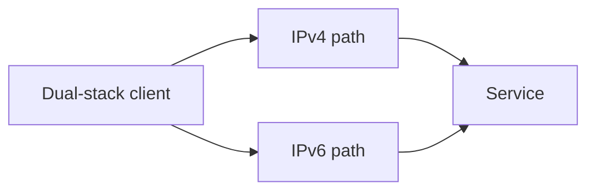

# IPv6 prefix planning and dual stack
A /p fixes p leading bits. Number of /q children = 2^(q-p), q>=p. /56 -> 256 /64; /48 -> 65536 /64; /32 -> 4294967296 /64. /64 has 2^64 address values, not all assignable ordinary endpoints; no IPv4 broadcast subtraction. /127 point-to-point RFC 6164, /128 single address. 2001:db8:1234:ab00::/56 has /64s ab00 through abff in fourth hextet. /56 fixed high byte ab. Documentation only. fe80::/10 link-local, fc00::/7 ULA (fd00::/8 locally assigned), ff00::/8 multicast, 2000::/3 principal global range includes special-purpose addresses. Anycast uses unicast syntax; routing selects one member. 

DNS A and AAAA records; dual stack does not translate automatically. Global IPv6 does not guarantee inbound reachability or encryption. Firewall policy needed; IPsec support recommended RFC 8504. Python: import ipaddress; n=ipaddress.IPv6Network("2001:db8:1234:ab00::/56"); print(2**(64-n.prefixlen)); print(next(n.subnets(new_prefix=64))). Expected 256 and 2001:db8:1234:ab00::/64. Avoid materializing huge child lists. Windows Get-NetRoute -AddressFamily IPv6; Linux ip -6 route. Default ::/0 via fe80::1 dev eth0 illustrative. Verify policy for both families, route and DNS configuration; no live testing. UniTrack conceptual scanner ab00, admin ab01, student ab02, services ab03 /64; actual allocation unknown. ProTrack-MX managed cloud support not verified; RLS/auth independent. [RFC 4291](https://www.rfc-editor.org/rfc/rfc4291), [RFC 6164](https://www.rfc-editor.org/rfc/rfc6164), [RFC 8305](https://www.rfc-editor.org/rfc/rfc8305), [IANA](https://www.iana.org/assignments/iana-ipv6-special-registry), [offline companion](../Assets/12-IPv6-Addresses-Interactive.html).
